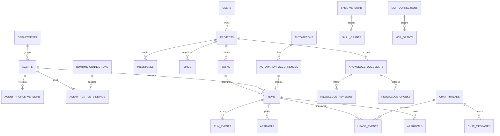

# Data Model - PostgreSQL Source of Truth

**Status:** The first physical migration is implemented for the operational task/run slice. It creates PostgreSQL tables for tasks, runs, ordered run events, idempotency keys, execution leases, retry metadata, result output, and evidence references. The broader entities below remain the target model, not claims of implemented product modules. All timestamps are `timestamptz`/UTC. No provider OAuth tokens or raw CLI credentials are stored here.

Migration source: `packages/db/migrations/0001_initial.sql`. PostgreSQL is authoritative for this slice; pg-boss stores durable queue jobs in its own schema. The worker commits an event before publishing it to SSE, and a run whose worker lease expires is recorded as `interrupted` without automatic replay.

## Key relationships

## Entity groups and essential columns

### Identity & organization

- `users(id, login_subject, display_name, status)` - one director initially, extensible later.
- `departments(id, slug UNIQUE, name, description, parent_id NULL)`.
- `agents(id, department_id NULL, name, slug UNIQUE, avatar_key NULL, status, archived_at NULL)`.
- `agent_profile_versions(id, agent_id, version_no, profession, seniority, personality_json, instructions_md, behavior_json, created_by, created_at)`; UNIQUE `(agent_id, version_no)`; immutable after publish.
- `teams(id, name)`, `team_memberships(team_id, agent_id, role)`; independent from departments.
- `runtime_connections(id, kind, host_ref, version_observed, health_status, auth_method_label, billing_mode, allowed_use, capabilities_json, last_probe_at)`.
- `agent_runtime_bindings(id, agent_id, runtime_connection_id, model_id NULL, priority, is_default, active)`.

### Projects & work

- `projects(id, owner_id, key UNIQUE, name, objective_md, status, priority, budget_policy_id NULL, created_at)`.
- `milestones(id, project_id, title, due_at NULL, status, acceptance_md)`.
- `epics(id, project_id, milestone_id NULL, title, status)`.
- `tasks(id, project_id, epic_id NULL, milestone_id NULL, parent_task_id NULL, assignee_agent_id NULL, title, objective_md, acceptance_md, status, priority, due_at NULL)`.
- `task_dependencies(task_id, depends_on_task_id, kind)`, UNIQUE on pair, cycle prevention in domain logic.
- `workspaces(id, project_id, relative_path, storage_ref, read_policy, write_policy, status)`; paths must resolve in permitted root.
- `runs(id, task_id, agent_id, profile_version_id, runtime_connection_id, workspace_id, external_run_id NULL, idempotency_key, execution_generation, status, started_at NULL, terminal_at NULL, terminal_reason NULL, verification_status, requested_by)`.
- `run_events(id, run_id, sequence, event_type, external_event_key NULL, occurred_at, recorded_at, source, redacted_payload_json, redaction_level)`; UNIQUE `(run_id, sequence)`; optional source dedup index.
- `artifacts(id, run_id, kind, object_ref, checksum, mime, size_bytes, verification_json, created_at)`; no secrets or arbitrary host paths in client-visible values.
- `approvals(id, run_id, principal_id, action_type, arguments_digest, scope_json, expires_at, status, decision_at, decision_by, policy_version)`.
- `audit_events(id, actor_type, actor_id, action, entity_kind, entity_id, result, safe_details_json, created_at)`; append-only and access controlled.

### Skills / MCP

- `skills(id, slug, source_type, source_repo NULL, owner_scope, status)`.
- `skill_versions(id, skill_id, content_digest, package_ref, manifest_json, scan_result_json, approved_at NULL, approved_by NULL)`.
- `skill_grants(id, skill_version_id, grantee_kind, grantee_id, conditions_json, active)`.
- `mcp_connections(id, slug, transport, endpoint_ref NULL, executable_ref NULL, auth_secret_ref NULL, status, capability_snapshot_json, version_observed)`.
- `mcp_tools(id, connection_id, tool_name, schema_digest, risk_class, snapshot_json)`.
- `mcp_grants(id, tool_id, grantee_kind, grantee_id, permission, constraints_json)`; project and run restrictions are checked at invocation time.

### Second Brain

- `knowledge_documents(id, scope_kind, scope_id NULL, stable_slug, title, classification, status, current_revision_id NULL)`.
- `knowledge_revisions(id, document_id, revision_no, commit_ref, content_digest, author_type, author_id, approved_by NULL, approved_at NULL, supersedes_id NULL, created_at)`.
- `knowledge_proposals(id, document_id NULL, scope_kind, scope_id NULL, content_ref, cited_sources_json, evidence_class, status, proposed_by, reviewed_by NULL, reviewed_at NULL)`.
- `knowledge_chunks(id, revision_id, chunk_no, text_hash, content_ref, tsvector_data, embedding NULL, embedding_model NULL, embedding_version NULL)`; one vector dimension per configured model/index; never mix incompatible embeddings.
- `knowledge_acl(id, document_id, grantee_kind, grantee_id, privilege)`; global/project visibility and document-level privacy.
- `agent_memories(id, agent_id, memory_ref, retention_class, created_at, reviewed_at)`; isolation from shared knowledge.

### Automation / chat / cost / visualization

- `automations(id, owner_id, project_id NULL, name, template_task_json, trigger_kind, trigger_config_json, timezone, status, missed_policy, overlap_policy, concurrency_cap, requires_approval)`.
- `automation_occurrences(id, automation_id, schedule_key, due_at, fired_at NULL, status, run_id NULL, failure_reason NULL)`; UNIQUE `(automation_id, schedule_key)`.
- `chat_threads(id, owner_id, mode, profile_version_id NULL, runtime_connection_id, model_id NULL, isolation_policy_json, status, title, created_at)`.
- `chat_messages(id, thread_id, seq, role, safe_content_ref, created_at, usage_event_id NULL)`; UNIQUE `(thread_id, seq)`.
- `usage_events(id, source_idempotency_key, run_id NULL, chat_thread_id NULL, agent_id NULL, project_id NULL, runtime_connection_id, model_id, token_input NULL, token_output NULL, token_cached NULL, token_reasoning NULL, measurement_quality, reported_at, collected_at)`; token components nullable, not false zero.
- `model_price_versions(id, provider, model_id, token_category, unit_price_usd, unit_tokens, valid_from, valid_until NULL, source_uri, recorded_at)`.
- `cost_entries(id, entry_type, origin_ref, currency, amount, source_quality, invoice_ref NULL, occurred_at, fx_rate_id NULL)`; `entry_type` distinguishes invoice charge, recurring subscription, reference-value estimate, and other charges.
- `subscription_records(id, provider, plan_label, billed_amount, currency, billing_period, receipt_ref NULL, status)`.
- `budget_policies(id, scope_kind, scope_id, limit_kind, limit_amount, currency NULL, window, action, enabled)`.
- `usage_alerts(id, budget_policy_id, severity, observed_value, message, emitted_at, resolved_at NULL)`.
- `office_rooms(id, slug, department_id NULL, geometry_ref, display_name, version)`.
- `office_placements(id, agent_id, room_id, desk_key, avatar_ref NULL, updated_at)`; no task 'activity' stored as animation truth.

## Cross-entity invariants

1. **One active run per agent** initially (or an explicit per-agent configurable cap); DB worker admission enforces this, not frontend state.
2. A run's `profile_version_id` is immutable and must match its assigned agent.
3. An automation occurrence can link to **at most one** canonical admitted run; missed-run/overlap policy is applied before admission.
4. `usage_events` may belong to a run **or** an isolated chat session; source correlation is explicit. Avoid allocating the same token count twice.
5. A knowledge proposal is untrusted until published. Index only published/authorized revisions into shared search.
6. Project, chat, workspace and knowledge scopes require server authorization, not a guessed ID check.
7. Approval action digests and expiry bind to **exact** pending tool use, not a generic agent allowance.
8. `cost_entries` actual charges and API-equivalent reference estimates are never summed into the same 'actual spend' KPI.
9. Archive/soft-delete an agent without cascading destruction of past runs, reviews, billing and audit logs.
10. Restrict all file references to immutable object IDs or canonical reviewed paths.

## DB reliability / migration practices

- Use migrations (e.g., Drizzle or Prisma migrations; tool to select during scaffold) and require a dedicated migration step before deployment.
- Favor foreign keys, unique constraints, check constraints and transactionally consistent task/run/admission writes.
- Use JSON for selected flexible configs, not for core relations or hidden authorization logic.
- Index: `(task_id,status)` runs; `(run_id,sequence)` events; `(project_id,status)` tasks; `(agent_id,status)` runs; `(automation_id,schedule_key)` occurrences; `(thread_id,seq)` chat messages; `(revision_id,chunk_no)` knowledge chunks; `(source_idempotency_key)` usage events.
- For usage ledger, retain original provider event ID and normalized record so replays cannot double count.
- Begin with PostgreSQL full-text search; add pgvector after embedding model/rate and ACL tests.
- Backup database and immutable artifacts/vault commits together to maintain referential consistency.

## Initial migration slices

1. `001_identity_organization`: users, departments, agents, profile versions, runtime connections.
2. `002_projects_tasks`: projects, tasks, workspaces, runs, run events, artifacts, approvals, audit.
3. `003_skills_knowledge`: skills/MCP, knowledge docs and proposals.
4. `004_chat_automation`: chat threads/messages, automations/occurrences.
5. `005_usage_office`: telemetry/pricing/cost, office layout.

The physical table list is a roadmap, not a requirement to create every table in the first migration. Implement only what the accepted release needs.
