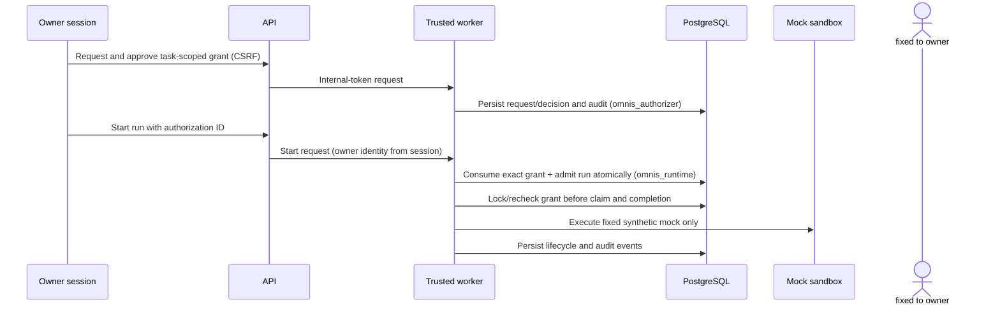

# Durable authorization and audit foundation

## Current boundary

The shipped R1-G4 foundation is restricted to a local, authenticated owner approving one deterministic mock run for one task. It does not enable a model provider or general-purpose tools. PostgreSQL remains authoritative; process memory is not an authorization source.

## State and scope

Each record contains a requesting principal, runtime, operation, capability set, task scope, policy version, correlation ID, expiry, decision actor/time, optional consuming run, and optional revocation actor/time. The current database checks constrain these values to `owner`, `mock`, `execute_task`, `mock.execute`, and exactly one task. A grant is consumed by at most one run. Approval is a separate explicit action; task creation does not approve execution.

Effective states are `pending`, `authorized`, `denied`, `revoked`, and derived `expired`. Expiry uses PostgreSQL time for decision, consumption, claim, heartbeat, and completion enforcement. A repeated or conflicting decision is rejected under a row lock. The separate `omnis_authorizer` login can request, decide, and revoke; `omnis_runtime` cannot directly modify authorization rows or insert directly into the audit table. Migration-owned security-definer routines expose atomic consumption, active-run row locking, and a restricted runtime audit append to the runtime login.

## Trusted identity and approval

The browser never supplies an actor identity. Owner-only API routes require the existing authenticated owner session and CSRF validation, then the API attaches the fixed `owner` identity over the private worker channel protected by the internal token. The worker rejects missing or unrecognized identity. The agent/runtime adapter has no approval interface. This does not create a general identity provider: the effective human principal remains the single local owner account, and the trust boundary depends on the existing session and internal-token protections.

## Enforcement and revocation

1. The API rejects run requests without an authorization ID and trusted owner session.
2. The coordinator reads the durable authorization and verifies status, actor, runtime, capability, expiry, and exact task scope.
3. In the run-admission transaction, PostgreSQL consumes the grant once and commits the queued run, idempotency row, audit event, and pg-boss work together.
4. Before execution claim, the worker locks and rechecks the consumed authorization. Missing, expired, or revoked grants interrupt queued work; unsafe work is not replayed.
5. Lease renewal checks effective authorization. Completion locks and rechecks the authorization in the same transaction as the terminal transition. Revocation and these checkpoints serialize on the authorization row.

Revocation becomes effective when its transaction commits. If a claim or completion acquired the row lock first, that transition can commit before revocation; a checkpoint acquiring the lock after revocation commits is denied. The system cannot retract an external side effect that already completed. The only current operation is the deterministic local mock, which has no provider side effect.

Database connection or authorization lookup errors fail closed. After restart, the worker reconstructs the authorization for a run from PostgreSQL; no in-memory grant cache authorizes execution.

## Audit

The audit table records request, approval/denial, consumption, revocation, expiry, enforcement denial, operation start, and terminal outcomes with actor, effective service identity, authorization/task/run IDs when known, fixed capability, correlation ID, timestamp, outcome, and safe reason code. Request/decision/revoke records are written by the trusted authorizer connection. Runtime-originated operation events can be appended only through `append_runtime_authorization_audit`; PostgreSQL verifies the login role, allowlists the event categories, derives actor/task/authorization/correlation/outcome from persisted rows, and records the effective identity as `service:omnis-runtime`. It does not accept a caller-supplied actor or JSON provenance field. Runtime cannot write approval, denial, or revocation decisions.

Audit row IDs default to PostgreSQL `gen_random_uuid()` values. Consumption and revocation inserts omit the ID, so a runtime-controlled predictable string cannot reserve the key needed by a privileged transition. Expiry is idempotent through a partial unique index on authorization ID for the single expiry event; the authorizer's conflict handling applies only to that explicit duplicate-expiry case. Required transition audit writes remain in the same transaction as their state changes and fail visibly if insertion fails. Prompts, credentials, and tokens are not stored in these records.

`omnis_runtime` has no direct audit-table INSERT, UPDATE, or DELETE privilege. The narrow append routine makes runtime operation events distinguishable from authorizer decisions; the trusted database administrator and authorizer process remain able to alter audit history. This is not tamper-proof: no cryptographic immutability or external audit anchoring is claimed.

Migration `0008` removes the shared authorization advisory lock. PostgreSQL exposes advisory-lock functions to `PUBLIC` by default, so a runtime session could hold the shared session lock indefinitely and block owner revocation. Admission now locks the exact eligible authorization row through the narrowly granted `lock_run_authorization_for_admission` function before it takes the task row lock; it then inserts the run and consumes that same grant in one transaction. Direct run insertion can hold the task foreign-key `KEY SHARE` lock before consumption, which is compatible with the audit foreign-key `KEY SHARE` lock acquired by unconsumed revocation. Unconsumed revocation locks and re-reads only the grant row; if it discovers that consumption won, it retries in a fresh transaction. For an already consumed grant, revocation locks the run and then the authorization row, matching worker claim, heartbeat, completion, and cancellation transitions. The grant row is the serialization point; unrelated grants do not share a revocation lock.

The lock order is therefore: run-store admission takes the existing global admission-cap lock, authorization row, task row, run insertion/consumption and audit foreign keys; direct consumption takes the authorization row and then audit foreign keys; unconsumed revocation takes the authorization row and audit foreign keys; consumed revocation and worker transitions take run row, authorization row, then audit foreign keys. The global admission-cap lock remains for admission limits and idempotency; revocation no longer acquires it. A transaction-local 3-second `lock_timeout` bounds row-lock waits inside revocation. A timeout raises SQLSTATE `55P03`, rolls back the revocation and its audit event, and is surfaced as an explicit retryable service-unavailable response. It does not mean the grant was revoked, and it does not prevent every form of database contention or repeated denial of service.

The admission-cap lock still uses a PostgreSQL advisory key callable by `PUBLIC`. A runtime session holding that key can block new run admissions, although the revocation function no longer waits on it. This admission availability limitation is not closed by migration `0008` and remains a separate reliability/security follow-up.

Migration `0008` also records migration provenance for active grant-less runs created before migration `0005_durable_authorization` was applied. Active rows created after that authorization boundary are not classified as legacy. Only migration-classified rows may be safely cancelled, failed, interrupted, or recorded as denied at execution claim. They cannot be started or completed, and no authorization grant is created for them. Runtime cannot read or modify the provenance table. Runtime-originated terminal audit events retain the fixed `service:omnis-runtime` actor and effective identity; the append function does not claim that a recovery principal performed the transition. A grant-less run created after the migration is not classified as legacy: execution enforcement fails closed, and a mandatory audit association failure rolls the lifecycle transaction back.

## Failure behavior and limits

- Missing, forged, cross-task, expired, consumed, denied, or revoked grants cannot authorize a run.
- A caller-provided approval flag or actor string is not accepted as authority.
- The adapter cannot grant itself a capability.
- Database failure stops admission or execution at the next checkpoint.
- Revocation row-lock waits are bounded to 3 seconds; a timeout is an explicit failed revocation, not a successful state change.
- Migration-classified legacy runs support terminal cleanup only; absent authorization never permits protected execution.
- Owner authentication is single-account; separate approver identities and delegated policy are future work.
- Persistent expiry status is derived from the expiry timestamp; an expiry audit record is emitted on authorizer-store read.
- This PR does not provide provider credential storage, connector network restrictions, model policy enforcement, or real-runtime authorization.

## Gates before model-only execution

Require an independently reviewed owner approval workflow and durable human identity, restricted connector with its own identity and provenance, trusted credential broker with revocation, provider-supported authentication and policy approval, bounded outbound egress, authorization checks before every provider operation, effective in-run revocation, and credential-canary absence verification. Keep provider credentials outside tool sandboxes. Do not reuse local Hermes, Codex, or Claude OAuth sessions. Arbitrary tools, shell execution, and general-purpose agent workloads remain prohibited. ADR-0010 backup encryption/authentication remains Proposed and separate.
