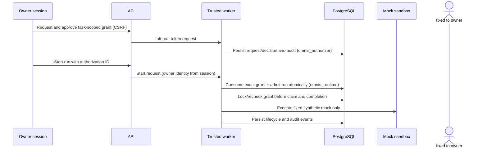

# Durable authorization and audit foundation

## Current boundary

The shipped R1-G4 foundation is restricted to a local, authenticated owner approving one deterministic mock run for one task. It does not enable a model provider or general-purpose tools. PostgreSQL remains authoritative; process memory is not an authorization source.

## State and scope

Each record contains a requesting principal, runtime, operation, capability set, task scope, policy version, correlation ID, expiry, decision actor/time, optional consuming run, and optional revocation actor/time. The current database checks constrain these values to `owner`, `mock`, `execute_task`, `mock.execute`, and exactly one task. A grant is consumed by at most one run. Approval is a separate explicit action; task creation does not approve execution.

Effective states are `pending`, `authorized`, `denied`, `revoked`, and derived `expired`. Expiry uses PostgreSQL time for decision, consumption, claim, heartbeat, and completion enforcement. A repeated or conflicting decision is rejected under a row lock. The separate `omnis_authorizer` login can request, decide, and revoke; `omnis_runtime` cannot directly modify authorization rows. Migration-owned security-definer routines expose only atomic consumption and active-run row locking to the runtime login.

## Trusted identity and approval

The browser never supplies an actor identity. Owner-only API routes require the existing authenticated owner session and CSRF validation, then the API attaches the fixed `owner` identity over the private worker channel protected by the internal token. The worker rejects missing or unrecognized identity. The agent/runtime adapter has no approval interface. This does not create a general identity provider: the effective human principal remains the single local owner account, and the trust boundary depends on the existing session and internal-token protections.

## Enforcement and revocation

1. The API rejects run requests without an authorization ID and trusted owner session.
2. The coordinator reads the durable authorization and verifies status, actor, runtime, capability, expiry, and exact task scope.
3. In the run-admission transaction, PostgreSQL consumes the grant once and commits the queued run, idempotency row, audit event, and pg-boss work together.
4. Before execution claim, the worker locks and rechecks the consumed authorization. Missing, expired, or revoked grants interrupt queued work; unsafe work is not replayed.
5. Lease renewal checks effective authorization. Completion locks and rechecks the authorization in the same transaction as the terminal transition. Revocation and these checkpoints serialize on the authorization row.

Revocation becomes effective when its transaction commits. If a claim or completion acquired the row lock first, that transition can commit before revocation; a checkpoint acquiring the lock after revocation commits is denied. The system cannot retract an external side effect that already completed. The only current operation is the deterministic local mock, which has no provider side effect.

Database connection or authorization lookup errors fail closed. After restart, the worker reconstructs the authorization for a run from PostgreSQL; no in-memory grant cache authorizes execution.

## Audit

The audit table records request, approval/denial, consumption, revocation, expiry, enforcement denial, operation start, and terminal outcomes with actor, effective service/worker identity, authorization/task/run IDs when known, fixed capability, correlation ID, timestamp, outcome, and safe reason code. Request/decision/revoke and run lifecycle records are inserted transactionally with the state transition where supported. Prompts, credentials, and tokens are not stored in these records.

`omnis_runtime` cannot update or delete audit rows through normal SQL grants, and the authorizer cannot delete them. This is not tamper-proof: the database administrator remains trusted, and runtime INSERT privileges allow it to append records. No cryptographic immutability or external audit anchoring is claimed.

## Failure behavior and limits

- Missing, forged, cross-task, expired, consumed, denied, or revoked grants cannot authorize a run.
- A caller-provided approval flag or actor string is not accepted as authority.
- The adapter cannot grant itself a capability.
- Database failure stops admission or execution at the next checkpoint.
- Owner authentication is single-account; separate approver identities and delegated policy are future work.
- Persistent expiry status is derived from the expiry timestamp; an expiry audit record is emitted on authorizer-store read.
- This PR does not provide provider credential storage, connector network restrictions, model policy enforcement, or real-runtime authorization.

## Gates before model-only execution

Require an independently reviewed owner approval workflow and durable human identity, restricted connector with its own identity and provenance, trusted credential broker with revocation, provider-supported authentication and policy approval, bounded outbound egress, authorization checks before every provider operation, effective in-run revocation, and credential-canary absence verification. Keep provider credentials outside tool sandboxes. Do not reuse local Hermes, Codex, or Claude OAuth sessions. Arbitrary tools, shell execution, and general-purpose agent workloads remain prohibited. ADR-0010 backup encryption/authentication remains Proposed and separate.
