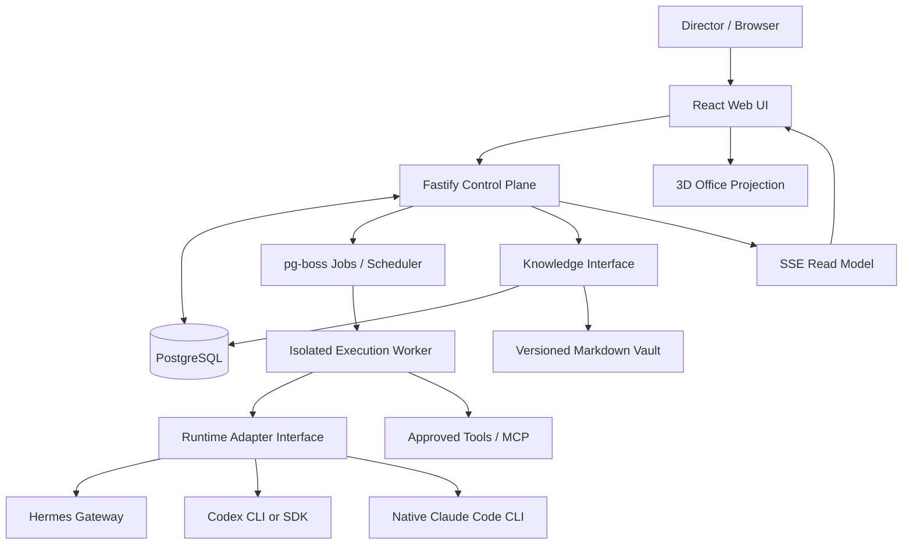
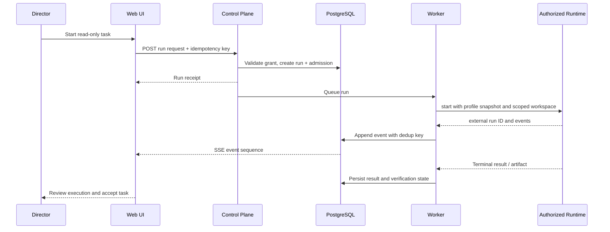

# System Architecture

## Style and core decision

**Proposed:** TypeScript modular monolith for the control plane; explicitly separate worker and sandbox processes for privileged runtime and tool execution. Avoid one service per product page. One durable PostgreSQL database is the operational source of truth. Agents cannot directly modify canonical project state except through controlled app commands.

## Context diagram



**Important:** Model providers are accessed by the authenticated runtimes, not by proxying provider OAuth tokens through the control-plane backend.

## Bounded modules inside the control plane

| Module | Owns | Does not own |
|---|---|---|
| Identity & Authorization | director login, policies, approvals, trusted session context | provider login secrets |
| Organization | departments, agent identities, profile versions, assignments | runtime internals |
| Projects | scope, milestones, epics, dependencies, deliverables | running model loops |
| Work Orchestration | tasks, runs, worker admission, idempotency, retries, event reconciliation | UI animations |
| Runtime Registry | configured runtime capabilities, status, adapter mapping | model vendor tokens |
| Skills & MCP | signed/approved skills, server registry, capability grants | direct write permissions via prompts |
| Knowledge | reviewed documents, proposals, revision history, scoped search | individual model internal memory |
| Chat | isolated conversations, message history, allowed model/profile context | operational task ownership |
| Scheduling | triggers, occurrences, missed-run policy | direct model calls |
| Usage & Billing | measured usage, reference value, confirmed charges, budgets | external invoice truth not received |
| Office Projection | read-only layout and state mapping | canonical task state |

## Deep interface contracts (illustrative TypeScript)

```typescript
interface RuntimeAdapter {
  probe(): Promise<RuntimeCapabilities>;
  start(input: RunRequest): Promise<{ externalRunId: string; ack: string }>;
  events(externalRunId: string, after?: string): AsyncIterable<RuntimeEvent>;
  requestStop(externalRunId: string): Promise<{ acknowledged: boolean }>;
  // Optional capabilities feature-detected; unsupported operations fail closed.
}

interface WorkOrchestrator {
  requestRun(command: RunCommand): Promise<RunReceipt>;
  requestCancel(runId: string, actorId: string): Promise<RunReceipt>;
  reconcile(runId: string): Promise<RunSnapshot>;
}

interface KnowledgeStore {
  search(query: ScopedQuery, principal: Principal): Promise<KnowledgeHit[]>;
  propose(change: KnowledgeProposal, principal: Principal): Promise<ProposalReceipt>;
  publish(proposalId: string, reviewer: Principal): Promise<KnowledgeRevision>;
}
```

No runtime-specific endpoint assumptions leak into business modules. The runtime adapter owns transport mapping, retries, observed completion and capability discovery. The orchestration module owns authoritative run transitions.

## Process isolation model

- **web:** browser assets only; no secrets.
- **api:** authentication, REST/SSE, database, read/write command validation; cannot directly execute arbitrary shell commands.
- **worker:** durable job processor, policy gate, isolated sandbox/host runtime client; only constrained permissions.
- **runtime native processes:** configured separately with scoped home, environment, resource limits and per-run workspaces where possible.
- **database:** private network only; independent backups.
- **knowledge indexer (later):** reads approved vault revisions and produces search indexes; do not index hidden/private files.

Native CLI auth stores must never be bind-mounted into user file-upload containers or web frontends. Provider approval and runtime capability checks happen before enabling unattended runs.

## Execution sequence



## Read-model / event architecture

- State changes generate durable `run_events` with monotonic app sequence per run.
- Frontend initially fetches an authoritative snapshot then subscribes to SSE (`Last-Event-ID` supported when possible); gaps trigger refetch.
- 3D scene maps `(agent state, last event, server timestamp, layout)` to animations; animation cannot issue backend state transitions itself.
- Event payloads are redacted and permission-scoped at read time; never serialize secrets, full CLI env, sensitive file contents or model hidden reasoning.

## Reliability constraints

1. `task` and `run` are distinct. A run can finish yet task may await acceptance.
2. Use durable run id, execution generation, and idempotency key for work admission.
3. 'Request stop' is not 'stopped' until confirmed; timeout is `unknown/interrupted`, not `completed`.
4. Retries can duplicate external effects. Side-effecting tools require operation-level idempotency and manual review on uncertainty.
5. A worker must not release concurrent jobs for a single agent beyond its configured limit.
6. Provider and runtime outages degrade gracefully; no auto paid-key fallback.

## Deployment topology

- **Development:** WSL2 Ubuntu or Linux, Docker Compose for PostgreSQL and app services; native model CLI/gateway on trusted host when subscription rules and secret store require it. Avoid Docker-root escalation.
- **Production proposal:** private k3s namespace, PostgreSQL PVC with backup; dedicated isolated runtime execution node/host as needed; private DNS and certificate; restrict UI with authentication and network policy.
- No internet-facing dashboard or runtime API by default. See `../06-delivery/OPERATIONS.md`.

## Observability

Trace app request -> task -> run -> adapter call -> tool event using correlation IDs. Emit structured audit separate from verbose execution diagnostics. Health checks report runtime availability and supported capabilities, not secrets. Instrument queue lag, terminal run counts, retries, approval latency and token telemetry completeness.
