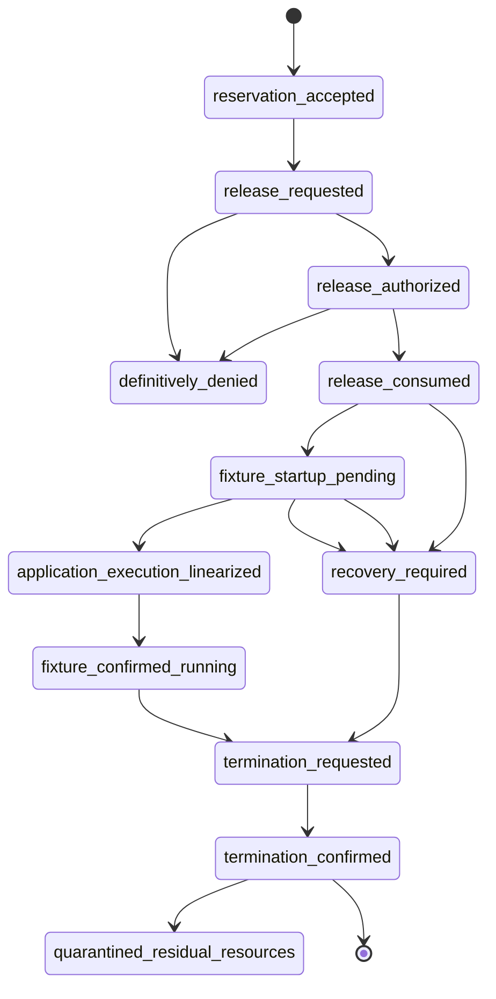

# Release and containment state machines

The Stage 2 release ledger owns authorization/request/consume transitions. Stage 1 owns only reservation validation. The bootstrap owns local gate acceptance evidence, not authorization. Supervisor/finalizer owns process observations and termination. Recovery authority owns quarantine and later cleanup authorization.

- `reservation_accepted`: Stage 1 durable receipt exists; Stage 2 obtains only a read-only validated snapshot. Evidence: Stage 1 response under its stable lock.
- `release_requested`: authenticated original controller request and digest persisted by Stage 2.
- `release_authorized`: signed owner authorization, current session/revocation sequence, Stage 1 snapshot, fixture generation, deadline and supervisor readiness verified; durable Stage 2 intent.
- `release_consumed`: one-use authorization and request durably tombstoned before permit send. Does not prove delivery or execution.
- `fixture_startup_pending`: permit send may have occurred; gated bootstrap and helper reconciliation pending. No retry.
- `application_execution_linearized`: trusted kernel fence proves first application instruction began at `now < original deadline` for exact permit/boot/cgroup identity. Gate open, message delivery, `execve`, or container start alone cannot establish it. If fence is unproven, this state is unreachable and release remains blocked.
- `fixture_confirmed_running`: independent supervisor verifies the exact process remains in the expected cgroup after the linearized start; this is an observation, not the authorization point.
- `termination_requested`: supervisor durable stop latch and freeze request; independently initiated on controller/session/observer failure or deadline.
- `termination_confirmed`: cgroup empty and all associated Windows Job/observers positively stopped; Docker acknowledgment alone is insufficient.
- `recovery_required`: ambiguity, restart, issuer loss, boot mismatch, unknown process, supervisor/manager failure, or late start. Admission closed.
- `quarantined_residual_resources`: only after independent process termination AND bounded residual exposure assessment; exact residual IDs retained under monitoring. Unknown containment never enters quarantine.
- `definitively_denied`: durable evidence proves permit not consumed/sent and request denied. Ambiguous outcomes cannot be labeled denied.

Crash before consume is denied after checking ledger; after consume/before ack is `recovery_required`, never resend. Stage 1 controller death between live validation and Stage 2 consume is not atomically detectable under V2; no live integration is allowed until a reviewed lease amendment changes that semantic. With the present strict rule, the outcome is blocked, not assumed valid. Duplicate after lost ack is status only. Restarted controller cannot validate its terminal Stage 1 session. WSL restart changes boot binding: no permit remains valid; startup interlock must keep Docker fixture services blocked pending reconciliation. Docker outage prevents object inspection/removal but independent cgroup kill may continue; residue is not quarantined until exposure assessed. Delayed/late startup remains frozen; if that cannot be proven, state is blocking unknown. Expiry closes gate and requests termination; cleanup window does not extend execution permission. Unknown process state remains `recovery_required`.

Containment transitions: `armed_frozen → permit_delivered → awaiting_entry_fence → application_execution_linearized_before_deadline → active → admission_closed/frozen → terminating → independently_empty → exposure_assessed → clean | quarantined`. Expiry before consumption denies; expiry after consumption but before delivery burns authorization and denies; expiry after delivery before kernel entry denies. Bootstrap descheduling across expiry denies. If freeze and first-instruction admission race and the kernel cannot serialize them, enter `containment_unknown`; no application instruction may be presumed to have won. Delayed Docker startup stays frozen or blocks release. Controller/supervisor crash near deadline triggers finalizer; without surviving finalizer, state is unknown and release remains blocked. Any unknown order, missed deadline, gate race or unit loss enters `containment_unknown` and blocks release/recovery clearance. Finalizer lock serializes with gate helper; whichever obtains the kernel-enforced fence first determines result. If no atomic fence primitive exists, no transition to `gate_open_before_deadline` is permitted.
