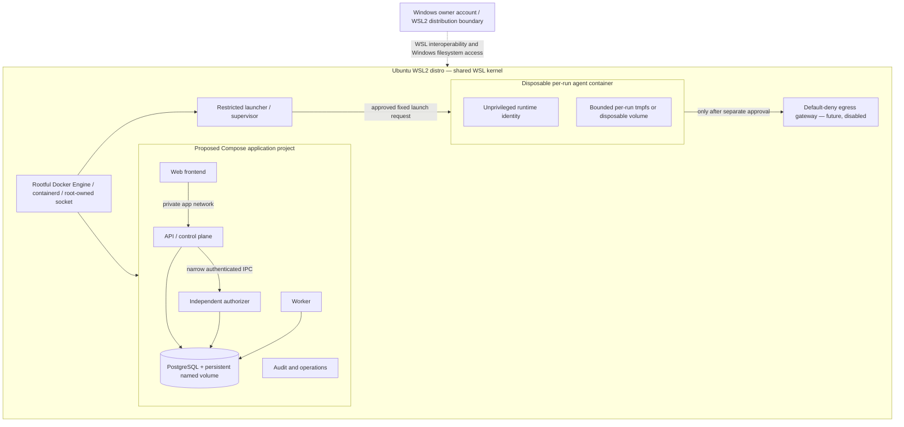

# Phase 1 — Connector Host-Boundary Feasibility

**Assessment date:** 2026-11-06
**Repository baseline:** `origin/main` at `28981f900f95a9673db35aeff5ceaff62f4fffe6`
**Readiness handoff:** PR #37 reviewed head `853ff8ae73b55efb1495734d56280bbd0df9382d`; squash-merge commit `e0512609973bf24a8fd40f7da7731865fdc45377`
**Scope:** Design and feasibility only. No provider authentication, inference, host provisioning, egress activation, or runtime change was performed.

## Decision

**BLOCK — real-runtime readiness.** The owner-selected deployment target is one Windows machine running Ubuntu under WSL2, with Docker/Compose preferred for application services. The repository does not yet define a full Compose deployment: Compose currently defines PostgreSQL, while API, worker, authorizer, and sandbox launcher have systemd unit files. Disposable non-root containers with read-only roots, dropped capabilities, no-new-privileges, seccomp, resource budgets, minimal mounts, and default-deny networking are plausible defense-in-depth. They still share the WSL Linux kernel and depend on the Docker daemon and launcher. The observed daemon is rootful; the launcher is in the Docker group and is root-equivalent. Current Codex app-server documentation exposes local command/tool surfaces without a demonstrated enforceable no-tool boundary. A prompt or hidden UI control is not a host security boundary. Keep runtime execution mock-only, G4-3 **Partially Fixed**, and R1-G5 **Partially Complete**.

The shortest safe path is: (1) Codex #1 confirms the backend authorization/credential contracts below; (2) choose a supported, pinned runtime and prove every prohibited tool effect is denied; (3) implement a disposable Docker-on-WSL synthetic verifier that fails closed when required kernel/daemon controls are unavailable; (4) obtain independent security review; (5) inspect and test the owner's actual WSL/Windows configuration before any real OAuth or inference authorization. Docker tests do not establish a separate Windows security boundary or VM-equivalent isolation.

## 1. Verified baseline and scope

### Repository and active work

- Latest fetched `origin/main` for this remediation is `28981f900f95a9673db35aeff5ceaff62f4fffe6`.
- PR #37's reviewed head was `853ff8ae73b55efb1495734d56280bbd0df9382d`; GitHub recorded its squash-merge commit as `e0512609973bf24a8fd40f7da7731865fdc45377`. Its readiness and Codex #3 handoff documents are included in the current main baseline.
- PR #36's reviewed head was `b4e2467bbfb5dbb65ce2fec1aac3ef87acc28f65`; GitHub squash-merged it to `main` at `28981f900f95a9673db35aeff5ceaff62f4fffe6`. Open PR #39 (`2d518547de7854daa36cc8bcf69efb6f081d9459`) adds an in-process, credential-free fake app-server protocol test and backend readiness document; it is not a host-isolation test. Open PRs #25, #26, and #31 do not overlap this document.
- Mission 8C refreshed PR #38 to head `20df6ad647475171653aef020bfc591fcdac230e`; it remains Draft. Exact-head CI run `42073794256` passed, including `checks`, `frontend-browser`, and `full-stack-browser-integration`. PR #39 remains the only open connector-related overlap and does not change the proposed Docker boundary.
- The original worktree was already on `security/r1g5-host-authorizer-isolation`, behind its remote by two commits, with an unrelated untracked UI specification. It was left untouched. This document is in an isolated worktree based on current `origin/main`.

### Existing host isolation evidence

`docs/07-governance/evidence/R1_G5_HOST_ISOLATION.md` records a successful disposable Ubuntu 24.04 systemd deployment check (historical CI run `41687576726`, implementation SHA `a6f33442da291ac02ca8b47b6cb758bd50540c30`). That run exercised actual service identities, installed root-owned application files, restricted service secrets, socket boundaries, and mock API-to-worker-to-launcher execution on an ephemeral runner. It is evidence for that exact disposable setup, not the developer host or a production/homelab target.

Current unit files in `infra/systemd/` define `omnis-api.service`, `omnis-worker.service`, `omnis-authorizer.service`, and `omnis-sandbox-launcher.service`; each uses a distinct primary group and systemd hardening directives. Only the launcher is explicitly in the `docker` group and remains root-equivalent. The worker has only its private group and `omnis-launcher-socket`; it is not in Docker or the authorizer socket group. These files do not establish that the services are installed or active on this host. At inspection time, the Omnis units were inactive. `scripts/host-security/provision-identities.sh` provisions no connector or credential-broker identity. `install-service-secrets.sh` installs service-specific files but has no provider credential path.

The only repository Compose file, `infra/compose/docker-compose.yml`, defines PostgreSQL with loopback port binding, a persistent named volume, and a health check. It does not define the web frontend, API, worker, authorizer, launcher, or audit services. Do not describe Omnis OS as fully containerized until those services have a separately reviewed Compose deployment plan. The PostgreSQL volume is persistent and must not be reset during boundary tests.

### Current WSL2 and Docker environment

Read-only observations from this WSL distro: Ubuntu 26.04.1; kernel `6.6.87.2-microsoft-standard-WSL2`; systemd 259 as PID 1; cgroup v2 with `cpu`, `memory`, `pids`, and other controllers visible. `/etc/wsl.conf` enables systemd and sets `jeysi` as the distro default user. `/mnt/c` is mounted through 9p, and WSL interop is registered. Windows-side `.wslconfig`, Hyper-V firewall policy, Docker Desktop settings, and Windows account controls were not inspected. WSL and its Linux filesystem remain accessible to the owning Windows account; containers in this distro do not create a separate Windows-user boundary.

Docker CLI is installed (`29.9.2`) and Compose CLI reports `v5.6.1`. `docker.service`, `dockerd`, and `containerd` were observed active; `dockerd` runs as UID 0. `/var/run/docker.sock` is `root:docker`, mode `0660`. The account database lists `jeysi` in `docker`, but this shell's effective supplementary groups omit `docker`; Docker API requests fail with permission denied. Daemon configuration, effective security options, active containers, runtime, user-namespace mode, published ports, networks, and volume inventory are therefore **UNKNOWN**. Rootless mode and user-namespace remapping are not verified. No daemon changes were attempted. The `docker` group is effectively root-equivalent when its membership is active.

The current shell reports AppArmor disabled (`N`); its own `/proc/self/status` shows seccomp mode 0. These observations do not prove which Docker container profile is effective. The kernel exposes user namespaces, but subordinate UID/GID allocations and daemon remapping are unverified. `/dev/kvm` is `root:kvm` mode `0660`, and the current user lacks access; virtualization is not part of the preferred architecture. No container-escape or destructive security test was run.

WSL systemd services do not keep a distro alive after WSL shutdown. Windows/WSL localhost forwarding and network behavior depend on the owner's WSL networking mode and firewall settings. Published Docker ports should bind to loopback unless a separately reviewed exposure is approved. WSL integration, Windows process interop, Windows-mounted paths, Docker persistent volumes, shutdown, and recovery all require target-specific inspection.

## 2. Docker-first WSL2 topology

The owner-selected target is Docker Compose on the existing WSL2 Ubuntu distro. This is the preferred application deployment direction, not a claim that the repository is already containerized. No real connector container or Compose stack is implemented by this assessment. A separately managed VM remains an optional stronger boundary if the Docker-on-WSL threat model cannot be accepted; it is not a deployment prerequisite.

Windows/WSL remains an outer trust boundary, not something Docker controls. Do not mount `/mnt/c`, `/mnt/*`, the developer home, SSH/Git/OAuth stores, Docker data root, service secrets, database files, host PID, host network, or the Docker socket into the runtime. Do not expose API, database, authorizer, audit, or gateway ports to the Windows LAN. Published UI/API ports bind to `127.0.0.1` unless a separate owner-approved exposure is reviewed.

### Application and execution boundaries

| Component               | Proposed placement and allowed path                                                                                                                                                        | Must not receive                                                                                                                   | Status / owner                                                                                                       |
| ----------------------- | ------------------------------------------------------------------------------------------------------------------------------------------------------------------------------------------ | ---------------------------------------------------------------------------------------------------------------------------------- | -------------------------------------------------------------------------------------------------------------------- |
| Web frontend            | Compose service; only frontend-to-API route on private application network; loopback-published browser port if needed                                                                      | DB credentials, authorizer/launcher sockets, Docker API, provider credentials                                                      | Compose service does not currently exist; Codex #3 platform design, application owners review contracts              |
| API/control plane       | Compose service; private DB connection and narrow authorizer IPC/network contract                                                                                                          | Docker socket, launcher control, provider credentials, runtime mounts                                                              | Existing native systemd unit only; Codex #1 owns backend contract                                                    |
| Authorizer              | Separate service identity/container; private DB access and authenticated API decision path                                                                                                 | Docker socket, runtime workspace, provider credentials                                                                             | Existing systemd service uses separate identity; container migration must preserve owner/replay semantics (Codex #1) |
| Worker                  | Separate service identity/container; DB and narrow launcher request path                                                                                                                   | Docker socket, authorizer secret beyond its current contract, provider credential store                                            | Existing systemd service; do not move authority during packaging work (Codex #1)                                     |
| PostgreSQL              | Compose service on internal-only database network; persistent named data volume; only required application roles                                                                           | Runtime-container network access, public port, browser access                                                                      | Compose-defined; local volume is persistent                                                                          |
| Launcher/supervisor     | Initially retain the existing separately reviewed service boundary or replace only after a focused design review; sole narrowly controlled Docker API client if daemon control is required | Generic caller-provided Docker API, untrusted paths/commands, secrets, broad network                                               | Existing `omnis-sandbox-launcher.service` uses Docker group and is root-equivalent; G4-3 remains partially fixed     |
| Per-run agent container | Fresh container, non-root UID/GID, no supplementary groups, read-only root, dropped capabilities, no-new-privileges, enforced seccomp, bounded resources, only private scratch             | Docker socket, host paths, Windows mounts, other project/run, API/authorizer/DB sockets, refresh credentials, unrestricted network | Proposed only; not implemented or tested on this WSL host                                                            |
| Credential broker       | Separate service identity and isolated secret-store access; authorization is checked independently; scoped credential delivered only to the admitted runtime if a provider supports it     | Access by API, worker, launcher, task workspace, logs, or peer runs                                                                | No broker/store or supported provider flow exists; Codex #1 owns authorization and provider contract                 |
| Egress gateway          | Separate private network boundary; default deny and exact owner-approved destinations only                                                                                                 | Generic forward proxy, direct fallback, access to control plane or Docker API                                                      | Not implemented; provider egress disabled                                                                            |

Compose network membership is not itself an authorization control. Use separate internal networks, explicit service attachment, fixed ports, and host firewall policy, then verify reachability from each container. The runtime should have `network_mode: none` for mock-only operation. If future provider access is authorized, attach it only to a dedicated gateway network; do not give it DNS or a general Internet route. The gateway must not become a generic proxy, and Docker daemon-level network creation remains in the trusted launcher boundary.

### Docker and WSL trust boundaries

1. **Windows account ↔ WSL distro:** WSL intentionally enables filesystem and process interoperability. The Windows account can access WSL files through the WSL integration surface; Docker containers do not isolate secrets from a compromised or malicious Windows account with equivalent host access.
2. **WSL kernel ↔ containers:** all ordinary Docker containers share the WSL2 kernel. Container configuration narrows access but does not eliminate kernel/container-runtime escape risk.
3. **Docker client ↔ daemon:** control of a rootful Docker socket is effectively host-root-equivalent. The socket must not be mounted into frontend, API, worker, authorizer, runtime, or task containers. Membership in the `docker` group grants this control.
4. **Launcher ↔ Docker daemon:** the current launcher is in the `docker` group. A launcher bug or compromise can control the daemon and create privileged or host-mounted containers. This remains a critical trusted computing base and unresolved G4-3 risk.
5. **Container ↔ service networks:** Docker bridge isolation reduces reachability but does not establish service authorization, data-level permissions, or protection from a compromised daemon. Probe actual IPv4/IPv6, localhost, DNS, published ports, and bridge routes.
6. **Container ↔ persistent storage:** named volumes survive container replacement and may be visible to daemon administrators and the Windows owner. Do not place provider credentials in shared or long-lived volumes. Keep task state and provider credential custody separate.

The API, worker, authorizer, launcher, and PostgreSQL role boundaries remain authoritative. Packaging them in Compose must preserve distinct credentials, least-privilege DB roles, authenticated IPC, and independent authorization. Do not give the API, worker, or runtime direct daemon access to simplify orchestration.

### Host identities and privilege boundaries

| Component                    | Proposed identity / minimum access                                                                             | Explicitly denied                                                                                   | Isolation and failure requirements                                                                                                                  |
| ---------------------------- | -------------------------------------------------------------------------------------------------------------- | --------------------------------------------------------------------------------------------------- | --------------------------------------------------------------------------------------------------------------------------------------------------- |
| Docker daemon                | Rootful daemon is current observed mode; privileged host management TCB                                        | Broad user/client access beyond explicitly trusted operators                                        | Restrict socket ownership; no TCP API; inspect daemon config and logs; rootful daemon compromise is host compromise                                 |
| Compose application services | Distinct non-root UID/GID per service, no supplementary groups, read-only image roots, explicit writable paths | Docker socket, host home, Windows mounts, unrelated service secrets and volumes                     | Separate secrets/DB roles/networks; per-service health and resource bounds; fail startup on missing restrictions                                    |
| Launcher/supervisor          | Dedicated identity; only component permitted to request run-container lifecycle                                | Arbitrary Docker API passthrough to callers; secret store; unrelated host paths                     | Fixed typed request schema, image/argument allowlists, safe path handling, concurrency and cgroup limits; rootful daemon authority remains residual |
| Runtime container            | Dedicated non-root UID/GID, no capabilities, `no-new-privileges`, default seccomp plus reviewed additions only | Host/device access, Docker socket, service sockets, host namespaces, Windows paths, peer containers | Read-only root, bounded scratch/tmpfs, `pids`/CPU/memory/FD/disk/output/time limits, `network_mode: none` until egress review                       |
| Broker/gateway               | Separate identities and networks, least-access secret or egress function only                                  | General Docker API, task DB authority, arbitrary proxying                                           | Separate lifecycle, bounded parsers, fail-closed behavior, no shared writable runtime mounts                                                        |

A privileged helper or unrestricted rootful Docker API proxy is not a safe shortcut. If the launcher must retain rootful daemon access, treat it as a host-root-equivalent TCB and require narrow operation design, fixed images/config, strict validation, independent review, and adversarial tests. A Docker authorization plugin/proxy may be considered only after its bypass resistance and complete API surface are demonstrated; it is not assumed here.

### Alternatives and isolation decision

| Option                                                   | Security effectiveness and residual risk                                                                                                                                                                                               | Compatibility and operational cost                                                                                                                                                      | Assessment                                                                                                                                                                  |
| -------------------------------------------------------- | -------------------------------------------------------------------------------------------------------------------------------------------------------------------------------------------------------------------------------------- | --------------------------------------------------------------------------------------------------------------------------------------------------------------------------------------- | --------------------------------------------------------------------------------------------------------------------------------------------------------------------------- |
| **A. Rootful Docker with strict per-container settings** | Non-root identity, read-only root, dropped capabilities, no-new-privileges, seccomp, resource limits, explicit mounts and isolated networks reduce workload authority. The daemon remains rootful and containers share the WSL kernel. | Best fit with the current WSL Docker Engine and Compose; easiest application packaging. Requires careful launcher restriction and target tests.                                         | Preferred for the application layer and synthetic mock containers. **Not established as sufficient for a hostile real AI runtime.**                                         |
| **B. Rootful Docker with user-namespace remapping**      | Maps container IDs to subordinate host IDs and can reduce host impact of container UID 0. The daemon still runs as root; kernel and daemon risks remain.                                                                               | Requires verified `/etc/subuid`/`/etc/subgid`, daemon configuration, volume ownership handling, and compatibility tests. These are currently unknown.                                   | Worth evaluating as defense-in-depth; not a substitute for daemon isolation or a no-tool boundary. Do not enable in this mission.                                           |
| **C. Rootless Docker**                                   | Runs both daemon and containers in a user namespace without a rootful daemon. It reduces daemon privilege but shares the WSL kernel and remains subject to Windows/WSL trust and kernel escape risk.                                   | Requires subordinate IDs and compatible networking/storage/cgroup setup. It may conflict with current launcher/systemd integration and published-port behavior. Not verified installed. | Stronger Docker management boundary if supported, but not assumed feasible and not enough alone for real execution. Evaluate in a separate non-production test environment. |
| **D. Additional container sandbox/runtime**              | A userspace kernel or container-backed runtime may add isolation; effectiveness depends on exact runtime, host support, configuration and escape surface.                                                                              | gVisor, Kata, and similar options need compatibility and WSL and virtualization checks; current `/dev/kvm` is inaccessible to this user. Could add substantial operations burden.       | Candidate for later evaluation, not selected or installed.                                                                                                                  |
| **E. Separate disposable VM**                            | Provides a separate guest kernel; VMM and host remain trusted. It is not the owner's preferred deployment topology and still needs tool denial and credential controls.                                                                | Higher resource/operations cost; WSL `/dev/kvm` access is not available to the current user.                                                                                            | Retain as an optional stronger alternative if the owner later accepts the operational cost; not required by this Docker-first design.                                       |

**Recommendation:** use Compose for the application services only after a focused packaging plan preserves existing contracts. For future synthetic agent testing, use a fresh restricted container with no Docker socket, no host/Windows mounts, no network, and explicit resource controls. This provides useful application-level containment evidence but does not close real-runtime gates. If the required threat model demands protection from Docker-daemon compromise, shared-kernel escape, or the Windows account, WSL2 Docker alone cannot meet that model; keep real execution blocked and require a separately accepted stronger boundary.

Docker supports seccomp, capability dropping, read-only mounts, no-new-privileges, and resource controls, but their effective settings must be inspected on the target engine. The observed shell's AppArmor state does not establish container AppArmor confinement. Rootless Docker and user namespace remapping are not confirmed available on this host. Vendor feature documentation is not evidence of a deployed policy.

## 3. Explicit allow/deny resource matrix and threat model

This matrix describes proposed per-run Docker containers on the WSL2 host. It is not an implemented policy. The Docker daemon, WSL kernel, Windows account, and launcher remain outside the container boundary and in the trusted computing base.

| Resource              | Runtime container allowed                                                                        | Runtime container denied                                                                                                              | Required enforcement/evidence                                                                                                                                                        |
| --------------------- | ------------------------------------------------------------------------------------------------ | ------------------------------------------------------------------------------------------------------------------------------------- | ------------------------------------------------------------------------------------------------------------------------------------------------------------------------------------ |
| Identity              | Dedicated non-root UID/GID and only its own process tree                                         | Root-equivalent host identity, supplementary groups, Docker/DB/Omnis groups, host PID namespace                                       | Inspect container config and live `/proc` credentials, groups, capabilities, namespace and cgroup; attempts to gain privilege fail                                                   |
| Image/config          | Digest-pinned image, root-owned read-only runtime/config                                         | Writable executable/config, inherited home config, plugins/hooks/MCP setup, arbitrary configuration change                            | Verify image provenance/digest, mount modes and effective config; attempted changes fail and are not persisted                                                                       |
| Filesystem            | Read-only image plus bounded per-run tmpfs/scratch                                               | Host home, `/root`, `/mnt`, Windows drives, projects, other runs, service secrets, DB files, Docker data root, unapproved bind mounts | Inspect all mounts; synthetic canaries and traversal attempts fail; only private scratch succeeds                                                                                    |
| Docker API            | None                                                                                             | `/var/run/docker.sock`, TCP daemon API, Docker CLI credentials/config                                                                 | Container has no socket, daemon endpoint, or inherited Docker environment; negative connection probe fails                                                                           |
| Service communication | Only explicitly required API contract, normally none for runtime after admission                 | PostgreSQL, authorizer, launcher control, API admin, audit store, peer containers                                                     | Enumerate Compose networks and probe IPv4/IPv6/name resolution/ports; only approved paths succeed                                                                                    |
| Credentials           | Only a narrowly scoped, provider-supported short-lived access credential if future policy allows | Refresh token, native CLI store, host credential store, other run's credential, secrets in argv/env/image/volume                      | Synthetic canary is observable only by its intended runtime process; not present in peer processes, persistent files, logs or artifacts; daemon/root visibility recorded as residual |
| Devices/capabilities  | No host device; minimal container defaults or stricter allowlist                                 | `/dev/kvm`, devices, privileged mode, host namespaces, `SYS_ADMIN`, ptrace, Docker control                                            | Inspect create config and live device/capability sets; privilege probes fail                                                                                                         |
| Network               | `network_mode: none` for synthetic runtime; future gateway-only network only after approval      | Internet, DNS/DoH, loopback/host/private/link-local/metadata, control plane, Docker API, alternate routes                             | Inspect network attachments/routes and firewall; negative probes fail, an isolated fake gateway positive control works only when explicitly attached                                 |
| Processes/tools       | Runtime's required process only, bounded by `pids` and cgroup                                    | Shell side effects, MCP/browser/plugin/child agent, arbitrary subprocess, host signal/ptrace, persistence after cancel                | Synthetic hostile requests and process canary produce no forbidden effect; cancellation leaves no container or descendants                                                           |
| Logs/artifacts        | Bounded opaque IDs, transition/exit codes, sanitized diagnostics                                 | Tokens/cookies/auth headers, raw environment, prompts by default, unbounded stdout, core dumps or unsanitized artifacts               | Canary scan logs/artifacts; explicit log-size limits; review Docker daemon log retention and core-dump policy                                                                        |
| Resources/storage     | Explicit CPU, memory, PID, FD, disk, output and wall-time quotas; disposable scratch             | Host-wide resource exhaustion, unlimited logs/tmpfs, persistent runtime home/overlay                                                  | Stress checks hit configured limits without affecting a control service; cleanup removes per-run writable state                                                                      |

### Host isolation threat model

“Current enforcement” refers only to source or evidence at the stated repository baseline and this read-only host inventory. No new Docker policy is implemented by this document.

| Trust boundary / threat                    | Severity and failure mode                                                                            | Existing evidence                                                                                                             | Missing enforcement / owner                                                                                         | Required acceptance evidence                                                                                                                                                                        |
| ------------------------------------------ | ---------------------------------------------------------------------------------------------------- | ----------------------------------------------------------------------------------------------------------------------------- | ------------------------------------------------------------------------------------------------------------------- | --------------------------------------------------------------------------------------------------------------------------------------------------------------------------------------------------- |
| Admission/replay                           | **Critical:** unauthorized or duplicate provider request                                             | Current authorization is scoped to synthetic `mock.execute`; no real connector admission                                      | Codex #1 defines provider-specific binding, one-use/replay, expiry, key rotation and uncertain states               | Invalid, expired, replayed or revoked decision is denied before credential release or gateway access                                                                                                |
| Native tools/MCP/child agents/config       | **Critical:** prompt injection creates command, file, network, plugin, or delegated-agent effects    | Worker is hard-wired to mock adapter; PR #39 is in-process fake protocol testing only                                         | Codex #1 owns protocol authorization; Codex #3 owns container effect denial. Runtime settings are defense-in-depth  | Exact pinned runtime attempts all forbidden actions; no side effect occurs in container, host, network or artifacts                                                                                 |
| Docker daemon and launcher                 | **Critical:** compromised launcher/container reaches rootful Docker API and controls host containers | `omnis-sandbox-launcher.service` has `docker` supplementary group; live host shows rootful `dockerd`; socket root:docker 0660 | Codex #3 must minimize launcher API authority or isolate daemon; owner decides risk tolerance; Claude #1 reviews    | No API/worker/runtime access to socket; launcher requests are fixed/validated; adversarial request cannot create privileged/host-mounted container; compromise impact documented                    |
| Shared kernel / privilege escalation       | **Critical:** container or runtime exploits WSL kernel/container runtime                             | WSL2 kernel is shared by containers; current shell AppArmor is disabled; effective container seccomp unknown                  | Codex #3 verifies kernel/daemon policy; consider rootless/userns/stronger runtime; Claude #1 reviews                | Effective seccomp/capability/userns settings inspected; synthetic escape probes are safely contained; failures leave host state unchanged. No test proves absence of unknown kernel vulnerabilities |
| Filesystem / Windows interop               | **Critical:** runtime accesses developer or Windows files, credentials, another project              | WSL `/mnt/c` mount observed; current units protect homes for native services only                                             | Codex #3 designs no host bind mounts and Windows-path denial; target owner inspects Windows access                  | Mount inventory excludes host/Windows paths; synthetic canaries under host paths inaccessible; explicitly record Windows owner access as outside container assurance                                |
| Credential custody                         | **Critical:** refresh/access secret leaks across services/runs                                       | No provider credential path exists; native CLI credentials not inspected                                                      | Codex #1 owns consent, provider contract, authorization/revocation; Codex #3 owns isolated delivery/redaction tests | Fake canary reaches only the intended runtime process; no refresh token in runtime; no peer, disk, DB, logs, argv, or artifact leak; host root/daemon access is documented residual                 |
| Service network boundary                   | **Critical:** SSRF/exfiltration reaches database, authorizer, host, metadata or unapproved Internet  | Existing mock run uses `--network=none`; no connector network policy exists                                                   | Codex #3 owns network segmentation/firewall/gateway; Codex #1 owns destination policy                               | Negative IPv4/IPv6/DNS/localhost/private/link-local/metadata probes fail; only fake gateway positive control succeeds; captures/counters show no alternate route                                    |
| Supply chain/configuration                 | **High:** mutable image, config, hooks or inherited environment restores tools                       | No real runtime package/image selected                                                                                        | Codex #3 pins provenance/image and clean config; runtime owner confirms supported settings                          | Digest/provenance and effective config match approved list; mutation/install attempts fail; no user home/config mounted                                                                             |
| Resource exhaustion                        | **High:** process, memory, CPU, FD, storage or output abuse harms WSL services                       | Existing mock sandbox has bounded synthetic execution; no real connector budgets                                              | Codex #3 defines Docker and host-level budgets/concurrency/cleanup                                                  | Controlled stress hits each limit; control workload remains responsive; daemon/WSL host stays within approved outer budget                                                                          |
| Cancellation/recovery/uncertain submission | **Critical:** retry duplicates paid work or task continues after cancel                              | Current durable queue behavior covers mock runs, not provider semantics                                                       | Codex #1 owns durable request states/no-retry; Codex #3 owns container teardown/orphan recovery                     | Kill around every simulated submission phase; never replay after uncertain send; use `unknown`/`interrupted`; no container/network/scratch orphan after bounded recovery                            |
| Persistent volumes/logs                    | **High:** credentials or runtime state survive replacement/restart                                   | PostgreSQL named volume persists; Docker daemon/log configuration is unknown                                                  | Codex #3 defines volume ownership/retention; Codex #1 keeps provider credentials outside DB                         | Inspect mounts/log driver/core/swap policy; canary absent from persistent stores after teardown; DB data retained and never reset as a test shortcut                                                |

Docker networks and container labels do not replace authenticated application authorization. Host IPC used for existing services should remain in its dedicated protected runtime directory with strict socket ownership. Do not mount a host control socket into a run container. If a container-to-host admission channel is later needed, specify its peer authentication, schema, one-use semantics, and failure behavior before implementation.

## 4. Credential custody

1. **Provider-policy approval gate:** before any credential implementation, the repository owner must record approval for the provider, applicable terms, supported authentication flow, account-connected features, data retention, and credential-handling design. Codex #1 owns the backend/account-policy contract. Do not assume a third-party OAuth token tunnel is permitted. Claude background execution remains disabled until its separate owner-policy review is recorded.
2. If a supported owner-consented Omnis-owned OAuth flow is established, use its dedicated application/client and consent journey. Never reuse, inspect, copy, or migrate personal Codex, Claude Code, or Hermes CLI credentials.
3. Refresh credentials must remain outside PostgreSQL, API, worker, authorizer, launcher, task/workspace, event and log records. A dedicated broker owns the protected store and refresh/revocation logic; only its own identity can access that store. The target facility, ACLs, encryption, backup, recovery and unlock behavior are unselected and unverified. Docker Compose secrets or a bind-mounted file are not by themselves a broker, per-admission authorization, or revocation system.
4. The broker independently verifies Codex #1's canonical authorization decision, including owner, scope, provider, run/container identity, expiry, revocation generation, replay identity and policy version. It performs an atomic revocation check immediately before issuance, consumes a one-time issuance record, applies rate limits, and returns only a provider-supported short-lived access credential to the exact admitted runtime. A Docker network connection or launcher request alone is not authorization. Refresh credentials never enter the runtime image, general environment, argv, shared volume, or task workspace. Broker, store, verifier, token endpoint and audit failures fail closed.
5. The credential delivery transport remains a contract decision: evaluate a narrowly authenticated one-use local channel or a run-scoped ephemeral mount that only the intended runtime can read. The exact mechanism must account for rootful Docker daemon and launcher visibility, prevent peer-container access, avoid persistent storage and artifacts, and be independently reviewed. If the chosen vendor interface requires an environment variable, the credential is visible to that runtime process; do not claim it is hidden from the runtime. Never expose refresh tokens to the runtime.
6. A delivered access token may remain usable until provider expiry or provider-side revocation. Cancellation stops further broker issuance and kills the container, but cannot prove a delivered token or remote provider computation stopped. If provider-supported lifetime/revocation semantics cannot bound this risk, credential delivery remains blocked.
7. systemd credentials are a static service-secret delivery primitive, not a per-run OAuth broker. The current WSL `systemd-analyze has-tpm2` state is partial and does not prove usable TPM-backed protection. Evaluate the exact target's secret store and prove enrollment, ACL, rotation, revocation, backup/restore and failure-closed behavior before storing a real token. Do not assume Linux kernel or desktop keyrings are available to a headless service.

No credential facility was exercised and no credential material was accessed. A synthetic high-entropy canary can test leakage across process arguments/environments, mounts, files, peer containers, database records, Docker logs, test results and CI artifacts. For a runtime that requires an environment token, expect it to be visible in that process's own environment; the canary must not appear in unrelated processes or persistent outputs. Such tests cannot prove provider OAuth policy, actual token scope/lifetime, refresh/revocation timing or vendor runtime handling; those require separately authorized consented integration and independent review.

Credential compromise boundaries: API/worker compromise must not expose broker storage; runtime-container compromise may expose only the short-lived token intentionally delivered to that run; broker compromise may expose the accounts within its ACL; rootful Docker daemon, WSL root/kernel, and the owning Windows account can inspect or modify container state and remain trusted residuals. Per-owner/provider records, separate service identities, bounded token life and issuance quotas reduce blast radius but do not remove those residuals.

Revocation has two layers: the broker atomically denies new issuance after durable authorization revocation, and the launcher terminates the run container and destroys ephemeral writable state. An issued token may remain usable until provider expiry/revocation. Per-run token revocation and provider-side cancellation are unknown until verified for the selected provider. If those semantics cannot bound residual access, do not issue credentials or start inference.

## 5. Network egress

The synthetic runtime container uses `network_mode: none` unless the test itself requires an isolated local fixture network. No runtime gets a direct Internet route. If provider traffic is ever separately authorized, use a dedicated Docker network attached only to the run container and an egress gateway; enforce default deny at the container network, host firewall, and gateway. Docker network separation must be verified on the actual WSL daemon and is not authorization by itself. Do not rely on `HTTP_PROXY`/`HTTPS_PROXY` environment variables alone.

A future allowlist must constrain destination hostname, port, TLS SNI and certificate hostname, DNS answer addresses, redirects, and HTTP `Host`/HTTP2 `:authority` where visible. Reject private, loopback, link-local, multicast, reserved, IPv4-mapped IPv6 and metadata destinations; pin vetted resolution per connection and revalidate redirects/resolutions. Provider endpoint changes require review. Runtime DNS must not bypass the gateway. Gateway/policy/DNS failure leaves traffic denied; no direct fallback.

TLS passthrough lets a gateway enforce host/port/SNI but not encrypted URL paths or request semantics. Method/path enforcement would require a reviewed application-aware or TLS-terminating proxy, which creates a new privacy and credential boundary. Do not add interception without separate review. No provider hostname is approved here.

### Negative reachability matrix (future disposable test only)

Use only local controlled endpoints, fake TLS certificates and reserved addresses; never contact provider or metadata services.

| Attempt from runtime container                                                            | Expected result                                                                            |
| ----------------------------------------------------------------------------------------- | ------------------------------------------------------------------------------------------ |
| `127.0.0.1`, `::1`, container loopback                                                    | No path beyond the container's own explicitly tested local process; no host UDS is mounted |
| API, PostgreSQL, authorizer, launcher, Docker, audit and other project ports              | Denied unless a specific non-runtime service contract is explicitly required               |
| RFC1918, WSL host/gateway, link-local, metadata and IPv6 ULA/link-local                   | Denied without sending traffic to a real metadata endpoint                                 |
| Direct external IPv4/IPv6 and raw socket                                                  | Denied                                                                                     |
| Arbitrary DNS, DoH, alternate resolver/port                                               | Denied; only gateway-side controlled resolution in a separately approved test              |
| Local fake TLS destination attached through the isolated gateway                          | Allowed only for the positive control, never a real provider                               |
| IP literal, unapproved hostname/port, conflicting SNI/Host/`:authority`, private redirect | Denied by the network policy and gateway                                                   |
| Gateway absent/stopped, malformed policy, DNS timeout or reload failure                   | Fail closed with no direct route                                                           |
| Docker socket and host socket path probes                                                 | No socket/device/mount exists in container; probes fail                                    |

Provider-only egress is not established until negative tests pass on the exact target. Passing tests do not authorize egress activation.

### Provider-side capabilities and shared CDN authority (F5, F13, F17)

Host egress cannot constrain tools executed by provider infrastructure after a request is received. Before eligibility, Codex #1 must inventory provider/account settings for hosted web/search, hosted code execution, connected apps/integrations, provider memory and provider-hosted agents/delegation, and define how each setting is verified. Unknown or uncontrollable capability remains a blocker; an empty local tool list does not establish a tool-free provider account.

For shared CDN/anycast endpoints, allowing a shared CDN IP plus SNI may route to another tenant if HTTP `Host` or HTTP/2 `:authority` differs. Where visible, require exact agreement among configured hostname, SNI, certificate hostname and HTTP authority; reject IP literals, conflicting absolute-form targets, authority changes and redirects beyond policy. TLS passthrough may conceal HTTP authority; record that as a residual. Do not add TLS interception without separate review.

## 6. Tool-free execution assessment

### Current vendor evidence (documentation review, 2026-11-06)

- **Codex app-server:** OpenAI's [app-server protocol reference](https://learn.chatgpt.com/docs/app-server) lists command execution with sandbox policies, a shell method documented as outside the sandbox, experimental process spawning, MCP calls and configuration writes. The configuration reference includes runtime settings but does not establish an immutable protocol-level deny-all boundary covering tools, processes, MCP, plugins, config and child agents. The method list is available surface evidence, not proof every method is model-callable in every build.
- **Claude Code:** Anthropic's [security](https://code.claude.com/docs/en/security), [permissions](https://code.claude.com/docs/en/permissions) and [sandboxing](https://code.claude.com/docs/en/sandboxing) describe permission and OS-backed sandbox options. These are not Omnis host controls. Pin and test the exact Linux version, clean settings hierarchy, hooks, plugins, MCP configuration and bypass options. Non-interactive sessions may not provide interactive prompts; a prompt is not enforcement.
- **Hermes Agent:** Nous's [API server](https://hermes-agent.nousresearch.com/docs/user-guide/features/api-server) and [toolsets reference](https://hermes-agent.nousresearch.com/docs/reference/toolsets-reference) describe server-configured tools, terminal capabilities, dynamic MCP and plugins. A restricted toolset is defense-in-depth only after the effective registry and all execution paths are tested.
- **Repository evidence:** `packages/runtime-adapters/src/index.ts` types only `kind: 'mock'`, and `apps/worker/src/server.ts` constructs `SandboxedMockRuntimeAdapter`. Main has no real connector, runtime selection, credential broker, provider policy or egress gateway. PR #39 is an in-process fixture, not vendor conformance or host isolation.

The controls are distinct. **Application authorization** (Codex #1) decides whether one exact operation is allowed and prevents replay. **Runtime configuration** (provider settings/tool lists/permission modes) reduces available features but can have alternate entry points or defects. **Host/container enforcement** (Codex #3) restricts effects even if the runtime is malicious: no host/Windows/workspace mounts, no DB/control-plane/Docker sockets, least privilege, no network by default and enforced resource bounds. However, Docker alone cannot prove a vendor runtime will not run a shell or subprocess inside its own container. The selected runtime must provide a demonstrable pre-execution no-tool gate, or an independently reviewed operating-system policy must make the requested effects impossible. If that cannot be demonstrated, real execution remains blocked.

### Required tool-effect denial proof

- Pin and review an exact runtime version/configuration with no user/project config, MCP, extensions, plugins, hooks, browser, scheduler, child-agent or function tools. Make configuration immutable to the runtime.
- Do not treat post-action adapter events as pre-execution rejection. An adapter event is secondary unless an exact runtime approval/dispatch gate is proven to block until Omnis approves.
- For initial text-only requests, mount no project workspace or host files, use only bounded disposable scratch, deny network except a later-reviewed gateway, expose no privileged helper or host device, and apply process/cgroup/syscall restrictions. Test whether restrictions permit startup and still deny effects for the exact image/runtime.
- Synthetic hostile inputs should request shell, file read/write, MCP, browser, plugin, child-agent, Git, config mutation and network actions. Independent host observations must show no unauthorized file, process, socket or network effect. Any uncertain tool dispatch ordering or side effect fails the gate.
- Fuzz/property-test bounded protocol and event parsers with malformed, oversized, repeated, reordered and adversarial input; prefer memory-safe parsing. Container stdout/stderr is untrusted and cannot be interpreted as an authorization command.

A prompt, hidden UI control, Docker `read_only` flag or empty tool list is not a complete no-tool control. If a runtime's own process/tool system can perform actions inside the container and those actions cannot be blocked before effect, do not use it for a real request. Do not enable Codex external sandbox bypass, Claude permission bypass, or Hermes dynamic tools in a future connector.

## 7. Resource, request and process lifecycle

### Control-plane and platform ownership

| Component              | Responsibility                                                                                                                                | Must not become                                                                           |
| ---------------------- | --------------------------------------------------------------------------------------------------------------------------------------------- | ----------------------------------------------------------------------------------------- |
| API/control plane      | Accept authenticated application requests and persist state through Codex #1-owned contracts                                                  | Docker client, credential broker, shell runner or authorization source                    |
| Independent authorizer | Make the canonical admission decision and maintain replay/revocation semantics                                                                | Docker manager or provider credential store                                               |
| Worker                 | Claim authorized work and send a fixed request to the approved launcher interface                                                             | Holder of Docker socket, provider refresh token, or general shell interface               |
| Launcher/supervisor    | Validate an exact launch schema, create one restricted per-run container, enforce lifecycle/resource/network policy and report bounded status | General Docker API proxy or second authorization authority                                |
| Docker daemon          | Manage the explicitly requested containers, networks and volumes                                                                              | Accessible to frontend/API/worker/runtime; its rootful compromise remains host compromise |
| Runtime container      | Execute only the approved pinned runtime request under container policy                                                                       | Access to Docker control, DB, host/Windows files, refresh secrets or unrestricted network |
| Credential broker      | Verify canonical authorization and deliver only narrowly scoped supported credentials                                                         | Independent authorization source or general proxy                                         |
| Egress gateway         | Enforce an independently approved destination policy and emit bounded connection evidence                                                     | General proxy, authorization source or fail-open path                                     |
| PostgreSQL/audit       | Persist authoritative lifecycle and safe audit/correlation data                                                                               | Provider token store or raw secret/log sink                                               |

The launcher is an enforcement executor, not an authorization authority. Codex #1's PostgreSQL-backed authorization remains authoritative; the launcher verifies integrity, scope, expiry, policy version and one-time identity and refuses if verification fails. Docker network identity or a container label alone is not authorization.

### Proposed lifecycle

1. **Admit:** API records a request and obtains a Codex #1-owned provider-specific decision. That contract must bind owner, request/task/project, connector/runtime/version/model, input digest, empty tool capability, limits, expiry, replay identity and revocation generation.
2. **Verify:** Worker sends only a fixed schema to the launcher. The launcher checks the authentic envelope against trusted verifier material and durable replay/revocation state; malformed, stale, replayed, wrong image/policy or unknown operations fail before container creation or credential access.
3. **Prepare:** Create a fresh pinned container with non-root UID/GID, no supplementary groups, read-only root, dropped capabilities, `no-new-privileges`, enforced seccomp, resource ceilings, bounded tmpfs and no host/Windows/project mount. Set an empty private HOME/config and minimal environment. Do not use privileged mode, host PID/network/IPC, devices or Docker socket.
4. **Network:** Synthetic mode uses `network_mode: none`. A separate later egress policy must bind one container/run to the gateway and exact approved destination; no direct route or DNS fallback.
5. **Credential check:** Broker independently checks consent and authorization, then issues only when container identity and policy are ready. Missing broker, revocation uncertainty, invalid consent or unsupported scope fails before provider communication. No credentials are used in this assessment.
6. **Start:** Run only a root-owned/digest-pinned entrypoint; wait for bounded readiness. Local readiness is not proof of authorization or provider reachability.
7. **Persist attempt:** Before gateway forwarding, backend stores a unique `submission_attempt`; gateway verifies a one-use permit tied to that durable record. If persistence or permit verification fails, no bytes are forwarded.
8. **Run/report:** Runtime and adapter may reject unsupported events secondarily, but cannot establish no-tool behavior alone. Container policy must deny all prohibited effects. Report only bounded sanitized status/results.
9. **Cancel/revoke:** Atomically deny further credential issuance, request a bounded interrupt if supported, then stop and remove the container and scratch. Record cancellation requested separately from local exit; do not claim provider work stopped without provider evidence.
10. **Complete/unknown:** Persist terminal success only on a validated completion. If any request may have been forwarded and acknowledgement is missing, persist `unknown`/`interrupted`; never retry automatically. A local turn ID is not proof of provider non-delivery or idempotency.
11. **Cleanup/recover:** Remove the container, ephemeral network attachment and scratch. On daemon/WSL restart, reconcile only resources owned by this launcher/project; terminate or mark interrupted by deadline and never replay. Never prune or reset shared/persistent PostgreSQL volumes as cleanup.

Set explicit per-container CPU, memory, pids, FD, disk/tmpfs, output, concurrency and wall-time limits, and separate outer WSL/daemon budgets. Docker cgroup limits do not replace bounds on the host daemon and launcher. Values must be selected from synthetic workload measurements and owner-reviewed before a prototype. Docker logs, core dumps, swap/hibernation, persistent volumes and Windows access must be included in residue handling.

Backend must persist a durable attempt before outbound forwarding. The record distinguishes `authorized`, `not_submitted` only when the gateway proves no bytes were forwarded, `submitting`, `unknown`, and `interrupted`. A crash after possible forwarding is uncertain even without provider acknowledgement. No automatic retry or replacement submission is allowed; explicit owner resolution or independently verified provider reconciliation is required. Provider idempotency, exactly-once delivery, replay-safe resumption, stable request IDs and cancellation semantics remain unavailable until verified for a selected provider/version.

## 8. Disposable Docker-on-WSL verification plan

This is a future plan only. Do not run boundary or destructive tests on the owner's current WSL distro. Use a disposable WSL2 distro or isolated Linux test host with a fresh test-only Docker data root and no personal mounts or credentials. Prefer an independently provisioned test account and daemon. A test that uses the current rootful daemon must be explicitly approved because its API is root-equivalent. Synthetic payloads and fake credentials only; no provider DNS, OAuth, or inference.

### Required fail-closed preflight

Before creating a test container, record and validate: WSL distro/kernel and Windows host version; Docker Engine/Compose versions and endpoint; daemon UID and security options; rootless or userns mode; socket ownership and effective test identity; cgroup v2 controllers; seccomp profile availability/effect; AppArmor/LSM status; network driver and firewall path; `/mnt`/Windows mounts; persistent data root; and published-port exposure. Verify the exact requested controls through container create/inspect state and from inside a disposable probe container. If a required control is unavailable or unobservable, mark the run **BLOCKED/FAIL**. Never silently substitute host systemd checks, a mock-only process, or a weaker container profile and report Docker boundary success.

Host limits and container limits are separate: set and verify an outer WSL/daemon budget for the disposable project, then per-service and per-run container CPU, memory, pids, FDs, disk, tmpfs, output, and wall time. Test cgroup values against the actual daemon; cgroup controller presence alone does not prove enforcement.

### Design/source evidence

Review Compose definitions for explicit `user`, `read_only`, `cap_drop`, `security_opt: no-new-privileges`, seccomp, resource limits, mount allowlists, network attachments, published ports, health checks, restart policy and secrets handling. Confirm no service except the explicitly reviewed launcher can reach Docker control. Static configuration is not runtime evidence. Verify every deployed container's actual config and inspect reachable endpoints from each identity. Record Docker daemon/root, shared kernel, Windows owner access and persistent volume administration as trusted residuals.

### Synthetic acceptance cases

Every case has a positive control (the fixture proves it can observe the intended permitted behavior) and a negative probe. Repeat from a clean disposable environment at least 10 times, including one clean daemon/distro recreation. Capture redacted machine-readable evidence with code/image digests, engine/kernel versions, effective container config, test identity, observed result and bounded logs. No case may be skipped and still count as PASS.

| Case                                       | Synthetic procedure                                                                                                                                                                                                                                                                             | Pass evidence                                                                                                                                                                     | Failure condition                                                                                    |
| ------------------------------------------ | ----------------------------------------------------------------------------------------------------------------------------------------------------------------------------------------------------------------------------------------------------------------------------------------------- | --------------------------------------------------------------------------------------------------------------------------------------------------------------------------------- | ---------------------------------------------------------------------------------------------------- |
| Clean runtime and lifecycle                | Start a pinned harmless fake runtime in a fresh non-root container; run one fixed text-only fixture; cancel, stop and remove it                                                                                                                                                                 | Expected fixture result; exact UID/groups/mounts/networks/config recorded; container and scratch removed within deadline                                                          | Wrong identity/config, stale container/scratch, process survives bounded stop                        |
| Host and Windows filesystem                | Put canaries in disposable fake home, second project, service paths and a temporary Windows-mounted test directory; provide no bind mounts; attempt reads, writes, symlink/proc traversal and `/mnt/c` access                                                                                   | Own scratch write/read succeeds; host and Windows canaries are absent/inaccessible; mounts list matches allowlist                                                                 | Any forbidden canary is visible/writable or an unexpected host mount exists                          |
| Docker control                             | Probe `/var/run/docker.sock`, alternate socket paths, inherited `DOCKER_HOST` and daemon TCP endpoints                                                                                                                                                                                          | No socket/device/env endpoint present; local negative probe fails; test supervisor positive control separately reaches only its approved fixture                                  | Runtime can create/list/inspect containers or access daemon control                                  |
| Cross-container/project and DB             | Put distinct canaries in two project networks/volumes and an isolated fake PostgreSQL/authorizer service; probe names, IPv4/IPv6, ports and volumes                                                                                                                                             | Intended service fixture reaches only its explicitly allowed peer; runtime cannot discover or connect to DB, authorizer, API-admin or another project                             | Any unauthorized DNS, route, socket, port or shared volume succeeds                                  |
| Network egress and gateway                 | With `network_mode: none`, probe IPv4/IPv6, DNS/DoH, localhost, host, RFC1918, link-local, metadata and public destinations. Separately attach a fake client only to a local test gateway with an allowlisted fake TLS endpoint; test SNI/Host/`:authority`, redirect and shared-CDN mismatches | No-network runtime has no route; fake gateway positive control reaches only the exact fake endpoint; counters/capture show no bypass; invalid authority/redirect fails            | Any direct access, unapproved DNS, fallback route, or authority mismatch succeeds                    |
| Tool and subprocess effects                | Use a synthetic protocol adapter that requests shell, filesystem, MCP, browser, plugin, child-agent, Git, config-write and network tools; include a sentinel executable and side-effect files                                                                                                   | Valid no-tool fixture succeeds; each prohibited effect is denied before effect or by enforceable OS policy; no sentinel/file/network effect occurs                                | Prompt/settings or post-action telemetry is the only rejection; any prohibited effect happens        |
| Privilege escalation                       | Attempt `setuid`, capability gain, mount, namespace creation, device access, ptrace, host PID visibility and privilege helper use                                                                                                                                                               | Expected minimal cap set and no-new-privileges are visible; each prohibited operation fails; positive normal runtime behavior succeeds                                            | Root/capability/host namespace/device access or privilege escalation succeeds                        |
| Credential canary                          | Use fake refresh/access sentinels in a test-only broker. Test wrong run/provider/scope, replay, rate limit and revoke immediately before issue; scan argv, env, mounts, processes, files, DB, logs and artifacts                                                                                | Broker positive control issues only scoped synthetic access canary to its authorized fixture; refresh canary never reaches runtime; no cross-run or persistent leak               | Credential is in image/env/argv/DB/log/artifact/peer or issue occurs after revoke                    |
| Cancellation/revocation and uncertain send | Fake gateway records a single synthetic submission. Revoke/kill before forwarding, after forwarding and during response; restart supervisor and inspect state                                                                                                                                   | Pre-forward can be classified not-submitted only with evidence; any uncertain forward becomes `unknown`/`interrupted`; no automatic second request; container and network removed | Duplicate request, false certainty, continued process after cancel, or orphan resource               |
| Resource limits                            | Stress CPU, memory, pids/threads, FDs, file size, scratch/disk, output and duration within disposable project; retain a control service                                                                                                                                                         | Each configured quota is hit and enforced; control remains responsive; WSL outer budget stays within approved limits                                                              | Container exceeds quota or starves host/control fixture                                              |
| Crash/restart/orphan recovery              | Kill runtime, launcher/supervisor and test daemon at controlled points; simulate WSL/distro restart only in the disposable environment; scan containers, networks, volumes and child processes                                                                                                  | Recovery discovers only its owned resources, does not replay uncertain work, and removes per-run resources by bounded deadline; persistent PostgreSQL fixture is not deleted      | Unowned container/network/process persists, state replays, or cleanup removes shared/persistent data |
| Logs/parser safety                         | Emit oversized frames, invalid encodings, terminal escapes and synthetic secret canaries; fuzz bounded protocol and gateway parsers                                                                                                                                                             | Output caps/redaction hold; parser fuzz/property suite passes; invalid input cannot request privileged action                                                                     | Unbounded logs/allocations, secret artifact, parser compromise of launcher or command interpretation |
| Container escape assurance                 | Inspect OCI config, namespaces, capabilities, seccomp and kernel patch state; run only non-destructive regression probes in disposable environment                                                                                                                                              | Effective restrictions match policy and known safe probes fail; independent review documents what is and is not established                                                       | Missing policy, unexpected privilege or destructive exploit testing required to claim proof          |

No synthetic suite can prove absence of unknown kernel/runtime vulnerabilities or protect against a compromised Windows owner account, rootful daemon, WSL kernel, or launcher. Do not run destructive container-escape exploits on a developer host. A synthetic Docker test demonstrates only the exact WSL/daemon/image configuration tested.

### Manual target inspection

Before any real-runtime eligibility review, the owner must inspect Windows account and Defender/firewall posture, `.wslconfig`, WSL networking mode, Windows process interoperability, drive automount and `\wsl$` access, Docker Engine ownership and socket/group membership, daemon TCP listeners, AppArmor/seccomp/userns effective state, cgroup/resource ceilings, published port exposure, persistent Docker volume backup/retention, swap/hibernation, logs/core dumps, WSL shutdown/reboot behavior, and recovery. These host checks cannot be inferred from the repository or a CI job. No host settings were changed or such checks performed in this mission.

### Optional stronger-boundary evidence

If later required by the threat model, a separately authorized disposable container or sandboxed runtime can be evaluated as an alternative. It is not required by the current owner-selected deployment direction and does not replace runtime tool denial, credential policy, or provider approval. The current WSL `/dev/kvm` access was not available to this user, so no container test was run.

## 9. Readiness gates and F1–F17 reconciliation

The finding labels below follow the independent-review remediation handoff supplied for Mission 8B. GitHub's accessible review metadata did not provide the complete F1–F17 report text; this table maps each finding to the supplied concerns and requested corrections. It does not claim independent closure. Review the exact updated head before treating any design finding as resolved.

### Gate A — Docker-on-WSL design readiness

Requires one authoritative Compose/launcher topology, named trust boundaries and owners, confirmed host and daemon capabilities, contract ownership, and measurable Docker-specific acceptance criteria. This document proposes the design and records some WSL observations. Docker daemon settings and Windows configuration remain unknown, so Gate A is **CONDITIONAL** pending independent review and owner inspection. Gate A does not authorize packaging, host changes, or a connector prototype.

### Gate B — Synthetic mock-container verification

Requires a disposable test distro/daemon and actual negative/positive Docker tests in §8 against fresh restricted containers, including mount, network, Docker API, tool/process, resource, lifecycle, and cleanup controls. No such tests were run for this document; this shell could not access the daemon API. Container escape and shared-kernel risk cannot be proven absent by ordinary tests. Gate B is **BLOCKED** pending safe disposable infrastructure and target capability verification. Do not treat current mock-only CI as evidence for this boundary.

### Gate C — Real-runtime eligibility

Requires separately implemented and independently reviewed backend authorization/replay/revocation contracts, owner-approved provider policy and supported credential flow, broker controls, provider-side capability policy, demonstrated denial of tool effects, Docker/WSL risk acceptance or an accepted stronger boundary, target-host assurance, and explicit operation-specific owner authorization. Gate A or B does not imply Gate C. **Real-runtime execution remains BLOCKED.**

### Finding reconciliation

Statuses describe documentation corrections only; none asserts that a proposed control is implemented or proven.

| Finding                                   | Docker-first reconciliation                                                                                                                                                                                                   | Owner/dependency                                                        | Status                                                              |
| ----------------------------------------- | ----------------------------------------------------------------------------------------------------------------------------------------------------------------------------------------------------------------------------- | ----------------------------------------------------------------------- | ------------------------------------------------------------------- |
| F1 — authoritative topology/channels      | Replaced the VM-first recommendation with Windows → WSL2 → Docker daemon → proposed Compose services and restricted per-run containers; documented networks, mounts, IPC, persistent storage and daemon trust boundary.       | Codex #3; Codex #1 confirms application IPC and authorization contracts | Resolved in design; exact-head review pending                       |
| F2 — verification of recommended boundary | Replaced container acceptance with Docker-on-WSL container, daemon, network, filesystem and lifecycle tests. Retains container only as optional stronger boundary.                                                            | Codex #3                                                                | Corrected for target; Docker proof not run                          |
| F3 — virtualization prerequisites         | KVM/vsock/nested-virtualization are no longer prerequisites for the preferred architecture. Engine access, daemon mode, cgroups, seccomp, LSM, userns, networking, and disposable test-daemon prerequisites are now explicit. | Codex #3; owner inspection                                              | Docker capabilities remain unverified                               |
| F4 — privileged host components           | Reframes privileged boundary around rootful dockerd and the Docker-group launcher; restricts daemon clients, launch requests, mounts and protocol handling.                                                                   | Codex #3; Claude #1 review                                              | Design specified; rootful launcher risk remains unresolved          |
| F5 — provider-side tools                  | Provider-hosted search, code execution, connected apps, memory and hosted agents remain outside local Docker enforcement.                                                                                                     | Codex #1 provider/account policy; owner approval                        | Blocked pending provider-specific policy and verification           |
| F6 — adapter event timing                 | Adapter events cannot guarantee pre-execution rejection; host/container effect denial is primary unless an actual approval gate is proven.                                                                                    | Codex #1 protocol; Codex #3 platform                                    | Requirement retained; effect-denial proof absent                    |
| F7 — credential broker                    | Requires isolated broker/store and one-purpose delivery; Docker secrets or mounted files alone are not a broker or isolation proof.                                                                                           | Codex #1 contract; Codex #3 delivery boundary                           | Conditional design; no broker/store exists                          |
| F8 — revocation at issuance               | Requires atomic revocation check before issuance, one-use accounting and bounded access-token life.                                                                                                                           | Codex #1 state contract; Codex #3 broker integration                    | Requirement specified; implementation/provider semantics unverified |
| F9 — uncertain submission evidence        | Durable attempt record must precede any gateway forward; uncertain responses become `unknown`/`interrupted`, never auto-retried.                                                                                              | Codex #1 durable state; Codex #3 gateway                                | Contract unimplemented                                              |
| F10 — positive controls/repetition        | §8 requires positive controls, 10 fresh runs, clean daemon recreation, observable probes, and parser tests.                                                                                                                   | Codex #3                                                                | Design specified; execution absent                                  |
| F11 — VMM/runtime choice                  | A separate VM is optional, not preferred. Compares rootful restrictions, userns remap, rootless Docker, additional sandbox runtimes, and a VM alternative without selecting an unverified runtime.                            | Codex #3; independent review                                            | Reconciled; alternatives not tested                                 |
| F12 — memory/storage residue              | Adds Docker volumes, logs, WSL swap/hibernation, Windows file access, core dumps and teardown to the residue review.                                                                                                          | Codex #3; target owner                                                  | Requirements specified; target policy unknown                       |
| F13 — provider policy approval            | Named owner approval remains required for provider terms, supported auth and account features; no token tunnel; Claude background execution stays disabled.                                                                   | Repository owner; Codex #1                                              | Approval not granted                                                |
| F14 — launcher unit name                  | Correct repository unit is `omnis-sandbox-launcher.service`; account is `omnis-launcher`; this unit joins `docker` and is root-equivalent.                                                                                    | Codex #3                                                                | Corrected from prior document; no unit modified                     |
| F15 — console/log handling                | Recasts runtime container console risk as untrusted container stdout/stderr, daemon logs and artifacts; requires bounded output and redaction.                                                                                | Codex #3                                                                | Requirement specified; effective logging config unknown             |
| F16 — unrelated documentation drift       | Keep this separately scoped because the prior review handoff did not identify the exact passage and current accessible PR review metadata contains no detailed text.                                                          | Documentation owner; exact location needed                              | Open/out of scope; no guess made                                    |
| F17 — shared-CDN Host authority           | Retains SNI/certificate/HTTP Host or `:authority` consistency, redirects and absolute-target rejection for any future gateway; TLS passthrough leaves authority residual.                                                     | Codex #3 gateway; Codex #1 destination policy                           | Requirement retained; no gateway exists                             |

## 10. Existing gates and required remediation

| Existing finding                                                                                                | Does it directly block a connector/provider request?                                                                                                                                     | Minimum remediation/evidence                                                                                                                                                                                                                                                 |
| --------------------------------------------------------------------------------------------------------------- | ---------------------------------------------------------------------------------------------------------------------------------------------------------------------------------------- | ---------------------------------------------------------------------------------------------------------------------------------------------------------------------------------------------------------------------------------------------------------------------------- |
| No independently enforced no-tool boundary                                                                      | **Yes — direct blocker.** The candidate runtimes expose local tools or processes; Docker configuration alone has not been shown to prevent model-triggered effects inside the container. | Pin a runtime; demonstrate a pre-execution denial gate or an effective OS policy that prevents every prohibited effect; pass hostile synthetic tests. Post-action telemetry is insufficient. Claude #1 independently reviews evidence.                                       |
| No approved provider credential path                                                                            | **Yes — direct blocker.** No owner-consented flow, broker, protected store or revocation path exists.                                                                                    | Codex #1 defines provider/account policy and backend contract; Codex #3 specifies platform delivery isolation; Claude #1 reviews. No native CLI credential reuse or token tunnel.                                                                                            |
| G4-3 partially fixed; rootful Docker launcher is root-equivalent                                                | **Yes for risk acceptance and boundary proof.** Current launcher can control the rootful daemon; a compromise can create privileged or host-mounted containers.                          | Restrict who can call it, use fixed validated launch schemas, deny Docker socket to API/worker/runtime, evaluate rootless/userns/stronger options without changing current host, and pass adversarial tests. Keep G4-3 partial until independently reviewed evidence exists. |
| R1-G5 partial; owner assertion/replay and key rotation/revocation remain open                                   | **Yes for trusted admission.** A container request or local socket does not prove valid owner authorization.                                                                             | Codex #1 defines signed/scoped short-lived admission, replay ledger, uncertainty handling and rotation/revocation drills; Claude #1 independently reviews. Keep R1-G5 partial until evidence exists.                                                                         |
| No connector identity, isolated run-container policy, broker, egress policy, resource budget, or boundary tests | **Yes.** These are proposals only.                                                                                                                                                       | Codex #3 implements only after backend contract and security review; prove in disposable WSL/Docker environment with synthetic workloads, positive controls and no-provider egress.                                                                                          |
| WSL Windows account, kernel and daemon are in the trust boundary                                                | **Yes if the threat model includes a compromised Windows account, daemon, WSL kernel or host-root actor.** Ordinary containers cannot protect against these principals.                  | Owner must accept that trust boundary or choose a stronger architecture; record Windows/WSL/Docker settings and target evidence. Do not represent the Windows host or rootful daemon as isolated from containers.                                                            |
| Runtime policy and provider-side tools are unknown                                                              | **Yes.** Local container network/filesystem controls cannot disable provider-hosted capabilities.                                                                                        | Codex #1 obtains provider-specific policy and testable account controls. Unknown or uncontrollable capabilities remain blocked.                                                                                                                                              |

Passing mock-only CI does not close any provider execution gate.

## 11. Codex #1 implementation handoff

### Backend/security contracts requiring Codex #1 ownership

- Exact authenticated API operation that creates a connector request; no generic command or arbitrary app-server config.
- Owner/authorizer decision bound to request ID, task ID, connector identity, allowed text-only operation, expiry, and replay policy; define verifier key custody and rotation/revocation.
- Request lifecycle states including `queued`, `submitting`, `streaming`, `completed`, `failed`, `unknown`, and `interrupted`; never infer remote non-delivery from lost local response.
- Idempotency rules limited to safe local admission; state explicitly that external provider execution is not exactly-once unless provider evidence confirms it.
- Bounded input/output/event schemas; reject tool/function/MCP/agent calls and malformed protocol messages; define what happens if candidate app-server emits a tool request.
- No DB credentials or database access for connector. Do not serialize provider tokens in task, database, event, API response or browser payload.
- Coordinate API/authorizer-to-launcher IPC and launcher-to-runtime-container identity with short-lived request authorization; do not treat socket ownership, Docker network membership, container labels, or daemon reachability as authorization.

### Platform-owned implementation candidates (future task only)

- New Compose service definitions and, if needed, narrowly scoped systemd unit/socket integration for the launcher, broker, or egress gateway.
- New identity/provisioning and disposable boundary verification scripts under `scripts/host-security/`.
- Dedicated synthetic protocol, socket, credential-canary and egress tests under test/platform infrastructure.
- Carefully scoped disposable CI job changes to `.github/workflows/ci.yml`, only after evidence that runner features support the tested isolation. Preserve existing required contexts.
- No API/worker/authorizer logic, production DB migration, frontend, existing provider configuration, host state, or CI egress allowlisting in this design task.

Codex #1 must confirm the proposed identity, authorization and credential contracts before implementing provider authorization or adapter code. Claude #1 independently reviews the security architecture and synthetic evidence; Codex #1 must not serve as the sole reviewer of its own backend implementation. Codex #2 reviews only if browser/test tooling changes are later proposed; Claude #2 is needed only if a user-facing consent flow/UI change is proposed.

### Concrete handoff to Codex #1 — backend/security contract

Before implementation, Codex #1 should return explicit answers for the following against a named commit:

1. **Authorization/admission:** identify the exact API and authorizer operation for a connector request; confirm that the decision binds owner, operation, provider/runtime/version/model, task/project, immutable profile version, input or prompt digest, empty tool set, limits, expiry, request ID, and replay identity. State which fields are signed or transactionally protected and how verifier-key rotation/revocation works.
2. **Connector identity and ownership:** confirm that the connector is not the API, worker, launcher, or authorizer; specify the permitted fixed job/result schema and the only allowed host channel. Confirm that OS peer credentials or Docker container identity are necessary but not sufficient authorization.
3. **Credential contract:** name the owner-consented supported provider OAuth flow (if one exists), storage owner, broker interface, provider-supported scopes, lifetime and refresh/revocation behavior. Confirm that refresh tokens never reach API/worker/launcher/runtime container and that the runtime receives only a short-lived access token after a valid admission. If those details cannot be established without real consent, state them as a blocker rather than inventing an interface.
4. **Revocation/uncertainty:** define whether revocation blocks only new starts or also active work; specify stop ordering; distinguish local termination from provider cancellation. Define `submitting`, `unknown`, and `interrupted` transitions and confirm no automatic replay after an uncertain send.
5. **Audit/events:** specify safe event types, correlation ID, provenance, output bounds, redaction, and whether prompts or provider IDs may be persisted. Confirm that no token or arbitrary tool payload enters PostgreSQL or event streams.
6. **Integration constraints:** confirm the worker remains hard-wired to the mock adapter until a separate approved feature; identify any migration/API/contract work as a separate Codex #1-owned PR. Do not request platform changes that silently weaken the existing authorizer boundary.

### Concrete handoff to Claude #1 — security architecture review

Request an independent read-only review of the exact updated PR head for Docker-on-WSL topology, rootful daemon and Windows/WSL residual risks, container restrictions, network and credential boundaries, synthetic test acceptance, backend contract compatibility, and the three readiness verdicts. Request a separate verdict on Docker design quality and real-runtime activation; real-runtime remains **BLOCK** absent new verified evidence. No review is represented as received in this document.

### Implementation roadmap (future, separately reviewed changes)

1. **Codex #1 contract decision:** approve or reject a provider-specific authorization, credential, revocation, audit, and uncertain-submission contract. No provider execution. This is a backend/security-owned design change.
2. **Codex #3 synthetic Docker-on-WSL container prototype:** only after the contract is reviewed, add a disposable runtime container supervisor using a fake runtime, no provider credentials, no external egress, and no application behavior changes. Keep its files and CI job platform-owned; prove the host identity, filesystem, process, socket and resource boundary.
3. **Codex #3 negative security verifier:** add canary, tool/process denial, network, lifecycle, failure-closed and cleanup cases from §8 to an isolated CI job only if runner capabilities match the target policy. Preserve `checks` and `frontend-browser`; unsupported controls fail or block the job, never silently downgrade.
4. **Codex #1 broker/authorization implementation:** only after provider policy and the security design are independently accepted. Separate PR for app-owned consent, broker storage/access, key rotation/revocation, request state, audit and API/DB changes. Claude #1 independently reviews security-sensitive contracts and implementation.
5. **Runtime adapter compatibility spike:** exact version, clean unauthenticated config, protocol/tool event matrix and synthetic offline tests only. A candidate that can execute a tool or cannot make all tool effects inert is rejected; do not attempt inference.
6. **Owner-target verification packet:** after disposable tests and independent review pass, document exact Windows/WSL/Docker/kernel/cgroup/network/credential environment and request separate authorization for target provisioning. Keep real provider login/inference disabled until a later exact-operation authorization.

Implementation boundaries: Codex #3 owns Docker/Compose platform design, launcher containment, container policy, egress gateway mechanics, platform verifier and related CI. Codex #1 owns provider-specific authorization, admission, credential broker contract/logic, persistent state, API and database changes. Claude #1 independently reviews security-sensitive design and infrastructure evidence. Claude #2/Codex #2 are dependencies only if UI or browser test behavior changes.

### Unresolved threats and explicit assumptions

- Root, kernel, systemd manager, and the trusted connector binary remain in the trusted computing base; process concealment cannot defeat host root.
- Docker secrets, environment variables and mounted files do not make credentials invisible to the runtime or rootful daemon and do not replace a refreshing/revoking broker.
- Docker bridge/firewall, seccomp, userns, cgroup and WSL networking behavior depends on the actual daemon, kernel and Windows configuration; exact target tests and manual inspection are mandatory.
- Codex app-server's no-tool configuration and tool-call handling are unproven; current docs describe active local tool and child-agent abilities.
- OAuth terms, supported app-owned flow, token scopes/lifetimes, provider endpoint stability, request identifiers/idempotency, and cancellation semantics have not been validated in a consented integration.
- No actual provider request, real OAuth operation, provider endpoint connection, or native credential inspection was performed.

## 12. References

- PR #37 [Phase 1 real-run readiness](https://github.com/Jeysibn/omnis-os/blob/853ff8ae73b55efb1495734d56280bbd0df9382d/docs/06-delivery/PHASE_1_REAL_RUN_READINESS.md) and [Codex #3 connector boundary handoff](https://github.com/Jeysibn/omnis-os/blob/853ff8ae73b55efb1495734d56280bbd0df9382d/docs/06-delivery/CODEX_3_PHASE_1_CONNECTOR_BOUNDARY_HANDOFF.md).
- Repository evidence: [`R1_G5_HOST_ISOLATION.md`](../07-governance/evidence/R1_G5_HOST_ISOLATION.md), `infra/systemd/omnis-*.service`, `scripts/host-security/provision-identities.sh`, `scripts/host-security/install-service-secrets.sh`, and `scripts/host-security/verify-disposable-systemd-deployment.sh` at the baseline SHA above.
- Docker, [Engine security](https://docs.docker.com/engine/security/), [rootless mode](https://docs.docker.com/engine/security/rootless/), [user namespace remapping](https://docs.docker.com/engine/security/userns-remap/), [seccomp](https://docs.docker.com/engine/security/seccomp/), [container resource constraints](https://docs.docker.com/engine/containers/resource_constraints/), and [Compose networking](https://docs.docker.com/compose/how-tos/networking/). These document available controls and tradeoffs; the effective settings on this host were not inspectable through the daemon API.
- Microsoft, [WSL filesystem interoperability](https://learn.microsoft.com/en-us/windows/wsl/filesystems), [WSL networking](https://learn.microsoft.com/en-us/windows/wsl/networking), and [systemd in WSL](https://learn.microsoft.com/en-us/windows/wsl/systemd). WSL filesystem, process and network behavior remains dependent on the Windows and distro configuration.
- Docker Desktop, [WSL 2 backend](https://docs.docker.com/desktop/features/wsl/). This is cited for WSL interoperability and security-model distinctions only; the host inventory observed a local Linux `dockerd`, and Docker Desktop settings were not inspected.
- OpenAI, current [Codex app-server protocol reference](https://learn.chatgpt.com/docs/app-server), [Codex configuration reference](https://developers.openai.com/codex/config-reference), [Codex app-server SIWC setup](https://developers.openai.com/siwc/token-sharing-open-source/codex-app-server), and [SIWC preview limitations](https://developers.openai.com/siwc/token-sharing-open-source/preview-limitations). Documentation reviewed 2026-11-06; the app-server protocol surface and settings are not evidence of a complete no-tool host boundary.
- Anthropic, [Claude Code security](https://code.claude.com/docs/en/security), [permissions](https://code.claude.com/docs/en/permissions), and [sandboxing](https://code.claude.com/docs/en/sandboxing). Documentation reviewed 2026-11-06; version-specific effective permissions/sandbox behavior still requires disposable testing.
- Nous Research, Hermes Agent [API server](https://hermes-agent.nousresearch.com/docs/user-guide/features/api-server) and [toolsets reference](https://hermes-agent.nousresearch.com/docs/reference/toolsets-reference). Documentation reviewed 2026-11-06; the documented API-server toolset is broader than a model-only interface.
- systemd, [Credentials](https://systemd.io/CREDENTIALS/), [`systemd.exec`](https://www.freedesktop.org/software/systemd/man/latest/systemd.exec.html), and [`systemd.resource-control`](https://www.freedesktop.org/software/systemd/man/latest/systemd.resource-control.html). Credential delivery is not a dynamic OAuth broker; service-wide cgroup controls are preferred to process-only limits where applicable.
- Microsoft, [Use systemd to manage Linux services with WSL](https://learn.microsoft.com/en-us/windows/wsl/systemd), including WSL systemd support and service lifetime limitations.
- Linux kernel, [KVM API](https://docs.kernel.org/virt/kvm/api.html), which documents `/dev/kvm` and VM/vCPU creation interfaces. This is relevant only to the optional VM alternative; device presence alone does not establish usable access or a safe VMM boundary.
- GitHub, [GitHub-hosted runners](https://docs.github.com/en/actions/concepts/runners/github-hosted-runners) and [runner reference](https://docs.github.com/en/actions/reference/runners/github-hosted-runners). The current documentation says nested virtualization may be technically possible on runners but is unsupported and has no stability, performance, or compatibility guarantee.
- Firecracker, [production host setup](https://github.com/firecracker-microvm/firecracker/blob/main/docs/prod-host-setup.md), [jailer](https://github.com/firecracker-microvm/firecracker/blob/main/docs/jailer.md), and [seccomp](https://github.com/firecracker-microvm/firecracker/blob/main/docs/seccomp.md). These projects document VMM confinement approaches; they are references for the optional VM alternative only, not the selected deployment topology.
- Cloud Hypervisor, [seccomp filtering](https://github.com/cloud-hypervisor/cloud-hypervisor/blob/main/docs/seccomp.md). Release-specific device, networking, vsock and confinement behavior remains to be evaluated before selection.
- QEMU, [security](https://www.qemu.org/docs/master/system/security.html) and [system invocation](https://www.qemu.org/docs/master/system/invocation.html). QEMU must run unprivileged with explicit device/resource controls and a reviewed sandbox; the selected build and command configuration need independent review.

**Gate status:** Runtime remains mock-only. G4-3 remains **Partially Fixed**. R1-G5 remains **Partially Complete**. No real connector, credential flow, provider egress, or inference is approved by this assessment.

**Mission 8C disposition:**

- Docker-based Omnis OS application deployment: **NOT READY / NOT VERIFIED**. Compose currently defines PostgreSQL only; the daemon API was inaccessible to this shell, and Windows-side networking/firewall settings were not inspected.
- Synthetic mock-agent container: **CONDITIONAL DESIGN; EXECUTION NOT VERIFIED**. The repository has existing mock sandbox evidence, but it is not evidence for the current WSL Docker daemon or a proposed per-run container policy. Use a disposable daemon and complete §8 before claiming readiness.
- Real AI runtime: **BLOCKED**. No-tool effect denial, backend admission/replay/revocation, provider policy, credential custody, daemon/launcher risk acceptance, and target-host assurance remain open.

G4-3 remains **Partially Fixed**. R1-G5 remains **Partially Complete**. Runtime remains mock-only. This document does not authorize packaging or deploying services, host changes, credential implementation, provider egress, provider authentication, or inference.
