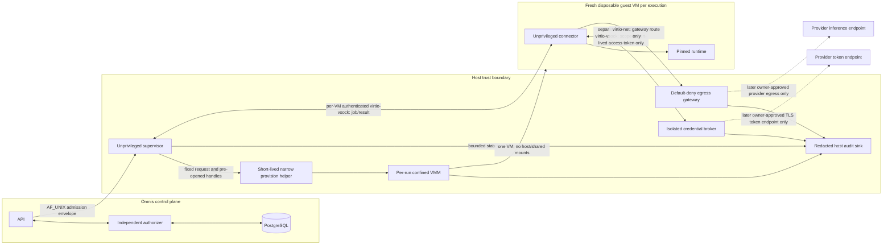

# Phase 1 — Connector Host-Boundary Feasibility

**Assessment date:** 2026-11-06
**Repository baseline:** `origin/main` at `28981f900f95a9673db35aeff5ceaff62f4fffe6`
**Readiness handoff:** PR #37 reviewed head `853ff8ae73b55efb1495734d56280bbd0df9382d`; squash-merge commit `e0512609973bf24a8fd40f7da7731865fdc45377`
**Scope:** Design and feasibility only. No provider authentication, inference, host provisioning, egress activation, or runtime change was performed.

## Decision

**BLOCK — real-runtime readiness.** A separate connector identity, isolated VM, narrow host IPC, resource limits, and deny-by-default egress gateway are plausible designs. Current Codex app-server documentation exposes command execution, a shell method explicitly outside the sandbox, MCP tool calls, configuration writes, and (experimentally) process spawning; it does not document a complete enforceable deny-all capability for this integration. A prompt or hidden UI control is not a host security boundary. Main contains no connector unit, broker, egress policy, or tests proving those capabilities are denied. Keep the runtime mock-only and keep G4-3 **Partially Fixed** and R1-G5 **Partially Complete**.

This blocks a real provider request, not further design or synthetic-only platform prototyping. The shortest safe path is: (1) Codex #1 confirms the backend authorization/credential contracts below; (2) select a pinned runtime and confirm an enforceable tool-inert boundary or keep it disabled; (3) implement a disposable-VM/CI synthetic verifier; (4) obtain independent security architecture review from Claude #1; (5) verify on a separately approved owner-controlled target before any real OAuth or inference authorization.

## 1. Verified baseline and scope

### Repository and active work

- Latest fetched `origin/main` for this remediation is `28981f900f95a9673db35aeff5ceaff62f4fffe6`.
- PR #37's reviewed head was `853ff8ae73b55efb1495734d56280bbd0df9382d`; GitHub recorded its squash-merge commit as `e0512609973bf24a8fd40f7da7731865fdc45377`. Its readiness and Codex #3 handoff documents are included in the current main baseline.
- PR #36's reviewed head was `b4e2467bbfb5dbb65ce2fec1aac3ef87acc28f65`; GitHub squash-merged it to current `main` at `28981f900f95a9673db35aeff5ceaff62f4fffe6`. Open PR #39 (`2d518547de7854daa36cc8bcf69efb6f081d9459`) adds only an in-process, credential-free fake app-server protocol test and a backend readiness document; its fixture makes no process, network, or credential access and is not a host-isolation test. Open PRs #25, #26, and #31 do not overlap this document. No application or infrastructure files are changed by this PR.
- The original worktree was already on `security/r1g5-host-authorizer-isolation`, behind its remote by two commits, with an unrelated untracked UI specification. It was left untouched. This document is in an isolated worktree based on current `origin/main`.

### Existing host isolation evidence

`docs/07-governance/evidence/R1_G5_HOST_ISOLATION.md` records a successful disposable Ubuntu 24.04 systemd deployment check (historical CI run `41687576726`, implementation SHA `a6f33442da291ac02ca8b47b6cb758bd50540c30`). That run exercised actual service identities, installed root-owned application files, restricted service secrets, socket boundaries, and mock API-to-worker-to-launcher execution on an ephemeral runner. It is evidence for that exact disposable setup, not the developer host or a production/homelab target.

Current units in `infra/systemd/` define `omnis-api`, `omnis-worker`, `omnis-authorizer`, and `omnis-launcher`; each uses a distinct primary group and several systemd hardening directives. The launcher is explicitly in the `docker` group and remains root-equivalent. The worker has only its private group and `omnis-launcher-socket`; it is not in Docker or the authorizer socket group. The current units permit AF_UNIX, AF_INET, and AF_INET6 and define no connector-specific cgroup resource budgets or provider egress policy. `scripts/host-security/provision-identities.sh` provisions no connector or credential-broker identity. `install-service-secrets.sh` installs service-specific files but has no provider credential path.

The existing `scripts/host-security/verify-disposable-systemd-deployment.sh` is explicitly destructive to its disposable runner: it provisions users, groups, files, secrets, units and services and requires root/systemd/Docker/credentials. It was inspected but **not run** locally. Do not use it on a developer or target host.

### Current developer environment

Read-only observations: Ubuntu 26.04.1 under WSL2, kernel `6.6.87.2-microsoft-standard-WSL2`, systemd 259 running as PID 1, and cgroup v2. The current developer user is UID/GID 1000 and belongs to `sudo`, `adm`, and general desktop groups. `/dev/kvm` exists as `root:kvm` mode `0660`, but the current user is not in `kvm` and lacks read/write access; a `vmx` CPU flag is visible, which does not establish usable KVM or nested virtualization. No VM was created or launched. `systemd-analyze has-tpm2` reports `partial`; the local systemd build reports a missing `libtss2-esys` library. This is not evidence of usable TPM-backed credential encryption. No service isolation, Windows-mounted-path denial, network namespace behavior, credential protection, or provider boundary was tested. Microsoft notes WSL systemd services do not keep a WSL instance alive, so WSL is useful for development checks but is not by itself evidence of an always-on host service or an accepted VM test target.

## 2. Authoritative Option C topology

Option C, one fresh disposable Linux guest VM per admitted execution, is the only architecture recommended here for a future hostile-runtime prototype. This is a proposed topology, not an implemented or selected VMM deployment. The current application remains mock-only. There is no guest process connection to a host Unix-domain socket.

Dashed provider paths are disabled in this assessment. PostgreSQL and the independent authorizer remain the canonical application authorization/audit source; the supervisor and broker execute that policy and cannot create grants.

The **unprivileged host supervisor** verifies the canonical authorization envelope and orchestrates lifecycle; it does not mint grants or access refresh credentials. The **privileged provision helper** is a short-lived, narrowly scoped component that creates/destroys a VM and attaches pre-created, per-run resource handles. The **VMM** runs under a per-run unprivileged identity with only the device descriptors and files required for that VM. The **guest connector** runs under a dedicated non-root guest identity. The **credential broker** owns the external secret store and independently verifies authorization before issuance. The **egress gateway** owns the only controlled external route. PostgreSQL remains the durable application state and audit authority, not a credential store.

### Host/guest channels and trust crossings

Every channel below is a design requirement. The selected transport, cryptographic profile, and schemas need owner/security approval before implementation. No current service implements these connector channels.

| Channel                   | Source → destination; transport                                                                                                                                                                                                              | Authentication and authorization                                                                                                                                                                                                                    | Allowed data and credential access                                                                                                                                                                                                                         | Failure behavior and boundary                                                                                                                                                                                                                                                           |
| ------------------------- | -------------------------------------------------------------------------------------------------------------------------------------------------------------------------------------------------------------------------------------------- | --------------------------------------------------------------------------------------------------------------------------------------------------------------------------------------------------------------------------------------------------- | ---------------------------------------------------------------------------------------------------------------------------------------------------------------------------------------------------------------------------------------------------------- | --------------------------------------------------------------------------------------------------------------------------------------------------------------------------------------------------------------------------------------------------------------------------------------- |
| Admission                 | API/authorizer → host supervisor; host-local protected IPC, candidate AF_UNIX                                                                                                                                                                | OS peer credentials plus an authenticated, bounded, one-use authorization envelope verified against Codex #1's trusted verifier/revocation contract                                                                                                 | Fixed admission fields only: request/task/project identity, connector/runtime/image digest, provider/model policy, input digest, empty tool set, limits, expiry, replay ID. No provider token, DB URL, shell command, arbitrary config, or workspace path. | Reject malformed, stale, replayed, revoked, or unverifiable input before VM creation or credential request. Crosses control-plane to host trust boundary.                                                                                                                               |
| VM lifecycle              | Supervisor → provision helper/VMM; private host IPC and inherited pre-opened file descriptors                                                                                                                                                | Supervisor identity and fixed request schema; helper validates image digest, resource profile, per-run opaque ID, and allowed operation. No arbitrary command/path RPC.                                                                             | Immutable image/kernel references, empty writable overlay, bounded CPU/memory/disk, vsock and guest-network handles. No task credential or provider secret.                                                                                                | Fail closed; tear down partial VM/network/overlay. The helper must not accept guest-controlled paths or general privileged operations. Crosses unprivileged-to-privileged host boundary.                                                                                                |
| Guest control/result      | Guest connector ↔ supervisor; per-VM virtio-vsock port, not AF_UNIX                                                                                                                                                                          | Bind guest CID to the active VM instance; authenticate both sides with per-run ephemeral keys and a bounded handshake. CID or vsock reachability alone is not authorization. The host validates the one-use admission binding.                      | Versioned, length-bounded job/result/status/event schemas; no arbitrary RPC, host command, DB URL, refresh credential, or credential-store operation. Guest receives only scoped request data; result is untrusted.                                        | Close/kill the VM on bad framing, identity mismatch, replay, timeout, or unsupported message. Guest cannot address host UDS paths. Crosses guest-kernel to host supervisor boundary.                                                                                                    |
| Credential issuance       | Guest connector ↔ credential broker; broker owns a dedicated host AF_VSOCK listener and binds each connection to the active VM CID/run. It uses a separate service port from control/result. No supervisor relay and no host UDS from guest. | Broker binds the guest CID/ephemeral key to active VM identity and independently checks canonical authorization/revocation at issue time; binds one-use issuance to run ID, provider, scope, expiry, and rate limit. Supervisor cannot widen scope. | Broker alone reads refresh secret. It returns only a provider-supported short-lived access credential directly to the intended guest runtime handoff. Refresh credential is never placed in guest boot data, environment files, argv, or task workspace.   | Deny on unavailable/uncertain revocation, invalid consent, replay, quota, or unsupported scope. Stop further issuance on revocation. A delivered token may remain usable until expiry/provider revocation. Crosses secret-store to guest/runtime boundary.                              |
| Broker credential storage | Protected external secret facility ↔ broker process; exact facility is target-dependent and not selected                                                                                                                                     | Dedicated broker identity and facility ACL/encryption; broker must authenticate to the store and decrypt only its assigned provider/account records. No API/worker/guest identity can read them.                                                    | Refresh credentials only; no task content, DB credentials, host command data or runtime configuration. Separate records by owner/provider/credential ID and audit every access without logging values.                                                     | Store unavailable, unlock failed, integrity uncertain or ACL mismatch means no refresh and no token issue. Broker/store compromise may expose all credentials that identity can decrypt and remains an explicit high-impact residual. Crosses protected-store to broker trust boundary. |
| Provider token endpoint   | Broker → egress gateway → exact provider authorization/token endpoint; source-specific gateway policy over TLS. Broker has no direct external route.                                                                                         | Owner-approved supported flow, exact endpoint/certificate validation, no redirects outside approved policy; gateway maps broker identity to token-endpoint policy. No general-purpose proxy tunnel.                                                 | Only provider-defined token request/response fields. Refresh token remains within broker/store; access response is handled in memory and only the approved short-lived value can be sent to the bound guest.                                               | Unsupported flow, changed endpoint/certificate, unexpected response, or policy ambiguity fails closed. Provider token service is an external trust boundary; no endpoint is contacted in this mission.                                                                                  |
| Provider egress           | Guest → egress gateway; dedicated virtio-net interface into isolated host network namespace/bridge                                                                                                                                           | Gateway maps interface/VM identity to the active run policy, applies destination allowlist, DNS/IP checks and TLS hostname verification. Guest does not choose an alternate route or gateway.                                                       | Only approved provider endpoint host/port after a later separate approval. No broker, API, DB, authorizer, launcher, Docker, metadata, host or arbitrary Internet access.                                                                                  | Default-deny at guest firewall, host bridge/firewall and gateway. Gateway failure removes route or stops guest; never direct fallback. Crosses guest network to controlled external-network boundary.                                                                                   |
| Logs/lifecycle            | Supervisor, VMM, broker, gateway → bounded host journal/audit sink; local protected IPC/files                                                                                                                                                | Source service identity; strict schema, length limits, redaction before persistence; guest messages treated as hostile input                                                                                                                        | Opaque request/run IDs, state transitions, resource/exit metadata, bounded safe reason codes. No raw environment, tokens, cookies, prompts by default, or unbounded guest console.                                                                         | Drop/reject oversized or malformed output; keep console disabled or tightly capped and non-authoritative. Logging failure cannot authorize or replay work. Crosses untrusted guest output into host logging boundary.                                                                   |

The supervisor and broker consult the canonical authorization source; they do not create a second policy authority. Until Codex #1 specifies the envelope, replay ledger, revocation generation and audit contract, no connector request can be admitted. The present `mock.execute` authorization record does not authorize real connector execution.

### Host identities and privilege boundaries

| Component         | Proposed identity and minimum access                                                                                                                            | Explicitly denied                                                                                                                                     | Isolation and failure requirements                                                                                                                                                                                                    |
| ----------------- | --------------------------------------------------------------------------------------------------------------------------------------------------------------- | ----------------------------------------------------------------------------------------------------------------------------------------------------- | ------------------------------------------------------------------------------------------------------------------------------------------------------------------------------------------------------------------------------------- |
| Supervisor        | Dedicated unprivileged `omnis-vm-supervisor`; own state directory and admission socket; access only to its narrow helper, broker and lifecycle IPC              | Docker, DB credentials, provider refresh secrets, guest filesystem, generic root command interface                                                    | systemd hardening, private home/tmp, no capabilities, cgroup limits, strict schemas; restart reconciles owned VM IDs and never replays submissions                                                                                    |
| Provision helper  | Separate short-lived privileged identity, invoked only through fixed local protocol; narrowly scoped VM/network setup operations and prevalidated paths/handles | General shell, arbitrary paths/commands, credentials, guest-controlled input beyond bounded identifiers, Docker socket                                | Small memory-safe helper preferred; otherwise evidence-backed parser hardening, fuzz/property tests, strict OS confinement and root-owned immutable inputs. A compromise is host privilege compromise, so minimize code and lifetime. |
| VMM               | Unique unprivileged UID/GID per VM; only `/dev/kvm` or equivalent handle, pinned image/kernel, overlay, vsock and tap descriptors for its own VM                | Other run files, host home, Docker, service sockets, credentials, unrestricted network, other processes                                               | Use the selected VMM's production sandbox/jailer or an equal-or-stronger reviewed policy; separate cgroup, namespaces, seccomp/LSM, bounded resources, no shared writable image.                                                      |
| Credential broker | Dedicated unprivileged `omnis-credential-broker`; access only to its protected store and required provider token endpoint; no task/database/guest filesystem    | API/worker/launcher secrets, database, arbitrary egress, guest refresh-token access, policy creation                                                  | Isolated service identity and socket; independent authorization/revocation checks, per-admission accounting, bounded rate, encrypted-at-rest store if supported and verified.                                                         |
| Egress gateway    | Dedicated unprivileged gateway identity; access to isolated guest-facing bridge and approved outbound path only                                                 | Host control plane, database, secret store, arbitrary proxying, TLS interception by default                                                           | Separate network namespace/firewall identity; strict host/port policy and bounded parsing; fail closed. Failure cannot create another guest route.                                                                                    |
| Guest connector   | Dedicated non-root guest UID/private GID, no supplementary groups or capabilities; read-only pinned code/config and bounded per-run scratch                     | Host files/devices/sockets, host provisioning, Docker, database, other guests, CLI credential stores, refresh credentials, arbitrary external network | Guest firewall, immutable image, no shared mounts; memory/disk destroyed per run. Tool/config denials must be effective even if the model requests them.                                                                              |

No long-running root-equivalent supervisor is proposed. If VM/network creation cannot be provided by an unprivileged VMM plus narrow helper, that privileged helper is a separate high-risk trusted component: document its syscall, filesystem, socket and operation allowlist, fuzz its protocol, and obtain independent review before a prototype. The component parsing guest-controlled data must be unprivileged. The launcher unit is `omnis-launcher.service`; it is root-equivalent through Docker group membership and is not part of this design.

### VMM selection criteria (not a selection)

Do not choose a VMM from startup speed alone. Compare a pinned, supported release of Firecracker, Cloud Hypervisor and QEMU, plus an explicitly reviewed container-isolation alternative, against: attack surface and production sandboxing; KVM/device requirements; vsock and guest networking support; per-VM UID and resource controls; image/overlay lifecycle; host integration privilege; observability and bounded console behavior; patch cadence/provenance; CI reproducibility; target-host compatibility; and independent security evidence. Container isolation shares the host kernel and is not equivalent to the required VM boundary. QEMU's broader device model and Firecracker/Cloud Hypervisor's narrower device models present different compatibility and attack-surface tradeoffs. No winner is selected until a pinned synthetic prototype and independent review compare the actual configuration.

Primary references reviewed for the criteria are linked in §12. Vendor/project feature descriptions are not proof of a safe configuration.

### Supplemental Option A host-supervisor policy

These systemd controls are candidates for the **host supervisor only**, not a replacement topology for the guest runtime. The future supervisor should use its own unprivileged `omnis-vm-supervisor` identity, private state, empty supplementary groups, no capabilities, a read-only pinned executable, restricted AF_UNIX admission/helper sockets, and separate host cgroup limits. It must not host the model runtime or receive a guest filesystem mount, provider token, Docker access, database credentials, or general privileged command interface. Do not apply a host UDS design to guest processes: the guest control path is per-VM virtio-vsock as specified above.

Potential systemd controls include `NoNewPrivileges=yes`, empty capability sets, `PrivateTmp=yes`, `ProtectSystem=strict`, `ProtectHome=yes`, `ProtectKernelTunables=yes`, `ProtectKernelModules=yes`, `ProtectKernelLogs=yes`, `ProtectControlGroups=yes`, `ProtectClock=yes`, `ProtectHostname=yes`, `ProtectProc=invisible`, `ProcSubset=pid`, `RestrictSUIDSGID=yes`, `LockPersonality=yes`, `RestrictRealtime=yes`, `UMask=0077`, and narrow `ReadWritePaths=`. Apply only after validating exact semantics and compatibility on the selected host. Use distinct cgroups for supervisor, helper, VMM, broker and gateway. Host service limits do not constrain guest workloads; guest vCPU, RAM, process, file, disk and network limits must be separately configured at the VM/guest boundary.

`PrivateNetwork=`, `IPAddressDeny=`, and `SystemCallFilter=` are candidate controls, not evidence. Verify actual namespaces/routes/firewall and system-call behavior. Do not assume a host systemd network setting provides guest isolation or FQDN policy. Avoid untested syscall allowlists and do not rely on environment proxy variables for guest egress.

### Isolation architecture comparison and recommendation

| Option                                 | Security boundary and residual risk                                                                                                                                                                                                                                                                                                                              | Runtime and credential implications                                                                                                                                                                                                                                                                                                                          | Operations, cost, and platform fit                                                                                                                                                                                                                                                                                                                 | Assessment                                                                                                                                                                                                                     |
| -------------------------------------- | ---------------------------------------------------------------------------------------------------------------------------------------------------------------------------------------------------------------------------------------------------------------------------------------------------------------------------------------------------------------- | ------------------------------------------------------------------------------------------------------------------------------------------------------------------------------------------------------------------------------------------------------------------------------------------------------------------------------------------------------------ | -------------------------------------------------------------------------------------------------------------------------------------------------------------------------------------------------------------------------------------------------------------------------------------------------------------------------------------------------- | ------------------------------------------------------------------------------------------------------------------------------------------------------------------------------------------------------------------------------ |
| **A. Dedicated systemd process**       | Separate UID/GID, mount namespace, syscall restrictions, cgroups, and private home materially reduce access. It still shares the host kernel and systemd manager; a kernel escape or host-root compromise crosses the boundary. `ProtectHome=` does not cover nonstandard home paths by itself.                                                                  | All three runtimes can be installed as ordinary processes, but their child-process and tool needs conflict with a strict no-exec policy. A credential delivered to the runtime is available to that runtime.                                                                                                                                                 | Lowest startup overhead and easiest to inspect. Current WSL has systemd/cgroup v2, but namespace, mount, Windows-path, TPM, and long-lived service behavior remain target-specific.                                                                                                                                                                | Useful as defense-in-depth for the host supervisor or synthetic test fixture. **Not sufficient as the sole boundary for a hostile model/tool runtime.**                                                                        |
| **B. Hardened rootless OCI container** | User namespaces, non-root UID, read-only root, explicit mounts, dropped capabilities, seccomp/LSM, PID/memory/CPU limits, and a restricted network namespace improve confinement. The host kernel is shared. Mounting a rootful Docker socket is root-equivalent and prohibited; rootful Docker without socket exposure still leaves its daemon in the host TCB. | CLI binaries can run if their dependencies are included. Denying `execve` may also break runtime operations and must be tested against the exact pinned binary. Do not mount host homes, native config, credentials, DB sockets, or project checkouts.                                                                                                       | Moderate image/build/runtime overhead. Rootless networking and LSM availability vary across Linux, WSL, and CI. Requires an immutable image and runtime-specific compatibility tests.                                                                                                                                                              | Better than a host process, but still a shared-kernel boundary. A viable fallback for synthetic tests; **not selected for the first real request** without an independent risk acceptance.                                     |
| **C. Disposable VM per request/run**   | Adds a guest-kernel boundary and permits a disposable guest filesystem, no host mounts, no shared Docker socket, restricted virtual devices, and host-controlled network attachment. Hypervisor, host kernel, VM supervisor, and any passed-through channel remain trusted; VM escape is residual risk.                                                          | Codex, Claude Code, or Hermes may run inside a supported Linux guest, but tool execution must still be denied or rendered inert within the guest. Send only the scoped task envelope. A short-lived credential necessarily becomes visible to the runtime process; keep refresh credentials outside the guest and destroy its memory/disk after the request. | Highest startup/resource cost and operational complexity. Requires an owner-selected Linux hypervisor/VM service, image lifecycle, vsock or similarly narrow control channel, and host egress gateway. WSL is not evidence that the target can run or safely host these VMs; GitHub-hosted job isolation is not equivalent to a production target. | **Recommended boundary for any future real runtime**, subject to a target decision and disposable verification. Begin with a synthetic, credential-free VM prototype; no VM or host service is provisioned by this assessment. |

The recommended flow is a minimal host supervisor plus one disposable Linux VM per run. The VM gets no shared project mount, no general host network, no Docker socket, and no Omnis database credentials. Its control/result channel is a narrow authenticated request/result protocol over per-VM virtio-vsock; its only future network path is an independently filtered egress gateway over a dedicated virtual NIC. Use a dedicated unprivileged connector identity inside the guest as a second boundary. **A VM is an outer blast-radius boundary, not by itself a no-tool control:** the host and guest OS must deny tool effects. Adapter detection is secondary and cannot guarantee that a tool request is observed before a runtime performs it. Synthetic negative tests must prove the effects are denied. If the owner's target cannot provide disposable VMs, keep real runtime execution blocked until an alternative boundary is independently reviewed and shown to meet the same criteria. Do not silently downgrade to Option A or B.

Runtime-specific compatibility is not established by this architecture choice: Codex app-server has protocol and child-process surfaces described in §6; Claude Code documents configurable permissions and OS sandboxing that must be pinned and tested in the chosen Linux guest; Hermes toolsets and API-server presets expose different capabilities and must be resolved and tested for the exact deployment. A compatibility failure is a reason to keep that runtime disabled, not weaken the guest boundary.

## 3. Explicit allow/deny resource matrix

This matrix distinguishes host components from the guest connector. A guest vsock endpoint is not a host Unix-domain socket, and a guest process does not receive host paths or device nodes.

| Resource             | Guest connector allowed                                                                                             | Guest connector denied                                                                                                       | Required enforcement/evidence                                                                                                                        |
| -------------------- | ------------------------------------------------------------------------------------------------------------------- | ---------------------------------------------------------------------------------------------------------------------------- | ---------------------------------------------------------------------------------------------------------------------------------------------------- |
| Identity             | One unprivileged guest UID/private GID                                                                              | Root, supplementary groups, host identities, Docker/DB/Omnis groups                                                          | Inspect guest UID/GID, groups, capabilities, namespaces and process tree from an independent host verifier.                                          |
| Code/config          | Pinned read-only connector/runtime and immutable minimal configuration                                              | User CLI config, plugins/hooks/MCP config, writable binaries, arbitrary configuration changes                                | Verify image digest/provenance and filesystem modes; mutation attempts fail.                                                                         |
| Filesystem           | Read-only guest root plus bounded per-run scratch                                                                   | Host home, `/root`, `/mnt`, `/media`, projects, other runs, host service secrets, DB data, shared writable mounts            | Device/mount inventory and negative reads/writes including symlink and `/proc` traversal; no shared filesystem device.                               |
| Host communication   | One versioned, bounded control/result protocol over per-VM virtio-vsock                                             | Host UDS paths, API/authorizer/launcher/DB/Docker sockets, generic host RPC                                                  | Verify VM-bound CID/ephemeral channel identity, schema validation, request authorization, replay rejection and no guest path to host UDS.            |
| Credentials          | Only a provider-supported short-lived access credential for its own admitted run, if later approved                 | Refresh token, another run's token, native CLI store, host credential store, token in boot image/argv/env file               | Synthetic canaries; broker issuance records; no canary in peer process, disk, logs, DB or artifacts. The runtime itself can access its issued token. |
| Devices/capabilities | Only enumerated virtual devices needed by the pinned guest/VMM profile                                              | `/dev/kvm`, raw host devices, host namespaces, host ptrace/process inspection, privileged guest capabilities                 | Compare guest device inventory to allowlist; assert no pass-through and inspect host VMM descriptors/capabilities.                                   |
| Network              | Guest-facing virtual NIC to the isolated gateway only; provider endpoints remain disabled until separately approved | Direct Internet, DNS/DoH, loopback/host/private/link-local/metadata, Omnis services, alternate gateway, Docker/control plane | Guest and host firewall counters, route table, packet capture, negative probes and local TLS fixture; gateway failure leaves no route.               |
| Process control      | Own connector/runtime processes within guest cgroup and bounded VM limits                                           | Host process inspection/signaling, unbounded child agents, shell/tool effects, surviving work after teardown                 | Synthetic hostile tool requests, guest process/cgroup limits, cancellation, VM kill, orphan scan on host.                                            |
| Logs/artifacts       | Bounded opaque IDs, state transitions and sanitized reason codes                                                    | Tokens/cookies/auth headers, raw environment, unbounded console, core dumps, unsanitized guest output                        | Canary scans; console disabled or bounded; swap/snapshot/core policy; artifact review and post-destroy storage checks.                               |
| Resources            | Configured guest vCPU, RAM, process/thread, file, disk, output and wall-time budgets                                | Host-wide resource exhaustion, unbounded overlay, unlimited output or persistent snapshots                                   | Enforce and measure guest limits plus independent host cgroup limits on VMM, supervisor, broker and gateway.                                         |

### Host isolation threat model

“Current enforcement” below refers to source or evidence in `main` at the stated baseline. Proposed connector controls are not counted as implemented. Severity describes the impact if the boundary fails.

| Trust boundary / threat                                           | Severity and failure mode                                                                                                                      | Current enforcement evidence                                                                                                                                                                | Missing enforcement and owner                                                                                                                                                                                                                        | Required acceptance evidence                                                                                                                                                                                                                                                  |
| ----------------------------------------------------------------- | ---------------------------------------------------------------------------------------------------------------------------------------------- | ------------------------------------------------------------------------------------------------------------------------------------------------------------------------------------------- | ---------------------------------------------------------------------------------------------------------------------------------------------------------------------------------------------------------------------------------------------------- | ----------------------------------------------------------------------------------------------------------------------------------------------------------------------------------------------------------------------------------------------------------------------------- |
| **Admission: forged, replayed, or stale run request**             | **Critical:** an unauthorized or duplicate billable provider request is accepted.                                                              | Current owner/session and authorizer flow is scoped to synthetic `mock.execute`; ADR-0009 records transaction/revocation behavior for that scope.                                           | Codex #1 defines a provider-specific, task/runtime/model/scope/expiry-bound decision, one-use/replay semantics, key custody/rotation, and uncertainty states. Codex #3 validates the host verifies the signed or otherwise authenticated envelope.   | Tampered, expired, wrong-runtime, wrong-task, replayed, revoked, and unknown-key envelopes all fail closed before credential release or provider socket access; audit records safe denial reasons.                                                                            |
| **Native tools, MCP, plugins, child agents, and config mutation** | **Critical:** prompt injection causes command execution, file/network access, delegation, or policy changes.                                   | Main worker is hard-wired to `SandboxedMockRuntimeAdapter`; PR #39 is a Draft in-process fake and is not main or OS-boundary evidence.                                                      | Codex #1 owns protocol/event rejection and application authorization. Codex #3 owns VM/process/filesystem/network denial. Runtime configs are defense-in-depth only.                                                                                 | For each exact pinned runtime, inject synthetic tool/control requests and prove no child, file, socket, network, config, plugin, or agent side effect; the host terminates or rejects the turn.                                                                               |
| **Process identity and privilege escalation**                     | **Critical:** runtime gains host service, root, Docker, or other-process authority.                                                            | Existing API, authorizer, worker, and launcher use separate groups and systemd hardening. The launcher alone is in `docker` and is root-equivalent; worker cannot access Docker directly.   | Codex #3 creates no connector identity yet. Require guest UID/GID, no supplementary groups/capabilities/sudo, cgroup-wide process lifecycle, and no host process namespace.                                                                          | Independently inspect actual guest and host process credentials, groups, capabilities, namespaces, cgroup membership, and denied signaling/ptrace attempts. Confirm no connector member can access Docker/launcher.                                                           |
| **Filesystem and workspace**                                      | **High:** runtime reads SSH/Git/provider sessions, another task/project, service secrets, or modifies trusted binaries.                        | Existing service units use `ProtectSystem=strict`, `ProtectHome=true`, and private tmp/devices; R1-G5 evidence covers the existing mock services only.                                      | No connector filesystem or workspace policy exists. Codex #3 proposes no host/project mount, disposable read-only guest root, bounded per-run scratch, and empty isolated runtime home.                                                              | Synthetic sentinel reads/writes fail for developer-home, another project, service config/secrets, DB files, host mounts, symlink escapes, and trusted code; only the approved private scratch succeeds.                                                                       |
| **Credential custody and cross-run access**                       | **Critical:** refresh/access token theft, cross-agent session reuse, or secret persistence in logs/artifacts.                                  | No provider credential path exists; existing service secret files serve API/authorizer/launcher only. No personal CLI credentials were inspected or reused.                                 | Codex #1 owns consent, OAuth/provider policy, authorization, scope, and revocation contract. Codex #3 owns broker/guest delivery isolation and redaction tests. Do not select a credential store until the target OS and provider flow are approved. | Synthetic canary is visible only to the one authorized runtime process that requires it; absent from arguments, parent/peer process, host files, DB, logs, artifacts, and post-cleanup storage. Explicitly record root/hypervisor visibility as TCB residual.                 |
| **IPC and control-plane boundary**                                | **High:** a guest impersonates the API/authorizer or submits arbitrary host work.                                                              | Existing API-authorizer and worker-launcher UDS controls apply only to current mock services; they do not define a connector channel.                                                       | No connector vsock protocol exists. Codex #1 owns the authorized request schema; Codex #3 owns per-VM identity binding, authenticated framing, replay checks and host isolation. The guest receives no host UDS, DB, Docker, launcher or API socket. | Valid fixed-schema vsock works only for the active VM; wrong VM identity, malformed, oversized or replayed messages fail closed, with no reachable host UDS.                                                                                                                  |
| **Network, DNS, localhost, metadata, and MCP**                    | **Critical:** exfiltration, SSRF, private service access, metadata theft, or provider traffic outside approved policy.                         | Current mock container uses `--network=none`; this protects the synthetic sandbox path only. Existing host systemd units allow AF_UNIX/AF_INET/AF_INET6; no connector egress policy exists. | Codex #3 owns default-deny VM attachment, firewall, DNS path, and gateway. Codex #1 owns provider approval/policy semantics. No provider destination is approved now.                                                                                | In an isolated network fixture, prove every direct path and unapproved DNS/private/link-local/loopback/IPv6/metadata/alternate proxy route is denied. Only a controlled fake destination through the test gateway is reachable; firewall counters and captures show the path. |
| **Supply chain and runtime configuration**                        | **High:** changed binary, user config, hook, plugin, or environment restores forbidden capabilities.                                           | Existing service install copies root-owned tracked application/dependency trees for the mock stack; no runtime package is selected or pinned.                                               | Codex #3 defines hash/provenance pinning and immutable image; runtime owner supplies supported config. Clean HOME/config; no user/project plugin roots, hooks, MCP servers, imported sessions, or inherited provider environment.                    | Verify pinned artifact digest, root-owned read-only files, effective config in the empty guest, and failed attempts to alter config or add an MCP/plugin/tool source.                                                                                                         |
| **Resource exhaustion and output abuse**                          | **High:** runaway child trees, memory/CPU/fd/disk/output exhaustion or service starvation.                                                     | Existing mock sandbox has bounded synthetic execution and CI timeouts. No connector-specific budgets exist.                                                                                 | Codex #3 defines per-run VM/cgroup CPU, memory, process, fd, disk, wall-clock, output and concurrency budgets plus forced teardown.                                                                                                                  | Controlled stress fixture reaches each configured limit, is terminated within a bounded window, leaves no orphan, and cannot affect the host or another run.                                                                                                                  |
| **Cancellation, crash, restart, and uncertain provider result**   | **Critical:** retry duplicates a potentially billable request or local cancellation is misreported as provider termination.                    | Current mock queue recovery and cancellation are durable for synthetic runs; they do not prove provider behavior. No exactly-once or provider request-ID guarantee is established.          | Codex #1 defines persisted `submitting` / `unknown` / `interrupted` semantics and no automatic retry. Codex #3 owns VM teardown, orphan cleanup, startup recovery and safe diagnostics.                                                              | Kill at each send/stream/ack boundary; after restart, no second submission occurs. State remains unknown unless authoritative reconciliation exists; cancellation is reported as requested/observed separately.                                                               |
| **Host / hypervisor / rootful Docker compromise**                 | **Critical:** host root, kernel, hypervisor, or VM supervisor can read memory or escape the guest; current Docker launcher is root-equivalent. | R1-G5 records the launcher residual and exact disposable Ubuntu mock deployment evidence.                                                                                                   | Separate the connector from the rootful launcher; keep host root/kernel/hypervisor in TCB; assess target hardening and backups. Codex #3 documents but does not claim elimination of VM-escape risk.                                                 | Target-specific boundary tests, configuration review, hypervisor/host patch posture, and explicit owner risk acceptance. Disposable CI cannot prove resistance to a host-root or hypervisor compromise.                                                                       |

Host-local UDS paths used between host services should be in dedicated root-owned runtime directories, not `/tmp`, with separate ACLs for admission, helper, broker and gateway control. Verify peer credentials and validate every message against a strict schema. The guest never joins host socket groups or connects to host UDS; it uses only its authenticated per-VM vsock channel.

## 4. Credential custody

### Proposed separation

1. **Provider-policy approval gate:** before any credential implementation, the repository owner must approve, by named recorded decision, the selected provider, terms/policy review, supported authentication flow, account-connected features, data retention, and credential-handling design. Codex #1 owns the backend/account-policy contract; platform design cannot imply that any provider flow is permitted. Do not create a third-party OAuth token tunnel. Claude background execution stays disabled until its separate owner policy review is recorded.
2. If a supported owner-consented Omnis-owned OAuth flow is established, use a dedicated application/client and consent journey. Never reuse, inspect, copy, or migrate native Codex/Claude/Hermes CLI credentials.
3. Keep refresh credentials outside PostgreSQL and outside API, worker, authorizer, launcher, task, workspace, event, and log records. A separate minimal broker owns the protected store and refresh/revocation logic. The broker identity alone can access that store. Define the credential endpoint, network reachability, and host-side storage protection for the exact target before implementation; no facility is selected here.
4. The broker independently verifies the canonical authorization decision, including scope, provider, run, guest identity, expiry, revocation generation, replay identity, and policy version. It performs an **atomic revocation check at issuance**, consumes a one-time issuance record, enforces per-admission accounting and bounded rate limits, and returns only the provider-supported short-lived access credential to the intended guest/runtime handoff. A guest connection or supervisor request alone is not authorization. Refresh credentials never enter guest boot data, guest filesystem, task workspace, environment files, or command line. Broker, store, verifier, token endpoint and audit failures are fail-closed.
5. The proposed guest credential channel is authenticated per-run virtio-vsock, bound to the active VM identity, with a bounded schema and one-time issue response; no guest AF_UNIX connection to the host is assumed. The exact authentication binding and broker contract require Codex #1 approval. The documented Codex SIWC app-server setup passes an access token to its child by environment key. If that is the selected interface, the runtime process can read/use its own token; do not claim it is hidden from the runtime. Host root/hypervisor remains able to inspect guest memory and is explicitly in the trusted computing base.
6. A token already delivered may remain usable until provider expiry or provider-side revocation. No per-run provider revocation semantics are assumed. Cancellation blocks further broker issuance and destroys the VM, but cannot establish that a delivered token or remote provider computation stopped immediately. If the provider-supported token lifetime and revocation behavior cannot bound this risk, credential delivery remains blocked.
7. systemd credentials are a static service-secret delivery primitive, not a per-run OAuth broker. Current WSL reports `systemd-analyze has-tpm2: partial` and missing `libtss2-esys`; usable TPM-backed protection is unverified here. Evaluate the exact target's secret store and prove enrollment, ACL, rotation, revocation, backup/restore, and failure-closed behavior before storing any real token. Do not assume the Linux kernel keyring or desktop keyring is available to a headless service.

No credential facility was exercised and no credential material was accessed. A synthetic high-entropy canary is sufficient to test that a known string does not appear in journals, process arguments, host/peer process views, temporary files after cleanup, database records, test results, traces, or CI artifacts. For a runtime that requires an environment token, the expected result is that the canary is present only in the one authorized runtime process context; the test must not falsely expect it to be absent from that process's own environment. This cannot prove a real OAuth flow's provider policy, token scope/lifetimes, refresh/revocation timing, storage guarantees, or app-server internal handling; those require separately authorized, owner-consented integration and independent review.

Credential compromise threat model: compromise of the API/worker must not expose broker storage; compromise of the connector guest can expose only the short-lived credential deliberately delivered to that one run; compromise of the broker identity/store can expose credentials within its decryption and account scope; compromise of host root/hypervisor can inspect broker/guest memory and remains trusted-host compromise. Limit each blast radius with separate identities and per-owner/provider records, no shared refresh token across agents/runs, per-admission issuance quotas, bounded access-token lifetime, and redacted access audit. If the selected OS secret facility cannot establish those ACL, encryption-key, backup, revocation and recovery properties, do not store a real credential there.

Credential revocation has two layers: the broker atomically checks durable authorization immediately before each issue and refuses refresh/new issuance after revocation; the supervisor kills the VM and destroys ephemeral storage. A short-lived access token already issued may remain usable until provider expiry or provider-side revocation. Per-run token revocation, request cancellation at the provider, and exact token scopes are **unknown until verified for the selected provider flow**. If provider semantics cannot bound this residual, do not issue a credential or start inference.

## 5. Egress boundary

The guest connector has no direct external route. Its guest-facing virtual NIC attaches only to a dedicated host bridge/network namespace with an enforced default-deny policy. A distinct gateway identity is the only component with the approved outbound route. The guest must not be able to reach host services through the bridge; the host firewall permits only the gateway protocol and exact destination path. Do not rely on `HTTP_PROXY`/`HTTPS_PROXY` environment variables alone.

For any later allowlist, constrain destination hostname, port, TLS SNI/hostname certificate validation, DNS answer addresses, redirect destinations, and (if the protocol allows without weakening TLS) method/path. Resolve at the proxy, reject any private, loopback, link-local, multicast, reserved, IPv4-mapped IPv6, and metadata address, pin the vetted result for the connection, and revalidate each redirect/resolution. Provider endpoint changes require a reviewed policy update. DNS must not be directly available to the connector. Proxy/firewall startup or health failure must leave egress denied, never fall back to direct network.

TLS passthrough preserves provider end-to-end TLS and permits the proxy to enforce host/port/SNI but not encrypted URL paths or request semantics. Enforcing method/path requires a carefully reviewed application-aware proxy or trusted TLS termination, which introduces a new credential and privacy boundary. The first design should use the narrowest provider host/port set the provider documents, avoid interception, and explicitly accept host-level rather than path-level enforcement if adequate. No provider hostname is allowlisted in this assessment.

### Negative reachability matrix (future disposable test only)

Use only controlled local test endpoints and reserved addresses; do not contact actual provider or cloud metadata services. Assert connection denial and bounded completion for:

| Attempt from connector                                                                           | Expected result                                                                                            |
| ------------------------------------------------------------------------------------------------ | ---------------------------------------------------------------------------------------------------------- |
| `127.0.0.1`, `::1`, guest loopback TCP                                                           | Denied for network paths; only explicitly enumerated guest-local sockets may exist, and none is a host UDS |
| API, PostgreSQL, authorizer, launcher, Docker and arbitrary host ports                           | Denied                                                                                                     |
| RFC1918 ranges, WSL host/gateway, link-local, `169.254.169.254`, IPv6 ULA/link-local             | Denied without sending traffic to real metadata endpoints                                                  |
| Direct external IPv4/IPv6 and raw socket                                                         | Denied                                                                                                     |
| DNS to arbitrary resolvers, DoH, alternate DNS port                                              | Denied; only proxy-side controlled resolution works                                                        |
| Allowed synthetic test hostname through proxy                                                    | Allowed only to a local TLS fixture with a test CA; never a real provider                                  |
| Disallowed hostname, IP literal, alternate port, malformed Host/SNI, redirect to private address | Denied by proxy and network layer                                                                          |
| Proxy absent, stopped, malformed policy, DNS timeout, policy reload failure                      | Fail closed; no direct fallback                                                                            |
| Host UDS path probes from guest                                                                  | No host socket paths or socket mounts exist in the guest; all probes fail                                  |

Provider-only egress is **not established** until all negative tests pass on the exact target environment, and those tests alone do not authorize egress activation.

### Provider-side capabilities and shared CDN authority (F5, F13, F17)

Host egress restrictions do not constrain tools executed inside provider infrastructure after a request is received. Before a provider is eligible, Codex #1 must inventory and define the account-level policy and verifiable disablement state for hosted web/search, hosted code execution, connected apps/integrations, provider memory, and provider-hosted agents or delegation. Unknown or uncontrollable features remain a blocker; an empty local tool list does not prove the provider-side account has no such capability.

The egress policy must also account for shared CDN/anycast hosting. Allowing a shared CDN IP plus TLS SNI is not enough if a proxy can forward a different HTTP `Host` or HTTP/2 `:authority` to another tenant on the same infrastructure. Where the gateway can inspect HTTP authority without breaking end-to-end TLS, require exact agreement among configured hostname, TLS SNI, certificate hostname, and HTTP `Host`/`:authority`; reject IP-literal URLs, conflicting absolute-form request targets, authority changes, and redirects outside the same exact policy. If TLS passthrough prevents inspection of HTTP authority, document this as a residual: the gateway can enforce hostname/SNI and certificate validation but cannot prove the encrypted application authority/path. Do not add TLS interception without a separate privacy and credential-boundary review. Shared-CDN tenant separation therefore remains unverified until the selected provider endpoint and proxy mode are tested.

## 6. Tool-free execution assessment

### Current vendor evidence (documentation review, 2026-11-06)

- **Codex app-server:** OpenAI's current [app-server protocol reference](https://learn.chatgpt.com/docs/app-server) lists `command/exec` with selectable sandbox policies; `thread/shellCommand`, documented as running outside the sandbox with full access; experimental `process/spawn`, also outside Codex's sandbox; MCP tool invocation; configuration writes; plugin operations; and thread/turn controls. The reference also describes sandbox policy on `turn/start`, including `externalSandbox`, which makes Codex skip its own enforcement. The [configuration reference](https://developers.openai.com/codex/config-reference) has settings such as `agents.enabled` and MCP configuration, but these are effective-runtime settings. The docs do **not** establish one immutable protocol-level switch that denies every tool, process, MCP, plugin, config, and child-agent path for an Omnis integration. The method list is evidence of available surfaces, not proof that every listed method is callable by model output in every build.
- **Claude Code:** Anthropic's [security](https://code.claude.com/docs/en/security), [permissions](https://code.claude.com/docs/en/permissions), and [sandboxing](https://code.claude.com/docs/en/sandboxing) documentation describes permission rules and OS-backed sandboxing. These controls can reduce capability, but are runtime configuration and runtime implementation, not an Omnis host boundary. The security documentation notes that non-interactive `-p` sessions do not show interactive permission prompts. Pin and test an exact version, clean settings hierarchy, hooks, plugins, MCP configuration, and any permission-bypass options. Do not treat interactive prompts or UI-hidden tools as enforcement.
- **Hermes Agent:** Nous's [API server documentation](https://hermes-agent.nousresearch.com/docs/user-guide/features/api-server) says API-server requests use the configured server-side agent toolset, including terminal capabilities by default. Its [toolsets reference](https://hermes-agent.nousresearch.com/docs/reference/toolsets-reference) describes toolsets, per-session/platform selection, dynamic MCP toolsets and plugin-registered tools. A restricted toolset is useful defense-in-depth only after the exact effective registry and every execution path are tested. A bearer key protects the API endpoint; it does not make the agent tool-free.
- **Repository evidence:** `packages/runtime-adapters/src/index.ts` types only `kind: 'mock'`, and `apps/worker/src/server.ts` directly constructs `SandboxedMockRuntimeAdapter`. Main has no Codex/Claude/Hermes executable, connector service, runtime selection flag, credential broker, or provider egress policy. PR #39's fake protocol is an in-process test fixture with no child-process, network, or credential interface; it tests mapping behavior, not vendor conformance or host isolation.

The three controls are distinct. **Application authorization** (Codex #1) decides whether one exact operation is authorized and durably prevents replay. **Runtime configuration** (provider settings/tool lists/permission modes) reduces advertised features but can have alternate entry points, configuration layering, or runtime defects. **Host enforcement** (Codex #3) denies effects even if the model, runtime configuration, or protocol client is malicious: no host project/home mount, no DB/control-plane/Docker sockets, unprivileged disposable guest, process execution restrictions, and default-deny networking. No prompt, UI setting, allowlist, or mock fixture substitutes for the host layer.

### Required tool-effect denial proof

Before any real provider request, demonstrate host-enforced effect denial. Protocol-level tool configuration is useful defense-in-depth but is not the primary boundary.

- Pin a specific reviewed runtime version and configuration; start with no user or project config, MCP servers, extensions, plugins, hooks, browser, scheduler, child-agent configuration, or arbitrary function tools. Preserve immutable configuration so the runtime cannot turn those capabilities back on.
- Do not claim that observing an adapter event means a tool was rejected before execution. A runtime may execute an action internally before emitting an event or may use an alternate path. Adapter rejection is secondary unless the exact runtime offers a demonstrated approval/dispatch gate that blocks execution until Omnis approves. The primary requirement is that guest/host policy makes the effects impossible or harmless even if the runtime attempts them.
- Regardless of protocol setting, provide no host workspace/home files; mount no project workspace for the first text-only operation; use only bounded private guest scratch if essential; deny network except a later-reviewed gateway; expose no privileged helper or host device; and enforce process/cgroup/syscall restrictions. Test exact pinned VMM, guest kernel and runtime because restrictions can affect startup.
- Feed synthetic hostile protocol/model fixtures requesting shell, file read/write, MCP, browser, plugin, child-agent, Git, configuration mutation, and network actions. Verify through independent host observations that no process, file, socket, or network side effect occurs. Verify both a valid text-only positive path and denied action negative paths. Any uncertain dispatch ordering or side effect is a gate failure.
- Fuzz/property-test the bounded control and event parsers with malformed, oversized, repeated, reordered, and adversarial frames; use a memory-safe parser implementation or document compiler/runtime hardening and sanitizer evidence for the chosen parser. Guest console/log/event output is untrusted input and must never become an authorization command.

Never enable Codex `externalSandbox` for a real connector unless the outer VM boundary is the enforcing sandbox and its no-tool-effect cases pass. For Claude Code, a permission rule is not a substitute for OS sandboxing, and both native sandbox configuration and guest effect denial must be tested. For Hermes, disable all built-in, dynamic MCP, and plugin tool registration in the synthetic profile and still prove the host denies attempted tool effects. Any configuration mutation that can re-enable a tool must be blocked by immutable config/read-only filesystem and VM confinement.

Current evidence does not demonstrate those controls for Codex app-server. **This is the direct blocker for real-runtime readiness.** If tool-free behavior cannot be established for the pinned candidate without unsupported patches or weakening the host sandbox, select a different text-only transport or keep the candidate disabled.

## 7. Resource, request and process lifecycle

### Connector-host lifecycle and component ownership

| Component                                  | Owns                                                                                                                                                                               | Must not own                                                                                                                                                                 |
| ------------------------------------------ | ---------------------------------------------------------------------------------------------------------------------------------------------------------------------------------- | ---------------------------------------------------------------------------------------------------------------------------------------------------------------------------- |
| Control plane/API                          | Authenticated owner intent, user-visible run request, task-scoped input and status reads.                                                                                          | Provider refresh credentials, runtime process privileges, or an alternate authorization policy.                                                                              |
| Existing authorizer / Codex #1 contract    | Canonical authorization decision, durable scope/expiry/revocation and replay handling.                                                                                             | Host isolation or a second independently editable policy source in the VM.                                                                                                   |
| PostgreSQL                                 | Durable request lifecycle, authorization references, safe audit/event metadata and terminal/unknown state.                                                                         | Provider refresh/access tokens, raw process environment, or secrets copied from the guest.                                                                                   |
| Host supervisor (Codex #3)                 | Verify the canonical one-use authorization envelope, request bounded VM lifecycle operations, enforce deadlines, collect safe status and reconcile owned runs.                     | Minting/re-deciding policy, root filesystem access, VMM-wide control, refresh tokens, direct DB authority, or arbitrary guest commands.                                      |
| Privileged provision helper                | Perform only fixed, validated per-run VM/network/storage create/destroy operations using prevalidated IDs and handles.                                                             | General shell/command execution, secret store, arbitrary host paths, Docker, or parsing unbounded guest input.                                                               |
| VMM                                        | Execute one isolated guest using pinned image, device and resource configuration.                                                                                                  | Other run files, host services, credentials, unrestricted network or privileged management API.                                                                              |
| Credential broker (contract with Codex #1) | Store/refresh/revoke provider refresh credentials outside PostgreSQL; independently verify admission and return only a permitted short-lived access credential to the bound guest. | General task execution, DB writes, creating grants, or handing refresh tokens to worker/API/launcher/guest.                                                                  |
| Connector inside guest                     | Translate the fixed job schema into the selected runtime protocol, parse bounded output, report safe events and apply defense-in-depth protocol restrictions.                      | DB, authorizer, launcher, Docker, host paths, host user credentials, or a generic host command API. Host/guest enforcement, not event monitoring alone, denies tool effects. |
| Runtime process                            | One text-only request using only the permitted input and its required short-lived access token.                                                                                    | Host authorization, persistent refresh credentials, uncontrolled workspace, or host-level network routes.                                                                    |
| Egress gateway                             | Enforce future approved provider destination policy and emit redacted connection/audit metadata.                                                                                   | General proxying, arbitrary destinations, TLS interception without separate review, or fail-open behavior.                                                                   |
| Audit/event pipeline                       | Persist bounded, non-secret authorization/runtime state and correlation IDs.                                                                                                       | Tokens, cookies, private headers, unbounded raw logs, or a claim that an interrupt request proves provider termination.                                                      |

The host supervisor is an enforcement executor, not another authorization authority. Codex #1's PostgreSQL-backed authorization contract remains the source of truth; the host verifies its integrity, scope, expiry, policy version and one-time identity, and refuses when verification cannot be completed. Vsock reachability, peer identity, or the current mock authorization record alone is not authorization.

1. **Admit:** API records the request and asks the existing authorizer for a provider-specific decision. Codex #1 must define the decision binding, expiry, replay/idempotency identity, and revocation generation before any host connector code exists.
2. **Verify on host:** Supervisor validates the signed/authenticated bounded envelope against the trusted verifier key/config and current revocation state. It rejects an unknown operation, runtime/version, model, scope, input digest, expiry, replay, or policy generation before credential release.
3. **Prepare guest:** Start a fresh, pinned, immutable VM image. Attach no project, developer home, database, Docker, authorizer, launcher, SSH/Git, or native runtime credential mounts. Use one isolated per-run scratch volume with a quota or memory-backed storage; do not reuse it across runs.
4. **Check credential path:** Broker confirms consent/authorization and provider credential availability, but does not return a secret until the guest and policy are ready. Missing broker, revocation uncertainty, invalid consent, or unsupported scope fails closed.
5. **Create network boundary:** Guest initially has no provider network. The only control path is the narrow host channel. A separately approved egress gateway remains default-deny; this assessment activates no provider destination.
6. **Start runtime:** Launch only the root-owned pinned connector/runtime entrypoint with a clean allowlisted environment, private HOME, no user/project config, disabled core dumps, one request, bounded lifetime, and no inherited secrets. App-server readiness is local protocol readiness, not proof of authorization or provider reachability.
7. **Persist submission attempt:** Before any gateway can forward bytes to a provider endpoint, the backend durably records a unique `submission_attempt` and correlation identity. The gateway requires a short-lived, one-use permit bound to that durable record. If durable write or permit verification fails, no outbound forwarding is possible. Codex #1 owns the record/state contract; the platform gateway only enforces the verified permit.
8. **Run and report:** Connector and adapter may reject unsupported tool/control events as defense-in-depth, but this is not treated as proof that no tool ran. Guest OS, filesystem, process, device and network policy must deny the effect independently. Stream only bounded sanitized result/status events; never convert tool arguments to host commands.
9. **Revoke/cancel:** On durable authorization revocation or owner cancellation, atomically deny further broker issuance, send a bounded runtime interrupt if supported, then destroy the guest VM and its cgroup. Record requested cancellation separately from observed local exit. Do not claim the provider stopped unless the provider confirms it.
10. **Complete or mark uncertain:** Persist success only after a valid terminal completion. If the request may have left the host and response/acknowledgement is lost, persist `unknown`/`interrupted`; do not retry automatically. A local thread/turn ID is correlation only, not evidence of provider non-delivery or idempotency.
11. **Destroy and audit:** Destroy VM memory, ephemeral disk/overlay, token material, network/tap/vsock handles and scratch; ensure snapshots, suspend images and core dumps are disabled or destroyed. Persist only safe request/provider correlation and lifecycle states in the existing event/audit path.
12. **Recover:** On supervisor/host restart, enumerate only cryptographically/OS-bound owned VM instances, stop or reconcile them under a strict deadline, mark any possibly submitted request unknown, and allow no automatic re-admission. A replacement request requires explicit owner resolution or an independently verified provider reconciliation result.

Resource limits exist at separate layers. The **host supervisor, helper, broker, gateway and per-VM VMM** each require distinct host cgroups and service-level CPU, memory, tasks, file-descriptor, file-size and wall-clock bounds. The **guest VM** separately receives a fixed vCPU count, memory ceiling, virtual disk quota, guest process/thread/FD/file/output limits and request deadline. Guest limits do not substitute for host VMM/service cgroups; host `TasksMax` does not constrain guest processes. Values are not selected here; benchmark a pinned synthetic workload and establish measured, owner-reviewed limits before a prototype.

The API/backend must persist an authorization decision and a distinct submission-attempt record before any provider-bound bytes can be forwarded. Give every attempt a unique Omnis attempt ID; the gateway must verify a one-use permit bound to that durable record before forwarding. The record must distinguish `authorized`, `not_submitted` (only when the gateway can prove it forwarded no bytes), `submitting`, and `unknown`/`interrupted`. A crash after the gateway might have forwarded any bytes is uncertain, even if no provider acknowledgement was received. The gateway must emit a bounded signed/otherwise authenticated forwarding result so backend audit state can be reconciled; missing or invalid result leaves the attempt unknown. Do not automatically retry or create a replacement submission. Codex #1 owns database transaction/state and correlation semantics; Codex #3 owns enforcing the permit at the last outbound forwarding point. Require explicit owner resolution or a verified provider reconciliation path before another request.

No documented Codex app-server guarantee for idempotency of a provider submission, exactly-once delivery, replay-safe resumption after client disconnect, or stable provider request ID surfaced to the host was established in this assessment. Treat all as **unavailable until verified** against the selected version/protocol. A local app-server thread ID is not proof that the provider did not receive or bill a request. Cancellation is best effort; local process termination cannot prove remote provider computation stopped.

Service restart may restore the listener for future requests, but must not replay an in-flight request. Persist only non-secret state and correlation metadata needed to mark the former attempt unknown. Use `Restart=on-failure` only if the supervisor can distinguish listener recovery from job replay and the backend remains fail-closed. Drain requests, send a bounded interrupt, then TERM/KILL the entire cgroup. Crash dumps and core files stay disabled.

## 8. Disposable VM verification plan

This is a future test design, not an executable instruction to provision the current host. Its primary acceptance target is the actual Option C topology from §2: a disposable guest, the selected confined VMM, host supervisor/provisioner, broker and gateway, and their real control/network boundaries. A systemd-only process test is supplemental Option A evidence and cannot pass the VM-boundary gate.

### Required environment and fail-closed preflight (F3)

A future synthetic VM job requires a disposable Linux VM host with:

- Linux KVM API and usable `/dev/kvm` access for the specifically unprivileged VMM identity; verify the device ACL and KVM API/capabilities by opening the device and creating a minimal VM, not by checking that the path exists.
- Hardware virtualization exposed to the host (or nested virtualization explicitly supported by the selected environment); record CPU architecture/features and kernel version. An outer VM with virtualization extensions hidden is not a valid VM test host.
- The pinned VMM's documented host prerequisites, production confinement/jailer or reviewed equivalent, cgroup v2 resource controllers, required namespaces/seccomp/LSM facilities, guest kernel/image support, and a tested virtual device model.
- Working per-VM virtio-vsock control transport and isolated guest networking to a local fake gateway. Validate the actual host/guest peer binding and firewall/route behavior.
- Disposable storage for immutable verified image plus a unique empty writable overlay, with snapshot, swap, crash-dump and cleanup policies recorded.
- A disposable runner that can be destroyed after the job. Do not put the VMM on a persistent shared self-hosted runner without separate isolation and owner review.

The preflight must report OS/kernel, CPU virtualization flags, `/dev/kvm` owner/mode and access test, KVM API version/capabilities, cgroup controllers, namespace/LSM/seccomp features, VMM binary version/hash, vsock support and guest-network setup. If any required capability is absent, fail or report the VM job **BLOCKED** before credentials or guest startup. It must never fall back to a process, systemd-only unit, Docker container, or mocked VM while reporting VM verification success.

GitHub's current runner documentation says nested virtualization may be technically possible but is not officially supported and offers no stability, performance, or compatibility guarantee. Standard hosted runners being VMs does not establish that nested KVM works. WSL2's Linux kernel and systemd support do not establish the required `/dev/kvm`, device model, vsock, network, or lifecycle behavior; WSL is not an accepted prototype target absent explicit, exact capability evidence. A future CI job may use a dedicated disposable KVM-capable runner only after separately authorized provisioning and independent review. No runner or host was provisioned in this assessment.

### Source/design evidence

Before VM execution is proposed, independently review: immutable image/kernel provenance and digest pinning; exact VMM/device configuration; helper RPC schema; VM/run identity mapping; host and guest firewall policy; vsock authentication; credential issuance contract; and cleanup/recovery code. Verify the correct existing launcher unit name is `omnis-launcher.service`. Static VMM configuration review does not establish effective isolation. Require parser fuzz/property tests for helper, vsock, gateway, and guest event inputs; favor memory-safe parsing. Where another language is used, require evidence-backed bounds checks plus fuzzing and sanitizer runs.

### Option C synthetic acceptance cases

All values are synthetic. Use a fake runtime/protocol peer and a local fake TLS provider endpoint with a request counter; do not resolve or contact provider endpoints. Every run must include positive controls proving the test harness can observe a deliberately allowed behavior, as well as negative probes proving prohibited behavior fails. Capture machine-readable case results with image digest, VMM/version/hash, host/guest kernel, device inventory, policy digest, run ID, observed status, and redacted evidence references.

| Case                                          | Synthetic procedure                                                                                                                                                                                                                                 | Pass evidence                                                                                                                                                                                                           | Fail condition                                                                                                                           |
| --------------------------------------------- | --------------------------------------------------------------------------------------------------------------------------------------------------------------------------------------------------------------------------------------------------- | ----------------------------------------------------------------------------------------------------------------------------------------------------------------------------------------------------------------------- | ---------------------------------------------------------------------------------------------------------------------------------------- |
| Host virtualization preflight                 | Check KVM open/create capability as VMM UID; test a minimal VM boot, vsock and guest network fixture.                                                                                                                                               | Every required capability is present and the exact VM path is exercised.                                                                                                                                                | Missing capability, failed VM boot, or fallback to a weaker boundary.                                                                    |
| VMM confinement and identity                  | Inspect VMM UID/GID, groups, capabilities, namespaces, LSM/seccomp, cgroup, open FDs, process tree, files and device handles.                                                                                                                       | Unique unprivileged per-run identity; only approved image/overlay/KVM/vsock/tap handles; enforced host CPU/memory/PID/FD limits.                                                                                        | VMM root-equivalent, extra descriptors, broad filesystem/device/network access or unbounded host resources.                              |
| Image provenance and fresh guest              | Verify pinned image/kernel digest and provenance; create at least 10 fresh runs with empty unique writable overlays and no restored snapshot.                                                                                                       | Each run uses the expected digest and has unique clean overlay/run identity; repeated runs do not share guest state.                                                                                                    | Digest mismatch, reused overlay, inherited state, or an unverified image.                                                                |
| Guest kernel/device inventory                 | Read guest kernel/build and enumerate devices, mounts, block devices, interfaces, vsock endpoints and capabilities. Compare to a versioned allowlist.                                                                                               | Exact expected kernel and device inventory; only approved virtual devices; no host device pass-through, shared folders, or unlisted device.                                                                             | Unrecognized device/mount/interface, passthrough device or inventory cannot be independently collected.                                  |
| Host/guest filesystem boundary                | Put synthetic canaries in fake host home, another project, secrets, DB store, another run and host service paths. Attempt reads, writes, symlink and proc traversal.                                                                                | All host/other-run canaries inaccessible; immutable image unchanged; only current bounded guest scratch writable.                                                                                                       | Any forbidden canary read/write, shared mount, or scratch survives beyond teardown.                                                      |
| Control-channel boundary                      | Exercise valid and malformed per-run vsock handshakes, wrong CID/key/run ID, replay, oversized/reordered frames, and attempts to enumerate/connect host UDS paths.                                                                                  | Valid fixed-schema request/result works; identity/replay/size checks reject invalid input; no host UDS is reachable from guest.                                                                                         | Guest reaches host socket, helper, broker secret store, or arbitrary RPC; malformed data crosses into privileged parser unchecked.       |
| Credential broker                             | Use distinct fake refresh/access canaries. Test valid one-time issue, wrong run/provider/scope, replay, rate limit, and revoke immediately before issue.                                                                                            | Broker atomically denies issuance after revocation, accounts for each attempt, keeps refresh canary outside guest, and delivers only authorized access canary via intended channel.                                     | Refresh token reaches guest; issue after revocation; canary leaks to sibling, disk, logs, DB, argv or artifact.                          |
| Egress and provider authority                 | Probe direct IPv4/IPv6, DNS/DoH, localhost, host/private/link-local/metadata, alternate routes and destinations; allow only fake TLS endpoint through gateway. Test conflicting SNI/Host/`:authority`, redirects and shared-CDN authority mismatch. | Only exact fake endpoint through gateway succeeds; negative counters and packet capture show no bypass; authority mismatch/redirect rejected.                                                                           | Any direct or unauthorized reachability; host authority accepted for another tenant; gateway failure creates fallback route.             |
| Tool/process effects                          | Deliver synthetic shell, file, MCP, browser, plugin, child-agent, Git, config-write, and network tool attempts plus a sentinel executable. Run valid text-only positive control.                                                                    | Text-only positive path succeeds; all forbidden effects fail at host/guest boundary; no sentinel process/file/socket/network event occurs.                                                                              | Relying only on a post-action adapter event; any effect occurs or its ordering cannot be established.                                    |
| Console/log and parser robustness             | Send control characters, giant frames, malformed UTF-8/protocol payloads and secret canaries in guest output. Run fuzz/property tests on parsers.                                                                                                   | Console disabled or strict byte/time-capped; output redacted/bounded; parser tests find no unbounded allocation, authorization confusion, or unsafe privileged action.                                                  | Unbounded console/logging, raw secret artifact, parser crash affects privileged supervisor, or guest output is interpreted as a command. |
| Data residue                                  | Exercise synthetic canaries in guest memory and scratch; inspect host swap, hibernation, snapshots, core dumps, crash artifacts, overlay and CI artifact paths before/after teardown.                                                               | No persistent snapshot/core/overlay/artifact; swap policy is explicit (disable, encrypted ephemeral swap, or other independently reviewed control); temporary data lifecycle documented and verified.                   | Secret-bearing guest memory/state persists beyond run without an accepted protection and cleanup path.                                   |
| Revocation, uncertain submission and recovery | Revoke before issue, during fake stream, and after fake server receives one request. Kill VMM/supervisor at each stage; restart supervisor; scan host for orphan VM/cgroup/tap/overlay.                                                             | Durable attempt record precedes gateway forwarding; no second fake request; known-not-submitted only when no forward was possible; otherwise state is `unknown`/`interrupted`; owned resources are cleaned by deadline. | Egress before durable attempt record; automatic retry/replay; false certainty; unowned orphan VM/resource remains.                       |
| Resource enforcement                          | Stress guest CPU/memory/process/thread/FD/file/disk/output/wall-time and a second control VM. Separately stress VMM/supervisor/broker/gateway host cgroups.                                                                                         | Guest quotas and distinct host cgroups enforce configured bounds; neighboring fixture remains available; all outputs remain bounded.                                                                                    | Guest or host component exceeds limits or affects unrelated services/VMs.                                                                |
| Failure initialization                        | Break KVM access, digest, vsock, gateway policy, revocation service, storage or required security facility one at a time.                                                                                                                           | Each failure blocks before access-token issue and runtime start; default-deny remains; partial VM/network/storage are removed.                                                                                          | Any degraded fallback, partial credential release, or runnable guest despite failed prerequisite.                                        |

Run the full suite repeatedly (initial minimum: 10 fresh executions on the same disposable image and at least one clean runner recreation). Preserve raw sensitive material only in memory for the test; persisted evidence is redacted. A test cannot pass on a skipped case or missing positive control. A successful VM test establishes evidence only for that pinned environment and does not prove target-host equivalence.

### Supplemental Option A evidence only

Existing `systemd-analyze verify`, effective-unit inspection, identity checks and current R1-G5 tests can validate host-process and service behavior. They do not test a guest kernel, VMM confinement, virtual devices, vsock, VM image lifecycle, or guest-to-host network isolation. Record them as supplemental Option A evidence only; never count them as Option C acceptance.

### Target-host evidence

After a synthetic VM test passes and only with separate owner authorization, repeat the verification on the intended disposable target: exact distro/kernel/hypervisor/VMM/KVM device, firmware/virtualization mode, cgroup/LSM, network/firewall/DNS, swap/core/snapshot handling, storage, service accounts, and restart lifecycle. WSL or GitHub CI cannot substitute for this target evidence. No target host was provisioned or tested here.

## 9. Readiness gates and F1–F17 reconciliation

The finding labels below follow the independent-review remediation handoff supplied for Mission 8B. GitHub's current PR review/comment records did not contain the complete F1–F17 report text; this table maps each finding to the stated concern and requested correction. It does not claim independent closure. Review the exact updated head before treating any design finding as resolved.

### Gate A — Documentation/design readiness

Requires one authoritative topology, named trust boundaries and component identities, source-of-truth ownership, supported environment prerequisites, measurable acceptance criteria, and explicit unverified assumptions. This document proposes those items for review. Gate A does not authorize a VM prototype or establish controls as implemented.

### Gate B — Synthetic VM security verification

Requires an actual disposable VM host and the selected VMM boundary, pinned guest image, positive and negative controls, network and tool-effect denial, credential canaries, revocation and uncertain-submission behavior, resource enforcement, restart/cancellation recovery, repeated runs, and retained redacted evidence. No such VM was run for this document. Missing KVM, vsock, guest networking, or runner isolation blocks this gate; a systemd-only test cannot substitute.

### Gate C — Real-runtime eligibility

Requires separately implemented and independently reviewed backend authorization/replay/revocation contracts, owner-approved provider policy and supported credential flow, broker controls, provider-side capability policy, effective tool-effect denial, target-host assurance, and explicit operation-specific owner authorization. Gate A or B does not imply Gate C. **Real-runtime execution remains BLOCKED.**

### Finding reconciliation

| Finding                                             | Correction recorded here                                                                                                                                                                                                                                                               | Evidence section    | Owner/dependency                                                | Status                                                                  |
| --------------------------------------------------- | -------------------------------------------------------------------------------------------------------------------------------------------------------------------------------------------------------------------------------------------------------------------------------------- | ------------------- | --------------------------------------------------------------- | ----------------------------------------------------------------------- |
| F1 — authoritative host/guest topology and channels | Replaced host-process diagram with host supervisor, narrow privileged helper, per-run VMM/VM, guest connector, independent authorizer, broker, gateway, vsock, virtio-net, and logging paths; each channel specifies identity, schema, credentials, fail-closed behavior and boundary. | §2                  | Codex #3 platform; Codex #1 authorization/broker contract       | Resolved in design; exact-head review pending                           |
| F2 — test recommended VM boundary                   | Replaced systemd-only primary plan with Option C guest/VMM, image, device, mount, vsock, egress, teardown and orphan-VM acceptance cases. Option A is supplemental only.                                                                                                               | §8                  | Codex #3                                                        | Resolved in design; VM proof not run                                    |
| F3 — virtualization prerequisites                   | Added KVM `/dev/kvm` access and VM-create check, hardware/nested virtualization, VMM, cgroup, vsock, guest networking, storage and disposable runner preflight; explicitly no weaker fallback.                                                                                         | §8                  | Codex #3; owner authorization for runner/target                 | Conditionally specified; actual target/runner capability unverified     |
| F4 — privileged host components                     | Split supervisor, helper, VMM, broker, gateway and guest identities; helper accepts fixed operations; guest data parsing is unprivileged/bounded and requires memory-safe parsing or fuzz/property/sanitizer evidence.                                                                 | §2, §8              | Codex #3; Claude #1 review                                      | Conditionally specified; no component implemented or tested             |
| F5 — provider-side tools                            | Added inventory for hosted search/web, code execution, connected apps, provider memory and hosted agents; local tool denial cannot control provider-side execution.                                                                                                                    | §5, Gate C          | Codex #1 owns provider/account policy                           | Blocked pending provider-specific policy and verifiable controls        |
| F6 — adapter event timing                           | Corrected claims: post-event detection is secondary and cannot prove pre-execution rejection; host/guest effect denial is primary.                                                                                                                                                     | §6, §7, §8          | Codex #1 protocol contract; Codex #3 host boundary              | Resolved in design; effect-denial proof not run                         |
| F7 — credential broker                              | Specified separate identity/store, independent authorization verification, restricted token endpoint, atomic issuance, accounting, replay/rate limits, no refresh-token exposure, and compromise threat boundary.                                                                      | §2, §4              | Codex #1 contract; Codex #3 host implementation later           | Conditionally specified; broker and store absent                        |
| F8 — revocation at issuance                         | Requires an atomic revocation check immediately before each issuance, one-use accounting and bounded token lifetime; cancellation destroys VM but cannot promise provider-side revocation.                                                                                             | §4, §8              | Codex #1 state/revocation contract; Codex #3 broker integration | Specified requirement; implementation and provider semantics unverified |
| F9 — uncertain submission evidence                  | Requires durable attempt record before gateway forwarding and a one-use permit at the outbound boundary; outcomes distinguish proven not-submitted from `unknown`/`interrupted`; no automatic retry.                                                                                   | §7, §8              | Codex #1 durable state; Codex #3 gateway enforcement            | Conditionally specified; backend/gateway contracts not implemented      |
| F10 — positive controls and repetition              | Added valid text-only and gateway controls, explicit probe observability, parser tests, fresh image/guest inventory, and minimum repeated runs.                                                                                                                                        | §8                  | Codex #3                                                        | Resolved in design; execution evidence absent                           |
| F11 — VMM choice                                    | Added selection criteria for Firecracker, Cloud Hypervisor, QEMU and container-isolation alternatives without selecting a winner.                                                                                                                                                      | §2, §12             | Codex #3; independent review                                    | Resolved in design; pinned candidate not selected                       |
| F12 — memory and storage residue                    | Added swap/hibernation, snapshots, core dumps, overlays, guest memory destruction and host secret-handling evidence requirements.                                                                                                                                                      | §2, §4, §7, §8      | Codex #3; target owner                                          | Conditionally specified; target policy unverified                       |
| F13 — provider-policy approval                      | Added named repository-owner approval gate for provider terms, auth flow, account features and credential handling; Claude background execution stays disabled; no token tunnel.                                                                                                       | §4, Gate C          | Repository owner and Codex #1                                   | Specified requirement; approval not granted                             |
| F14 — launcher unit name                            | Correct name recorded as `omnis-launcher.service`; launcher remains outside the proposed connector boundary and root-equivalent through Docker group membership.                                                                                                                       | §1, §2, §8          | Codex #3                                                        | Resolved in document; no launcher change proposed                       |
| F15 — guest console                                 | Requires console disabled or strictly byte/time capped, treated as hostile input and excluded from unreviewed artifacts.                                                                                                                                                               | §2, §8              | Codex #3                                                        | Specified requirement; VMM configuration absent                         |
| F16 — unrelated documentation drift                 | Record the review's note for a separate documentation-maintenance task; the exact affected passage was not included in the Mission 8B handoff or accessible PR review record, so no correction is guessed or claimed.                                                                  | This finding matrix | Documentation owner; exact location needed                      | Open/out of scope                                                       |
| F17 — shared-CDN Host authority                     | Added exact SNI/certificate/HTTP Host or `:authority` consistency checks, redirect/absolute-target rejection, and residual risk when TLS passthrough hides HTTP authority.                                                                                                             | §5, §8              | Codex #3 gateway; Codex #1 provider endpoint policy             | Conditionally specified; endpoint/proxy behavior unverified             |

## 10. Existing gates and required remediation

| Existing finding                                                                                           | Does it directly block connector/provider request?                                                                                                                                                                                                | Minimum remediation/evidence                                                                                                                                                                                                                                                                           |
| ---------------------------------------------------------------------------------------------------------- | ------------------------------------------------------------------------------------------------------------------------------------------------------------------------------------------------------------------------------------------------- | ------------------------------------------------------------------------------------------------------------------------------------------------------------------------------------------------------------------------------------------------------------------------------------------------------ |
| No independently enforced no-tool boundary                                                                 | **Yes — direct blocker.** Candidate app-server can dispatch local tools/agents; no host denial evidence exists.                                                                                                                                   | Pin candidate; establish a genuine pre-execution approval gate if the runtime supports one, and enforce denied effects at the guest/host boundary; pass synthetic hostile-tool tests with no side effects. Post-action adapter monitoring is not sufficient. Claude #1 independently reviews evidence. |
| No approved provider credential path                                                                       | **Yes — direct blocker.** No app-owned consent flow, broker, storage or revocation path exists.                                                                                                                                                   | Codex #1 defines OAuth/client/consent, broker/store, scoped access-token handoff, expiry/revocation, leakage and failure-closed contracts; Claude #1 independently reviews them. No native CLI credential reuse.                                                                                       |
| G4-3 partially fixed; rootful Docker launcher is root-equivalent                                           | Not inherently if the connector is independently isolated and has no Docker group, socket, launcher group, or reachable control socket; it remains a host TCB risk and broad host-compromise concern.                                             | Verify connector cannot inspect/control Docker/launcher in disposable and target tests. Reduce rootful launcher risk separately before broader production execution; do not relabel G4-3 complete here.                                                                                                |
| R1-G5 partially complete; owner assertion/replay protection and key rotation/revocation drills remain open | **Yes for trusted request admission.** A connector socket alone does not prove a request carries valid owner authorization; static API/authorizer token and existing idempotency do not satisfy proposed real-provider assertion/replay boundary. | Codex #1 defines signed/scoped short-lived decision or equivalent authorization binding, replay ledger, uncertainty behavior, revocation/rotation drill; Claude #1 independently reviews. Keep R1-G5 partial until evidence exists.                                                                    |
| No connector identity, sockets, broker, proxy, resource policy, or boundary tests                          | **Yes.** These are design-only proposals.                                                                                                                                                                                                         | Implement in isolated platform PR after backend contract/security review; prove with synthetic disposable verifier; obtain independent review and target-host test plan.                                                                                                                               |
| Local WSL runs under developer account                                                                     | **Yes as assurance gap**, not proof a future separate host cannot work.                                                                                                                                                                           | Do not provision this host. Use ephemeral Ubuntu CI for initial test and separately owner-approved target for final host proof.                                                                                                                                                                        |

Mock-only CI passing does not close any provider execution gate.

## 11. Codex #1 implementation handoff

### Backend/security contracts requiring Codex #1 ownership

- Exact authenticated API operation that creates a connector request; no generic command or arbitrary app-server config.
- Owner/authorizer decision bound to request ID, task ID, connector identity, allowed text-only operation, expiry, and replay policy; define verifier key custody and rotation/revocation.
- Request lifecycle states including `queued`, `submitting`, `streaming`, `completed`, `failed`, `unknown`, and `interrupted`; never infer remote non-delivery from lost local response.
- Idempotency rules limited to safe local admission; state explicitly that external provider execution is not exactly-once unless provider evidence confirms it.
- Bounded input/output/event schemas; reject tool/function/MCP/agent calls and malformed protocol messages; define what happens if candidate app-server emits a tool request.
- No DB credentials or database access for connector. Do not serialize provider tokens in task, database, event, API response or browser payload.
- Coordinate API/authorizer-to-supervisor host IPC and supervisor-to-guest vsock identity with short-lived request authorization; do not treat Unix peer credentials, guest CID, or vsock reachability as authorization.

### Platform-owned implementation candidates (future task only)

- New systemd unit/socket files under `infra/systemd/` for connector and, if approved, broker/egress proxy.
- New identity/provisioning and disposable boundary verification scripts under `scripts/host-security/`.
- Dedicated synthetic protocol, socket, credential-canary and egress tests under test/platform infrastructure.
- Carefully scoped disposable CI job changes to `.github/workflows/ci.yml`, only after evidence that runner features support the tested isolation. Preserve existing required contexts.
- No API/worker/authorizer logic, production DB migration, frontend, existing provider configuration, host state, or CI egress allowlisting in this design task.

Codex #1 must confirm the proposed identity, authorization and credential contracts before implementing provider authorization or adapter code. Claude #1 independently reviews the security architecture and synthetic evidence; Codex #1 must not serve as the sole reviewer of its own backend implementation. Codex #2 reviews only if browser/test tooling changes are later proposed; Claude #2 is needed only if a user-facing consent flow/UI change is proposed.

### Concrete handoff to Codex #1 — backend/security contract

Before implementation, Codex #1 should return explicit answers for the following against a named commit:

1. **Authorization/admission:** identify the exact API and authorizer operation for a connector request; confirm that the decision binds owner, operation, provider/runtime/version/model, task/project, immutable profile version, input or prompt digest, empty tool set, limits, expiry, request ID, and replay identity. State which fields are signed or transactionally protected and how verifier-key rotation/revocation works.
2. **Connector identity and ownership:** confirm that the connector is not the API, worker, launcher, or authorizer; specify the permitted fixed job/result schema and the only allowed host channel. Confirm that a UDS/vsock peer credential is necessary but not sufficient authorization.
3. **Credential contract:** name the owner-consented supported provider OAuth flow (if one exists), storage owner, broker interface, provider-supported scopes, lifetime and refresh/revocation behavior. Confirm that refresh tokens never reach API/worker/launcher/guest and that the runtime receives only a short-lived access token after a valid admission. If those details cannot be established without real consent, state them as a blocker rather than inventing an interface.
4. **Revocation/uncertainty:** define whether revocation blocks only new starts or also active work; specify stop ordering; distinguish local termination from provider cancellation. Define `submitting`, `unknown`, and `interrupted` transitions and confirm no automatic replay after an uncertain send.
5. **Audit/events:** specify safe event types, correlation ID, provenance, output bounds, redaction, and whether prompts or provider IDs may be persisted. Confirm that no token or arbitrary tool payload enters PostgreSQL or event streams.
6. **Integration constraints:** confirm the worker remains hard-wired to the mock adapter until a separate approved feature; identify any migration/API/contract work as a separate Codex #1-owned PR. Do not request platform changes that silently weaken the existing authorizer boundary.

### Concrete handoff to Claude #1 — independent security architecture review

Request an independent read-only review of this updated exact PR head for threat completeness; Option A/B/C tradeoffs and residual risks; Codex/Claude Code/Hermes capability interpretation; rootful Docker and host/hypervisor trust; broker/access-token containment and revocation; the VM/control-plane boundary; negative verification criteria; recovery/no-retry behavior; and the final readiness gate. Ask for separate verdicts on (a) design/documentation quality and (b) real-runtime activation. The real-runtime verdict must remain **BLOCK** unless the reviewer has new exact-head evidence that closes the applicable gates. No review is represented as received in this document.

### Implementation roadmap (future, separately reviewed changes)

1. **Codex #1 contract decision:** approve or reject a provider-specific authorization, credential, revocation, audit, and uncertain-submission contract. No provider execution. This is a backend/security-owned design change.
2. **Codex #3 synthetic VM host prototype:** only after the contract is reviewed, add a disposable guest supervisor using a fake runtime, no provider credentials, no external egress, and no application behavior changes. Keep its files and CI job platform-owned; prove the host identity, filesystem, process, socket and resource boundary.
3. **Codex #3 negative security verifier:** add canary, tool-denial, network, lifecycle, failure-closed and cleanup cases from §8 to a separate disposable CI job. Preserve current required `checks` and `frontend-browser` contexts; ensure unsupported runner features fail the job instead of skipping boundary tests.
4. **Codex #1 broker/authorization implementation:** only after provider policy and the security design are independently accepted. Separate PR for app-owned consent, broker storage/access, key rotation/revocation, request state, audit and API/DB changes. Claude #1 reviews security-sensitive contracts and implementation.
5. **Runtime adapter compatibility spike:** exact version, clean unauthenticated config, protocol/tool event matrix and synthetic offline tests only. A candidate that can execute a tool or cannot make all tool effects inert is rejected; do not attempt inference.
6. **Owner-target verification packet:** after disposable tests and independent review pass, document exact OS/hypervisor/cgroup/network/credential environment and request separate authorization for target provisioning. Keep real provider login/inference disabled until a later exact-operation authorization.

Implementation boundaries: Codex #3 owns host supervisor, VM image/process policy, egress gateway mechanics, platform verifier and related CI. Codex #1 owns provider-specific authorization, admission, credential broker contract/logic, persistent state, API and database changes. Claude #1 independently reviews security-sensitive design and implementation. Claude #2/Codex #2 are dependencies only if UI or browser test behavior changes.

### Unresolved threats and explicit assumptions

- Root, kernel, systemd manager, and the trusted connector binary remain in the trusted computing base; process concealment cannot defeat host root.
- systemd credential directory protection does not make a token invisible to the process receiving it and does not replace a refreshing/revoking broker.
- Network namespaces/proxy and systemd IP filtering can differ by kernel, systemd, cgroup BPF, host firewall and WSL configuration; exact target tests are mandatory.
- Codex app-server's no-tool configuration and tool-call handling are unproven; current docs describe active local tool and child-agent abilities.
- OAuth terms, supported app-owned flow, token scopes/lifetimes, provider endpoint stability, request identifiers/idempotency, and cancellation semantics have not been validated in a consented integration.
- No actual provider request, real OAuth operation, provider endpoint connection, or native credential inspection was performed.

## 12. References

- PR #37 [Phase 1 real-run readiness](https://github.com/Jeysibn/omnis-os/blob/853ff8ae73b55efb1495734d56280bbd0df9382d/docs/06-delivery/PHASE_1_REAL_RUN_READINESS.md) and [Codex #3 connector boundary handoff](https://github.com/Jeysibn/omnis-os/blob/853ff8ae73b55efb1495734d56280bbd0df9382d/docs/06-delivery/CODEX_3_PHASE_1_CONNECTOR_BOUNDARY_HANDOFF.md).
- Repository evidence: [`R1_G5_HOST_ISOLATION.md`](../07-governance/evidence/R1_G5_HOST_ISOLATION.md), `infra/systemd/omnis-*.service`, `scripts/host-security/provision-identities.sh`, `scripts/host-security/install-service-secrets.sh`, and `scripts/host-security/verify-disposable-systemd-deployment.sh` at the baseline SHA above.
- OpenAI, current [Codex app-server protocol reference](https://learn.chatgpt.com/docs/app-server), [Codex configuration reference](https://developers.openai.com/codex/config-reference), [Codex app-server SIWC setup](https://developers.openai.com/siwc/token-sharing-open-source/codex-app-server), and [SIWC preview limitations](https://developers.openai.com/siwc/token-sharing-open-source/preview-limitations). Documentation reviewed 2026-11-06; the app-server protocol surface and settings are not evidence of a complete no-tool host boundary.
- Anthropic, [Claude Code security](https://code.claude.com/docs/en/security), [permissions](https://code.claude.com/docs/en/permissions), and [sandboxing](https://code.claude.com/docs/en/sandboxing). Documentation reviewed 2026-11-06; version-specific effective permissions/sandbox behavior still requires disposable testing.
- Nous Research, Hermes Agent [API server](https://hermes-agent.nousresearch.com/docs/user-guide/features/api-server) and [toolsets reference](https://hermes-agent.nousresearch.com/docs/reference/toolsets-reference). Documentation reviewed 2026-11-06; the documented API-server toolset is broader than a model-only interface.
- systemd, [Credentials](https://systemd.io/CREDENTIALS/), [`systemd.exec`](https://www.freedesktop.org/software/systemd/man/latest/systemd.exec.html), and [`systemd.resource-control`](https://www.freedesktop.org/software/systemd/man/latest/systemd.resource-control.html). Credential delivery is not a dynamic OAuth broker; service-wide cgroup controls are preferred to process-only limits where applicable.
- Microsoft, [Use systemd to manage Linux services with WSL](https://learn.microsoft.com/en-us/windows/wsl/systemd), including WSL systemd support and service lifetime limitations.
- Linux kernel, [KVM API](https://docs.kernel.org/virt/kvm/api.html), which documents `/dev/kvm` and VM/vCPU creation interfaces. Device presence alone does not establish usable access or a safe VMM boundary.
- GitHub, [GitHub-hosted runners](https://docs.github.com/en/actions/concepts/runners/github-hosted-runners) and [runner reference](https://docs.github.com/en/actions/reference/runners/github-hosted-runners). The current documentation says nested virtualization may be technically possible on runners but is unsupported and has no stability, performance, or compatibility guarantee.
- Firecracker, [production host setup](https://github.com/firecracker-microvm/firecracker/blob/main/docs/prod-host-setup.md), [jailer](https://github.com/firecracker-microvm/firecracker/blob/main/docs/jailer.md), and [seccomp](https://github.com/firecracker-microvm/firecracker/blob/main/docs/seccomp.md). The project documents KVM dependence and an unprivileged jailed VMM setup; its configuration still must be verified for the chosen release.
- Cloud Hypervisor, [seccomp filtering](https://github.com/cloud-hypervisor/cloud-hypervisor/blob/main/docs/seccomp.md). Release-specific device, networking, vsock and confinement behavior remains to be evaluated before selection.
- QEMU, [security](https://www.qemu.org/docs/master/system/security.html) and [system invocation](https://www.qemu.org/docs/master/system/invocation.html). QEMU must run unprivileged with explicit device/resource controls and a reviewed sandbox; the selected build and command configuration need independent review.

**Gate status:** Runtime remains mock-only. G4-3 remains **Partially Fixed**. R1-G5 remains **Partially Complete**. No real connector, credential flow, provider egress, or inference is approved by this assessment.

**Mission 8B disposition:** Gate A is **READY FOR EXACT-HEAD DESIGN REVIEW**; the topology, component trust boundaries, prerequisites, and acceptance criteria are specified, but independent approval is pending. Gate B is **BLOCKED** until an authorized KVM-capable disposable environment actually passes the Option C suite. Gate C is **BLOCKED**; real-runtime readiness remains **BLOCKED**. This documentation does not authorize VM provisioning, credential implementation, provider egress, authentication, or inference.
