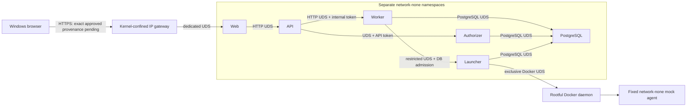

# ADR-0012: Minimal-network Docker-only WSL2 research architecture

**Status:** Proposed research direction; **ingress-provenance gate BLOCKED**. Not implementation or deployment approval.

**Date:** 2026-11-10

## Baseline, history and review scope

Repository base: `46348e19ff0e4ef7a2cd60f72987609d5fc32f47`; its main CI run 42721091712 passed. PRs #91, #94 and #95 are merged; #90 remains a separate open workstream at this baseline. No PR #90 migrations or event APIs are assumed here.

Earlier heads `f8643fa` and `7202e7a` proposed firewall-dependent bridge isolation. Security review withheld design approval because continuous watchdog/interlock enforcement was unresolved. This refinement supersedes that proposed bridge/watchdog mechanism, not the historical findings or existing runtime contracts. The owner reports Codex #1 and independent reviewers accepted **VIABLE FOR SECURITY DESIGN REFINEMENT** as the research direction; that is not approval of this revised commit.

See [ADR-0011](0011-independent-authorizer-process.md), [Compose operations](../../../infra/compose/README.md) and the [companion threat model](../../05-security/DOCKER_ONLY_WSL2_THREAT_MODEL.md). Existing Compose remains hybrid and unchanged. PR #91 proved disposable internal browser integration; its Chromium override is not deployed TLS or Windows ingress evidence.

## Proposed research decision and trust boundary

Investigate conditional Option B: separate network-none application/control-plane containers, restricted filesystem UDS channels, and one kernel-confined HTTPS gateway. Only the gateway needs an external IP interface. This uses the existing WSL2 kernel, not another host, VM or Kubernetes.

Rootful Docker, its administrators, the kernel, launcher and trusted bootstrap remain privileged authorities. Docker socket access is host-root-equivalent even when mounted read-only. API and worker receive no Docker socket or bootstrap privileges. Authorizer remains independent; compromised API owner attribution is still a residual trusted-API limitation. No provider credentials, real-provider execution or production broker activation is authorized.

**No API-to-PostgreSQL connection or credential is introduced.** API continues using worker/authorizer contracts. Network-none means separate namespaces, not a shared loopback or host network. No DNS-based service discovery is needed in the core.

## Component, transport and membership matrix

| Connection/component            | Verified current contract                                                      | Proposed conversion / source changes                                                    | Authority                                                    |
| ------------------------------- | ------------------------------------------------------------------------------ | --------------------------------------------------------------------------------------- | ------------------------------------------------------------ |
| Windows → gateway               | Proposed deployment HTTPS, not owner-host verified                             | New pinned HTTPS gateway/bootstrap; only IP-enabled application component               | Leaf key only; no daemon or core DB secret                   |
| Gateway → web                   | Separate ingress absent from current app Compose                               | New fixed HTTP-over-UDS upstream; no generic CONNECT/forward proxy                      | Dedicated gateway/web socket volume                          |
| Web → API                       | `apps/web/server.ts` validates HTTP api:4100 and proxies requests              | Change listener/upstream configuration to UDS; preserve header allowlist and streaming  | Web has only API channel, no DB/control-plane credentials    |
| API → worker                    | `apps/api/src/worker-client.ts` uses fetch and internal token; server uses TCP | HTTP-over-UDS client/listener, JSON and streaming implementation changes                | Retain internal token; no API database authority             |
| API → authorizer                | Restricted filesystem UDS plus API token                                       | Preserve transport; adapt provisioning/mapping, not authorization                       | Separate socket and secret custody                           |
| Worker/authorizer/launcher → DB | Existing separate role credentials and DB admission contracts                  | PostgreSQL local sockets; configure server, pools, provisioning and operational clients | Preserve runtime/authorizer/launcher roles and ACLs          |
| Worker → launcher               | Restricted UDS; strict Run/worker/generation and DB authorization              | Preserve; no existing launcher token claimed                                            | Lease/consumed-grant validation and single-use reservation   |
| Launcher → daemon               | Docker socket and fixed mock lifecycle                                         | Preserve exclusive UDS and host workspace mapping                                       | Root-equivalent launcher remains trusted                     |
| Agents                          | Fixed mock image/program, network none                                         | Preserve existing controls                                                              | No daemon, credentials or control-plane socket               |
| Migration/backup                | Privileged operational DB clients                                              | Short-lived network-none socket clients                                                 | Separate admin/migrator/backup credentials only while active |

Every core service uses `network_mode: none` in a future implementation. No application bridge, published core port, host network, shared network namespace or implicit fallback is allowed. Gateway receives only its private IP namespace and web socket. Source changes above, socket health checks, ownership provisioning, packaging/bootstrap and recovery tests are future separately authorized work; this PR changes none of them.

## Socket identity, ownership and filesystem contract

Proposed rootful/no-userns-remap identities: web 11002, API 11003, worker 11004, authorizer 11005, launcher 11006; distinct private primary groups. Socket groups: authorizer 12001 (API/authorizer only), launcher 12002 (worker/launcher only). New gateway-web, web-API and API-worker channels require distinct groups allocated after collision checks. PostgreSQL UID/GID comes from the pinned image; DB socket access never grants DB authorization by itself.

The reviewed one-shot provisioner initializes separate server-owned socket volumes: parent mode 2750 with setgid, umask 0007, socket mode 0660 and verified server UID/socket GID. Only server has directory write access; authorized clients mount only their needed socket directory read-only. Existing Node servers chmod sockets but do not automatically chgrp, so effective inheritance must be verified after every bind before readiness. Unexpected owner, symlink, stale socket type, mapping, mode or mount fails closed; no chmod 777, container-root repair or TCP fallback. Restart/recreation repeats checks and owner-scoped stale-socket cleanup.

Directory and token checks are not automatically SO_PEERCRED validation. Any new peer verification must be tested across actual namespaces and approved by Codex #1. Rootless/remapped daemon is unsupported until explicitly reviewed. Unrelated host/abstract sockets, Docker socket, host proc, shared PID namespaces and VSOCK access are denied except launcher's explicit daemon socket. Host administrator/launcher can defeat these boundaries and remain trusted.

## Gateway trusted bootstrap: unimplemented candidate

The bootstrap is a minimal digest-pinned trusted executable with no plugins, shell hooks or untrusted dependencies. Docker creates its private network namespace; bootstrap verifies expected namespace/interface/routes before any gateway application runs. Proposed startup requires namespace-local NET_ADMIN only; unprivileged high-port TLS avoids NET_BIND_SERVICE. Host network namespace, privileged mode and Docker socket are prohibited. Actual runtime capability and namespace mapping behavior must be proved.

1. Start only immutable bootstrap with application entrypoint withheld. No HTTP listener, provider configuration or production authority is released before confinement. Creating an interface before rules exist does not authorize untrusted application execution; bootstrap is part of the TCB and must itself perform no outbound resolution or network calls.
2. Install namespace-local nftables default-deny INPUT/OUTPUT for both IPv4/IPv6. Allow only the exact HTTPS listener flow and established reply packets derived from an admitted ingress connection. Deny new outbound IP, DNS UDP/TCP, DoH/DoT, LAN, gateways, metadata and alternate protocols. Do not broadly allow loopback or all conntrack-established traffic; flush inherited connection state and prove reply association cannot admit unrelated traffic. Permit minimal required neighbor control only after review.
3. Verify actual rule generation, local hooks/counters, no unexpected socket/descriptor, and exact interface mapping. The authorized ingress predicate remains blocked as specified below: bootstrap cannot release gateway merely because rules were installed.
4. Open only approved TLS/upstream resources, then irreversibly drop effective/permitted/inheritable/ambient capabilities and capability bounding set, supplementary setup groups and privilege-regain paths. Set no-new-privileges and reviewed seccomp; read-only root, private bounded writable state and non-root gateway identity. Verify the resulting privileges before exec. No setuid executable, writable executable or alternate entrypoint may regain policy authority.
5. Apply reviewed process restrictions preventing rule replacement, namespace entry/creation, packet/raw sockets, VSOCK and unnecessary device/syscall access. Evaluate Landlock filesystem restrictions as defense in depth where supported; do not treat it as assumed IP/UDS enforcement. Exact restrictions require gateway/Node/TLS runtime compatibility tests.
6. Execute only the fixed gateway after every mandatory check, including approved ingress provenance. Any failure exits without gateway startup and preserves quarantine. No recovery fallback removes controls.

Policy belongs to the gateway namespace and persists independently of a controller/watchdog process. After capability drop, a compromised gateway must be unable to change policy. No external watchdog crash detection is used as continuous prevention. Namespace destruction removes both the confined process and its policy; recreation always repeats bootstrap. Host-root/daemon malicious replacement is outside this boundary. Kernel bugs and runtime bypass remain residual risks.

## Ingress provenance: BLOCKED design gate

Proposed origin is `https://localhost:8443` with owner-controlled CA trust in Windows, offline CA private key and gateway leaf key only. Loopback Docker publication is requested, but it is not proof of provenance. WSL NAT/mirrored mode, Windows localhost forwarding, Docker DNAT/SNAT, userland proxies and bridge-local traffic may change the source observed inside gateway. A LAN or other-container connection must not become indistinguishable from authorized Windows-local traffic at the enforcement point.

No independently enforceable discriminator has been established. Candidate IP/interface/conntrack tuples are insufficient until actual path evidence proves prohibited clients cannot produce the same observations. Host/Origin headers, TLS encryption and owner login do not prove Windows-local network provenance; untrusted clients can select headers. Browser client certificates would be a new owner/security decision and are not assumed to identify physical network origin.

Required evidence on disposable target-host fixtures: simultaneously trace Windows-local, Windows/LAN nonlocal, WSL-local and unrelated-container attempts; record translation, ingress interface, source/destination and proxy path at every enforcement point. Prove authorized TLS succeeds and prohibited flows hit kernel denial, including direct bridge/container-IP access, IPv6 and alternate host interfaces. If disallowed traffic can arrive with the allowed predicate, reject it and keep gate blocked. Do not compensate with authentication alone or relaxed egress.

If no gateway-local discriminator exists, owner must explicitly consider a separate host-enforced ingress boundary or a revised gateway threat model. Neither exception is selected here. No final Docker-only compatibility claim or implementation approval is made.

## Descriptor transfer and allowed-channel relay

Network-none alone does not prevent acquisition of a connected IP descriptor over UDS. Apply the following status distinctions:

| Mechanism                            | Status / required design                                                                                            | Compatibility and evidence                                                                                                                          |
| ------------------------------------ | ------------------------------------------------------------------------------------------------------------------- | --------------------------------------------------------------------------------------------------------------------------------------------------- |
| Narrow filesystem UDS mounts         | Proposed; existing authorizer/launcher restricted sockets are established baseline                                  | Unauthorized groups, socket substitution, wrong server identity and recreation tests                                                                |
| AF_UNIX-only socket creation in core | Proposed seccomp socket/socketpair argument policy; deny AF_INET/AF_INET6/AF_PACKET/AF_VSOCK and namespace creation | Exercise Node, pg, pg-boss, health, shutdown and recovery; missing support blocks                                                                   |
| SCM_RIGHTS acquisition               | Requires testing and review; family filters do not restrict existing received descriptors                           | Evaluate denial of recvmsg/recvmmsg and io_uring descriptor-receive alternatives; runtime/library compatibility must pass; no unexamined fallback   |
| Inherited descriptors                | Proposed bootstrap closes all unexpected FDs before exec; explicit allowlist for stdio and approved resources       | Inspect actual descriptors, child inheritance and injected IP FDs; avoid leaking setup handles                                                      |
| Existing shared host sockets         | Prohibited except dedicated control channels and launcher's daemon socket                                           | Mount/FD/proc/namespace inventory plus host/VSOCK denial                                                                                            |
| Allowed-channel relay                | Residual threat despite descriptor denial                                                                           | Strict HTTP paths/schemas, no arbitrary proxy destinations or descriptor commands; test CONNECT/upgrade/SSRF and malicious authorized peer behavior |

A compromised gateway can still invoke the intended web channel and a compromised web can invoke API endpoints. Token/session/CSRF and narrow contracts remain required; transport isolation does not prove a trusted API's human intent. No general-purpose IP-to-UDS relay is introduced beyond fixed owner-facing HTTP reverse proxying.

## Application compatibility and persistence

Preserve exact HTTPS Origin/Host behavior, secure cookies, owner authentication, CSRF denial, JSON body limits/schema validation, API-worker internal token and API-authorizer token. Forward only approved headers. SSE must preserve replay cursor, event identities/order, cancellation, backpressure, session revocation and reconnect behavior; no buffering or arbitrary upgrades. WebSockets are denied absent a separately approved requirement.

API sessions are memory-backed (`apps/api/src/server.ts`, `session-store.ts`). **API restart invalidates active logins**; recovery tests must reauthenticate and retrieve committed records, not claim durable sessions. Worker/DB restart must preserve supported persisted Task/Run/events without fabricated completion, duplicate execution or automatic resubmission of unknown outcomes.

PostgreSQL sets no TCP listen address, uses restricted local sockets and explicit SCRAM role authentication; do not default local HBA to trust or grant the API DB access. Preserve existing runtime/authorizer/launcher/admin/migrator ACLs, pg-boss transactions, reconnection and pool behavior. Inspect current URL/env validation before changing socket configuration. Migration/backup clients remain short-lived, with privileged secrets excluded from runtime.

Keep persistent DB volume, authenticated encrypted backup outside that volume, separated decryption keys and protected independent copy. Proposed owner decisions remain daily backup, seven daily/four weekly retention, RPO24h/RTO4h subject to measured restore. Restore into a fresh volume; verify ACLs, sequences and event fingerprints before switching. Never restore over owner data. Canonical timestamps and ordering remain unchanged; operational display is Asia/Manila. Logs are bounded/redacted; audit state stays durable.

## Kernel and runtime prerequisites

Require actual WSL2 evidence for private network/PID/mount namespaces, namespace-local nftables INPUT/OUTPUT and IPv4/IPv6 behavior, capability/bounding-set drop, no-new-privileges, seccomp and required syscall argument filtering, filesystem UDS permissions, Docker network-none/entrypoint/restart behavior and supported pinned runtime. IPv6 disabled/absent is recorded, not claimed as tested enforcement. AppArmor/Landlock availability is unknown; if selected as mandatory they become hard prerequisites. Unsupported mandatory facility blocks startup/design advancement; no privileged mode, host networking, wider mount or default bridge fallback.

## Failure-state and negative-test matrix

All runtime tests below are **NOT RUN** for this candidate. Require permitted flows and observed denial, with packet/descriptor/privilege evidence.

| State                                 | Required prevention/recovery                                                              | Acceptance test status                                                   |
| ------------------------------------- | ----------------------------------------------------------------------------------------- | ------------------------------------------------------------------------ |
| Cold startup / partial initialization | No gateway exec before policy/provenance/privilege checks; core starts network-none       | Inject failure at each step, inspect traffic/FDs; NOT RUN                |
| Gateway compromise                    | Kernel denies new outbound traffic, policy mutation, unauthorized ingress and FD export   | Adversarial gateway fixture with capabilities removed; NOT RUN           |
| Controller/watchdog crash             | Existing namespace rules and no-IP core remain effective without polling                  | Kill controller, attempt all prohibited flows; NOT RUN                   |
| Docker daemon outage                  | No privilege widening; inspect live-restore behavior; uncertain execution remains unknown | Daemon outage in disposable environment; NOT RUN                         |
| WSL2 restart                          | Fresh bootstrap and socket checks; no stale release marker or unconfined restart          | Authorized disposable WSL recovery; NOT RUN                              |
| Policy replacement/removal            | Gateway cannot change rules or regain NET_ADMIN; root/daemon remain trusted               | Attempt replacement/namespace escape as gateway; NOT RUN                 |
| Endpoint recreation                   | New namespace cannot inherit a stale readiness authorization                              | Recreate and inject partial bootstrap failures; NOT RUN                  |
| DNS/metadata/direct-IP bypass         | Core no IP; gateway deny new IP across IPv4/IPv6/protocols                                | UDP/TCP DNS, alternate resolvers/DoH, VSOCK and metadata; NOT RUN        |
| Socket substitution / FD transfer     | Owner directories, verified identity, restricted receive/inheritance                      | Wrong socket, symlink, SCM_RIGHTS and inherited IP descriptor; NOT RUN   |
| PostgreSQL reconnect                  | Role authentication, ACLs and durable transactional state retained                        | SCRAM denial, pool/pg-boss recovery and duplicate launch checks; NOT RUN |
| SSE disconnect/recovery               | Correct replay/backpressure/revocation; API restart requires login                        | Disconnect/revoke/restart and same event IDs; NOT RUN                    |
| Cleanup                               | Stop scoped processes before volume/policy deletion; preserve DB and unrelated resources  | Failure at every cleanup boundary; NOT RUN                               |

## Alternatives and owner decision register

| Decision category     | Position                                                                                             | Gate                                                                             |
| --------------------- | ---------------------------------------------------------------------------------------------------- | -------------------------------------------------------------------------------- |
| Research direction    | Minimal-network core plus kernel-confined HTTPS gateway                                              | VIABLE FOR SECURITY DESIGN REFINEMENT as reported; new exact-head review pending |
| Unresolved design     | Trustworthy Windows-local ingress provenance                                                         | BLOCKED; no approved discriminator                                               |
| Future implementation | Immutable bootstrap, secret/FD lifecycle, capabilities/seccomp, fault model and kernel compatibility | Not authorized; Codex #1 and independent review required                         |
| Separate exception    | Host-managed ingress enforcement                                                                     | Owner exception needed; cannot label as fully Docker-managed                     |
| Separate exception    | Trust gateway with broader networking or weaker locality                                             | Changes threat model; not accepted implicitly                                    |
| Operational choices   | Origin/CA trust, rootful launcher trust, backups and target-host tests                               | Explicit owner decisions pending                                                 |

Option A in the prior comparison (hybrid host services) remains an explicit owner tradeoff. Conditional Option B is this refined research candidate. A separate daemon gateway remains rejected absent demonstrated confinement benefit: it adds root-equivalent TCB and duplicated authority. Existing fixed mock runtime, consumed-grant/lease validation, atomic authorization, launch deduplication and truthful unknown outcomes are unchanged.

## Finding traceability and sequential gates

F1 socket ownership: retained setgid/mapping/readiness design; runtime tests NOT RUN. F2 continuous prevention: replace mutable watchdog-dependent core policy with no-IP namespaces and proposed gateway-local immutable confinement; **ingress provenance remains BLOCKED**. F3 DNS bootstrap: core has no resolver dependency, gateway denies all new DNS/IP before application; runtime proof pending. F4 launcher authentication: preserve UDS plus database admission, no token invention. F5 lateral filtering: remove core bridge paths; allowed UDS relay/FD risks remain explicit.

1. Codex #1 and its independent reviewer reassess this exact commit, bootstrap/descriptor/provenance contracts and all earlier findings. Research acceptance is not APPROVE FOR DESIGN.
2. Separately authorized read-only WSL inventory establishes kernel/runtime/networking prerequisites without secrets or changes.
3. Only after the design gate and owner implementation authorization, build disposable bootstrap/IPC/TLS fixtures and run all positive/negative tests.
4. Independently review persistence, migration, fresh-volume restore and recovery evidence.
5. Separately authorized owner-host acceptance verifies Windows TLS, LAN/container denial, authentication/CSRF/SSE and WSL recovery. No provider activation.

This revision makes no claim that any candidate runtime test passed on the owner's host. PR remains Draft. No deployment or source-code changes are authorized.
