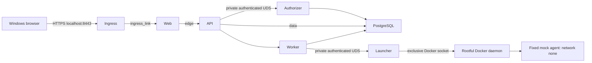

# ADR-0012: Docker-only WSL2 mock deployment and trusted control plane

**Status:** Proposed; implementation and deployment prohibited until the gates below are approved.

**Date:** 2026-11-10

## Context and verified baseline

Base: `46348e19ff0e4ef7a2cd60f72987609d5fc32f47`. PRs #91, #94 and #95 are merged; #90 is open. Main run 42721091712 was in progress when inspected, so this proposal does not claim that revision passed CI. PR #91 established disposable internal browser integration, not Windows ingress or production control-plane isolation.

The owner requires the existing WSL2 Ubuntu installation, rootful Docker, no additional host/VM or Kubernetes, and prefers Docker-managed services. Production execution remains deterministic mock-only. No synthetic broker activation, provider credentials or provider execution is authorized.

Existing contracts are in [ADR-0011](0011-independent-authorizer-process.md), [Compose operations](../../../infra/compose/README.md), and the [Docker-only threat model](../../05-security/DOCKER_ONLY_WSL2_THREAT_MODEL.md). ADR-0011's historical Proposed status is retained; merged implementation does not imply deployment approval.

## Proposed decision

Prefer Option B: independently containerized authorizer and launcher, with the launcher alone holding daemon access. This is conditional on security equivalence tests and Codex #1 approval. Retain Option A as a reference, not an implicitly accepted fallback. Reject an additional daemon gateway unless review demonstrates stronger confinement than the existing fixed launcher contract.

Rootful Docker administrators, the Docker daemon, kernel, launcher, trusted API owner-session boundary, authorizer, and provisioning operator are trusted authorities. Web, worker, synthetic agents and their dependencies are treated as compromise candidates. The API is also a compromise candidate: its current trusted owner attribution is a residual limitation, not protection against a malicious authenticated API.

## Service and network matrix

All networks below are internal except `ingress_publish`, whose ordinary bridge is prohibited until the explicit host policy is independently approved. No host networking is permitted. The diagram omits separate database access networks for clarity.

| Service | Membership | Allowed initiation | Secrets and identity |
|---|---|---|---|
| HTTPS ingress | ingress_publish, ingress_link | Web:8080 only | Dedicated non-root UID 11001; TLS leaf key only |
| Web | ingress_link, edge | API:4100 only | UID 11002; no DB/control-plane secret |
| API | edge, data | Worker:4101, DB:5432; authorizer UDS | UID 11003; runtime DB and API-authorizer token |
| Worker | data | DB:5432; launcher UDS | UID 11004; runtime DB and launcher token |
| PostgreSQL | data, auth_db, launch_db, ops_db | No initiated network traffic | UID from pinned image; database volume |
| Authorizer | auth_db | DB:5432 only | UID 11005; authorizer DB, decision-signing material |
| Launcher | launch_db | DB:5432; Docker UDS | UID 11006; launcher DB, worker-launcher token |
| Migration/backup jobs | ops_db, only while running | DB:5432 only | Separate short-lived operational credentials |
| Synthetic agents | network none | None | Non-root fixed identity; scoped workspace only |

No database port is published in this proposal. API/worker retain a shared data network for compatibility, but network membership is not permission: directional filtering must deny PostgreSQL/worker initiation to API except explicitly required established replies. Control-plane sockets use distinct volumes, mounted only into their two participants. Authorizer and launcher share neither sockets nor secrets.

## Host-enforced network policy

Compose alone is insufficient. A separately authorized host policy must be loaded before service startup and verified after daemon restart. It must cover forwarded traffic and host INPUT, rather than relying only on Docker's internal-network declaration or DOCKER-USER rules. No service receives NET_ADMIN to administer its own controls.

Use stable dedicated bridge identities and dynamically verified endpoint sets; default deny new connections for all application/control-plane bridge sources. Permit only the matrix TCP tuples, loopback-published HTTPS ingress, established replies and necessary bridge-local discovery. Deny host/bridge gateways, LAN, metadata, external IPv4 and IPv6 destinations, and all unspecified protocols. Block external DNS forwarding: configure a non-forwarding authoritative service-discovery resolver or demonstrate equivalent daemon-level query suppression without disrupting unrelated workloads. Docker embedded DNS upstream forwarding is an explicit unresolved gate; service discovery must continue to work. If per-project DNS suppression cannot be implemented safely, implementation is blocked.

The ordinary ingress bridge must not be created before this reviewed deny policy exists. Publishing is exactly `127.0.0.1:8443:8443`, with no IPv6 publication unless separately reviewed. IPv6 is denied even when disabled in a particular bridge; tests must distinguish absent IPv6 routing from active enforcement. Required evidence includes packet counters and active temporary listeners, not only sampled Internet connection failures. The approved policy mechanism/backend and atomic lifecycle are Gate 1 design deliverables; this ADR does not authorize firewall changes.

## Authorizer contract

Reuse `apps/authorizer/src/server.ts`, `app.ts`, `env.ts`, API authorizer client and database provisioner. Preserve schema validation, single-owner attribution, task-scoped mock grants, expiry/revocation checks and transactional decision/audit writes. Use only `omnis_authorizer`, never admin/migration/runtime credentials.

Assign unique fixed service UIDs/GIDs and document their host mapping before startup. Do not reuse UID 10001 for all services. Separate private primary groups and socket groups; socket directories 0750, sockets 0660, secret files 0400/0600 and no world-readable mounts. Compose secrets are mounted files, not an encrypted vault or protection from daemon root. No shared PID namespace, host PID namespace, Docker socket or application-code writable mount.

API authentication retains the existing token plus restricted UDS contract. UDS peer UID inspection must be tested across actual namespace mappings; it must never treat a shared/reused numeric UID as unique service identity. Containerization must not silently add a peer-check bypass. Strict request schemas, bounded requests and same-key idempotent readback remain mandatory. Lost responses remain unknown until authoritative database readback.

Existing static token authentication does not supply general per-request signatures, cryptographic expiry or a replay ledger. Grant expiry/revocation and database idempotency are distinct controls. Codex #1 must decide whether synthetic deployment can retain that residual risk or requires signed method/path/body/request-ID/expiry binding and replay storage. No such backend contract is implemented by this PR. Coordinate token rotation with a maintenance window and fail closed on mismatch; overlapping-key/zero-downtime rotation requires an approved contract and regression tests. Restart reads durable decisions; it cannot mint replacement authority.

## Launcher contract

Reuse `apps/sandbox-launcher/src/service.ts`, `server.ts` and `docker-sandbox.ts`. Launcher alone may access the rootful daemon socket. Even a read-only mount permits mutating Docker API calls and is host-root-equivalent. Docker admins and a compromised launcher can defeat container/secret boundaries; ordinary container restrictions cannot remove this residual authority.

Worker requests contain only the existing Run/worker/generation schema. Verify current lease, expiry, consumed/unrevoked task-scoped mock grant and single launch reservation in PostgreSQL. Worker cannot select image, program, environment, host path, devices or networking. Reuse the existing pinned image and fixed program, network none, read-only root, dropped capabilities, no-new-privileges, bounded CPU/memory/PIDs/time, and narrow writable workspace.

Use a dedicated absolute host workspace root, mapped at the identical absolute path inside launcher because the host daemon resolves bind sources. No arbitrary caller path, symlink escape or mounts outside that root; ownership, no-follow containment and cleanup require adversarial tests. Do not mount owner home or repository into launcher. Authorize only operations required by the existing scoped create/start/inspect/log/wait/stop/remove lifecycle. A compromised direct-socket launcher can exceed that allowlist; it is a code contract, not daemon-enforced confinement.

Preserve durable reservations and launch deduplication. After response loss or restart, inspect only authorized run-scoped container identities and reconcile with durable generation/lease state. Never automatically resubmit uncertain work. Missing evidence remains unknown. Cleanup must not touch unrelated containers or volumes.

A separate gateway would only improve confinement if it independently revalidates authority and rejects arbitrary Docker API calls, paths and container configuration. It duplicates critical validation, adds authentication/recovery state, and remains root-equivalent. Do not introduce it without a demonstrated threat reduction and independent review.

## HTTPS ingress and browser contract

Proposed exact origin: `https://localhost:8443`. Owner must approve the port and certificate trust method. Issue a localhost SAN leaf certificate using an owner-controlled local CA; install only its trust certificate into Windows after authorization. Keep CA private key offline/outside containers; mount only leaf key/certificate into ingress. Document expiry, renewal and key permissions. Do not use browser certificate-warning bypasses.

Preserve Origin/Cookie/Set-Cookie and idempotency headers. API allowed origin must equal the exact approved origin and secure cookies remain enabled. Preserve authenticated CSRF denial, session revocation and SSE authorization; disable SSE buffering and use bounded reconnect/idle behavior compatible with existing contracts. No WebSocket feature is assumed; deny upgrade requests unless an approved application requirement exists. Reject unexpected Host values and upstream routing; prevent an open forward proxy.

Independently test container TLS, WSL loopback, Windows localhost and denial from LAN/non-loopback interfaces in the owner's actual WSL mode. A normal bridge control published successfully on CI Docker 28.0.4, while the internal bridge had empty effective ports and ECONNREFUSED. Neither proves target WSL behavior. Do not change WSL networking mode automatically. Test trusted TLS, secure cookies, authentication, CSRF, SSE reconnect/revocation, `isSecureContext` and `crypto.randomUUID` without Chromium overrides. HTTP localhost's browser exception is not TLS acceptance.

## Persistence and operations

Keep a dedicated named PostgreSQL volume in the WSL Linux filesystem. Pin the existing database image digest. Do not initialize a second cluster against an existing volume. Use one-shot reviewed provisioning/migration jobs with admin/migrator credentials mounted only while active; serialize migration execution and require successful completion before runtime startup. Runtime and authorizer/launcher roles retain existing least-privilege grants. Migration rollback is a tested compatibility/restore procedure, not blind down-migration.

Reuse `scripts/db-recovery/backup.mjs`, `restore-verify.mjs` and disposable recovery tests. Encrypt/authenticate backups; store outside the primary volume and maintain an independently protected off-device copy. Keep decryption keys separate. Proposed policy for owner approval: daily backups, seven daily and four weekly copies, RPO 24 hours, provisional RTO four hours subject to measured restore. Restore into a fresh database/volume, verify role ACLs, audit/event fingerprints, sequences and settled-state policy before switching. Never validate restore over owner data.

Compose health dependencies coordinate DB, worker, API, web and ingress. Socket/authentication readiness needs explicit preflight. Restart policies do not replace durable recovery. Test worker/API/DB restart, container recreation, Docker daemon restart and WSL shutdown/start separately, preserving committed Task/Run/events and unknown outcomes. Configure bounded container log rotation and redaction; retain security audit events durably in PostgreSQL. Proposed local logs: 10 MiB x 3 per service, owner-approved protected audit export retention. Canonical timestamps/order remain unchanged; operations display Asia/Manila.

PR #90 remains an independent open workstream. Do not assume migration 0029 or Mission Lane V2 endpoints exist on this base; rebase/review migration and event persistence acceptance after it merges. No edits to that branch are authorized.

## Alternatives

| Option | Benefits | Limitations and gates | Effort/recovery |
|---|---|---|---|
| A: hybrid | Reuses systemd identities and service hardening | Owner acceptance of host services; ingress and target-host validation still missing | Lowest implementation; coordinate Compose and systemd recovery |
| B: Docker-managed control plane | Matches owner preference; one service lifecycle | Rootful daemon still trusted; identity, UDS, secrets, workspace and network equivalence unproven | Moderate/high; explicit socket/daemon/database reconciliation |
| C: daemon gateway | Potential independent restriction of daemon operations | Extra root-equivalent TCB; duplicated authorization and new protocol/replay risks | Highest effort and recovery complexity; benefit must be demonstrated |

All can run on existing WSL2 in principle. None is deployment-approved. Preferred B is conditional, not a claim of security equivalence.

## Sequential acceptance gates and owner decisions

1. **Gate 1: security architecture.** Codex #1 reviews contracts and arranges an independent read-only security review. Resolve namespace identities, DNS/host egress enforcement, launcher workspace mapping and residual API/daemon trust. Exact documentation head and verdict must be recorded. Owner explicitly approves architecture before implementation.
2. **Gate 2: authorized inventory.** Codex #3 records WSL/Windows/kernel/Docker versions, NAT/mirrored mode, socket ownership, daemon security/backend, storage and existing policies without reading secrets. No elevated bypass or probes without authorization.
3. **Gate 3: disposable topology.** After implementation authorization, build isolated fixtures with unique project resources. Prove all allowed/denied matrix paths, UDS ownership/authentication, fail-closed prerequisites, TLS and secret isolation. Independent platform/security review plus Codex #2 browser QA.
4. **Gate 4: persistence.** Verify migration permissions, restart/recreation and fresh-volume restore, unknown-state preservation and scoped cleanup. Codex #1 owns backend semantics; independent review required.
5. **Gate 5: owner host.** Separate authorization for Windows TLS/browser access, CSRF/SSE, LAN denial, host policy, daemon and WSL recovery. Preserve existing data with verified backup/rollback. No provider activation.

| Owner decision | Proposed choice | Approval state |
|---|---|---|
| Trusted rootful daemon/launcher and API residual authority | Explicitly accept only within reviewed mock scope | Pending |
| Docker-only control-plane design | Conditional Option B | Pending Codex #1 and independent review |
| Host policy allowed despite Docker-managed application services | Required for equivalent enforcement; no host application daemon | Pending; conflict blocks implementation if declined |
| Origin/certificate trust | HTTPS localhost:8443, owner-controlled CA | Pending |
| Backup location, retention, RPO/RTO and keys | Policy above with independent copy | Pending |
| Implementation and target-host operations | Separate authorizations after design | Not authorized |

## Review record

Codex #1 backend/security review: requested through the Draft PR handoff; pending. Codex #1 must arrange its own independent reviewer. A separate platform documentation review is supplementary and cannot replace that process. No approval is asserted here.
