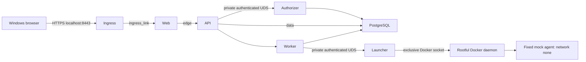

# ADR-0012: Docker-only WSL2 mock deployment and trusted control plane

**Status:** Proposed; implementation and deployment prohibited until the gates below are approved.

**Date:** 2026-11-10

## Context and verified baseline

Base: `46348e19ff0e4ef7a2cd60f72987609d5fc32f47`. PRs #91, #94 and #95 are merged; #90 is open. Main run 42721091712 was initially in progress and subsequently completed successfully; this is application CI evidence, not deployment approval. PR #91 established disposable internal browser integration, not Windows ingress or production control-plane isolation.

The owner requires the existing WSL2 Ubuntu installation, rootful Docker, no additional host/VM or Kubernetes, and prefers Docker-managed services. Production execution remains deterministic mock-only. No synthetic broker activation, provider credentials or provider execution is authorized.

Existing contracts are in [ADR-0011](0011-independent-authorizer-process.md), [Compose operations](../../../infra/compose/README.md), and the [Docker-only threat model](../../05-security/DOCKER_ONLY_WSL2_THREAT_MODEL.md). ADR-0011's historical Proposed status is retained; merged implementation does not imply deployment approval.

## Proposed decision

Prefer Option B: independently containerized authorizer and launcher, with the launcher alone holding daemon access. This is conditional on security equivalence tests and Codex #1 approval. Retain Option A as a reference, not an implicitly accepted fallback. Reject an additional daemon gateway unless review demonstrates stronger confinement than the existing fixed launcher contract.

Rootful Docker administrators, the Docker daemon, kernel, launcher, trusted API owner-session boundary, authorizer, and provisioning operator are trusted authorities. Web, worker, synthetic agents and their dependencies are treated as compromise candidates. The API is also a compromise candidate: its current trusted owner attribution is a residual limitation, not protection against a malicious authenticated API.

## Service and network matrix

All networks below are internal except `ingress_publish`, whose ordinary bridge is prohibited until the explicit host policy is independently approved. No host networking is permitted. The diagram omits separate database access networks for clarity.

| Service               | Membership                       | Allowed initiation                   | Secrets and identity                                |
| --------------------- | -------------------------------- | ------------------------------------ | --------------------------------------------------- |
| HTTPS ingress         | ingress_publish, ingress_link    | Web:8080 only                        | Dedicated non-root UID 11001; TLS leaf key only     |
| Web                   | ingress_link, edge               | API:4100 only                        | UID 11002; no DB/control-plane secret               |
| API                   | edge, data                       | Worker:4101, DB:5432; authorizer UDS | UID 11003; runtime DB and API-authorizer token      |
| Worker                | data                             | DB:5432; launcher UDS                | UID 11004; runtime DB; restricted launcher UDS      |
| PostgreSQL            | data, auth_db, launch_db, ops_db | No initiated network traffic         | UID from pinned image; database volume              |
| Authorizer            | auth_db                          | DB:5432 only                         | UID 11005; authorizer DB, decision-signing material |
| Launcher              | launch_db                        | DB:5432; Docker UDS                  | UID 11006; launcher DB; restricted worker UDS       |
| Migration/backup jobs | ops_db, only while running       | DB:5432 only                         | Separate short-lived operational credentials        |
| Synthetic agents      | network none                     | None                                 | Non-root fixed identity; scoped workspace only      |

No database port is published in this proposal. API/worker retain a shared data network for compatibility, but network membership is not permission: directional filtering must deny PostgreSQL/worker initiation to API except explicitly required established replies. Control-plane sockets use distinct volumes, mounted only into their two participants. Authorizer and launcher share neither sockets nor secrets.

## Host-enforced network policy

Compose alone is insufficient. A separately authorized host policy must be loaded before service startup and verified after daemon restart. It must cover forwarded traffic and host INPUT, rather than relying only on Docker's internal-network declaration or DOCKER-USER rules. No service receives NET_ADMIN to administer its own controls.

Use stable dedicated bridge identities and dynamically verified endpoint sets; default deny new connections for all application/control-plane bridge sources. Permit only the matrix TCP tuples, loopback-published HTTPS ingress, established replies and necessary bridge-local discovery. Deny host/bridge gateways, LAN, metadata, external IPv4 and IPv6 destinations, and all unspecified protocols. Block external DNS forwarding: configure a non-forwarding authoritative service-discovery resolver or demonstrate equivalent daemon-level query suppression without disrupting unrelated workloads. Docker embedded DNS upstream forwarding is an explicit unresolved gate; service discovery must continue to work. If per-project DNS suppression cannot be implemented safely, implementation is blocked.

The ordinary ingress bridge must not be created before this reviewed deny policy exists. Publishing is exactly `127.0.0.1:8443:8443`, with no IPv6 publication unless separately reviewed. IPv6 is denied even when disabled in a particular bridge; tests must distinguish absent IPv6 routing from active enforcement. Required evidence includes packet counters and active temporary listeners, not only sampled Internet connection failures. The approved policy mechanism/backend and atomic lifecycle are Gate 1 design deliverables; this ADR does not authorize firewall changes.

## Authorizer contract

Reuse `apps/authorizer/src/server.ts`, `app.ts`, `env.ts`, API authorizer client and database provisioner. Preserve schema validation, single-owner attribution, task-scoped mock grants, expiry/revocation checks and transactional decision/audit writes. Use only `omnis_authorizer`, never admin/migration/runtime credentials.

Assign unique fixed service UIDs/GIDs and document their host mapping before startup. Do not reuse UID 10001 for all services. Separate private primary groups and socket groups; socket directories 2750 with verified group inheritance, sockets 0660, secret files 0400/0600 and no world-readable mounts. Compose secrets are mounted files, not an encrypted vault or protection from daemon root. No shared PID namespace, host PID namespace, Docker socket or application-code writable mount.

API authentication retains the existing token plus restricted UDS contract. UDS peer UID inspection must be tested across actual namespace mappings; it must never treat a shared/reused numeric UID as unique service identity. Containerization must not silently add a peer-check bypass. Strict request schemas, bounded requests and same-key idempotent readback remain mandatory. Lost responses remain unknown until authoritative database readback.

Existing static token authentication does not supply general per-request signatures, cryptographic expiry or a replay ledger. Grant expiry/revocation and database idempotency are distinct controls. Codex #1 must decide whether synthetic deployment can retain that residual risk or requires signed method/path/body/request-ID/expiry binding and replay storage. No such backend contract is implemented by this PR. Coordinate token rotation with a maintenance window and fail closed on mismatch; overlapping-key/zero-downtime rotation requires an approved contract and regression tests. Restart reads durable decisions; it cannot mint replacement authority.

## Launcher contract

Reuse `apps/sandbox-launcher/src/service.ts`, `server.ts` and `docker-sandbox.ts`. Launcher alone may access the rootful daemon socket. Even a read-only mount permits mutating Docker API calls and is host-root-equivalent. Docker admins and a compromised launcher can defeat container/secret boundaries; ordinary container restrictions cannot remove this residual authority.

Current verified implementation: worker authentication is restricted Unix-domain socket access; `apps/sandbox-launcher/src/service.ts` has no worker-token authentication hook. Database-backed authorization in `server.ts` validates admission; grant consumption and launch reservation remain governed by the existing database lifecycle. Preserve that contract. A new token, rotation scheme or cryptographic peer protocol would be a future Codex #1-approved backend change, not an existing or automatically approved feature. Worker requests contain only the existing Run/worker/generation schema. Verify current lease, expiry, consumed/unrevoked task-scoped mock grant and single launch reservation in PostgreSQL. Worker cannot select image, program, environment, host path, devices or networking. Reuse the existing pinned image and fixed program, network none, read-only root, dropped capabilities, no-new-privileges, bounded CPU/memory/PIDs/time, and narrow writable workspace.

Use a dedicated absolute host workspace root, mapped at the identical absolute path inside launcher because the host daemon resolves bind sources. No arbitrary caller path, symlink escape or mounts outside that root; ownership, no-follow containment and cleanup require adversarial tests. Do not mount owner home or repository into launcher. Authorize only operations required by the existing scoped create/start/inspect/log/wait/stop/remove lifecycle. A compromised direct-socket launcher can exceed that allowlist; it is a code contract, not daemon-enforced confinement.

Preserve durable reservations and launch deduplication. After response loss or restart, inspect only authorized run-scoped container identities and reconcile with durable generation/lease state. Never automatically resubmit uncertain work. Missing evidence remains unknown. Cleanup must not touch unrelated containers or volumes.

A separate gateway would only improve confinement if it independently revalidates authority and rejects arbitrary Docker API calls, paths and container configuration. It duplicates critical validation, adds authentication/recovery state, and remains root-equivalent. Do not introduce it without a demonstrated threat reduction and independent review.

## HTTPS ingress and browser contract

Proposed exact origin: `https://localhost:8443`. Owner must approve the port and certificate trust method. Issue a localhost SAN leaf certificate using an owner-controlled local CA; install only its trust certificate into Windows after authorization. Keep CA private key offline/outside containers; mount only leaf key/certificate into ingress. Document expiry, renewal and key permissions. Do not use browser certificate-warning bypasses.

Preserve Origin/Cookie/Set-Cookie and idempotency headers. API allowed origin must equal the exact approved origin and secure cookies remain enabled. Preserve authenticated CSRF denial, session revocation and SSE authorization; disable SSE buffering and use bounded reconnect/idle behavior compatible with existing contracts. No WebSocket feature is assumed; deny upgrade requests unless an approved application requirement exists. Reject unexpected Host values and upstream routing; prevent an open forward proxy.

Independently test container TLS, WSL loopback, Windows localhost and denial from LAN/non-loopback interfaces in the owner's actual WSL mode. A normal bridge control published successfully on CI Docker 28.0.4, while the internal bridge had empty effective ports and ECONNREFUSED. Neither proves target WSL behavior. Do not change WSL networking mode automatically. Test trusted TLS, secure cookies, authentication, CSRF, SSE reconnect/revocation, `isSecureContext` and `crypto.randomUUID` without Chromium overrides. HTTP localhost's browser exception is not TLS acceptance.

## Persistence and operations

Keep a dedicated named PostgreSQL volume in the WSL Linux filesystem. Pin the existing database image digest. Do not initialize a second cluster against an existing volume. Use one-shot reviewed provisioning/migration jobs with admin/migrator credentials mounted only while active; serialize migration execution and require successful completion before runtime startup. Runtime and authorizer/launcher roles retain existing least-privilege grants. Migration rollback is a tested compatibility/restore procedure, not blind down-migration.

Reuse `scripts/db-recovery/backup.mjs`, `restore-verify.mjs` and disposable recovery tests. Encrypt/authenticate backups; store outside the primary volume and maintain an independently protected off-device copy. Keep decryption keys separate. Proposed policy for owner approval: daily backups, seven daily and four weekly copies, RPO 24 hours, provisional RTO four hours subject to measured restore. Restore into a fresh database/volume, verify role ACLs, audit/event fingerprints, sequences and settled-state policy before switching. Never validate restore over owner data.

Compose health dependencies coordinate DB, worker, API, web and ingress. Socket/authentication readiness needs explicit preflight. Restart policies do not replace durable recovery. Test worker/API/DB restart, container recreation, Docker daemon restart and WSL shutdown/start separately, preserving committed Task/Run/events and unknown outcomes. Configure bounded container log rotation and redaction; retain security audit events durably in PostgreSQL. Proposed local logs: 10 MiB x 3 per service, owner-approved protected audit export retention. Canonical timestamps/order remain unchanged; operations display Asia/Manila.

PR #90 remains an independent open workstream. Do not assume migration 0029 or Mission Lane V2 endpoints exist on this base; rebase/review migration and event persistence acceptance after it merges. No edits to that branch are authorized.

## Alternatives

| Option                          | Benefits                                               | Limitations and gates                                                                            | Effort/recovery                                                      |
| ------------------------------- | ------------------------------------------------------ | ------------------------------------------------------------------------------------------------ | -------------------------------------------------------------------- |
| A: hybrid                       | Reuses systemd identities and service hardening        | Owner acceptance of host services; ingress and target-host validation still missing              | Lowest implementation; coordinate Compose and systemd recovery       |
| B: Docker-managed control plane | Matches owner preference; one service lifecycle        | Rootful daemon still trusted; identity, UDS, secrets, workspace and network equivalence unproven | Moderate/high; explicit socket/daemon/database reconciliation        |
| C: daemon gateway               | Potential independent restriction of daemon operations | Extra root-equivalent TCB; duplicated authorization and new protocol/replay risks                | Highest effort and recovery complexity; benefit must be demonstrated |

All can run on existing WSL2 in principle. None is deployment-approved. Preferred B is conditional, not a claim of security equivalence.

## Sequential acceptance gates and owner decisions

1. **Gate 1: security architecture.** Codex #1 reviews contracts and arranges an independent read-only security review. Resolve namespace identities, DNS/host egress enforcement, launcher workspace mapping and residual API/daemon trust. Exact documentation head and verdict must be recorded. Owner explicitly approves architecture before implementation.
2. **Gate 2: authorized inventory.** Codex #3 records WSL/Windows/kernel/Docker versions, NAT/mirrored mode, socket ownership, daemon security/backend, storage and existing policies without reading secrets. No elevated bypass or probes without authorization.
3. **Gate 3: disposable topology.** After implementation authorization, build isolated fixtures with unique project resources. Prove all allowed/denied matrix paths, UDS ownership/authentication, fail-closed prerequisites, TLS and secret isolation. Independent platform/security review plus Codex #2 browser QA.
4. **Gate 4: persistence.** Verify migration permissions, restart/recreation and fresh-volume restore, unknown-state preservation and scoped cleanup. Codex #1 owns backend semantics; independent review required.
5. **Gate 5: owner host.** Separate authorization for Windows TLS/browser access, CSRF/SSE, LAN denial, host policy, daemon and WSL recovery. Preserve existing data with verified backup/rollback. No provider activation.

| Owner decision                                                  | Proposed choice                                                 | Approval state                                      |
| --------------------------------------------------------------- | --------------------------------------------------------------- | --------------------------------------------------- |
| Trusted rootful daemon/launcher and API residual authority      | Explicitly accept only within reviewed mock scope               | Pending                                             |
| Docker-only control-plane design                                | Conditional Option B                                            | Pending Codex #1 and independent review             |
| Host policy allowed despite Docker-managed application services | Required for equivalent enforcement; no host application daemon | Pending; conflict blocks implementation if declined |
| Origin/certificate trust                                        | HTTPS localhost:8443, owner-controlled CA                       | Pending                                             |
| Backup location, retention, RPO/RTO and keys                    | Policy above with independent copy                              | Pending                                             |
| Implementation and target-host operations                       | Separate authorizations after design                            | Not authorized                                      |

## Review record

Codex #1 backend/security review: requested through the Draft PR handoff; pending. Codex #1 must arrange its own independent reviewer. A separate platform documentation review is supplementary and cannot replace that process. No approval is asserted here.

## Concrete enforcement candidate and open design findings

Supplementary platform review of commit `1ddb8cd` returned **REQUEST CHANGES**: network lifecycle/DNS enforcement, container hardening equivalence and UID/socket mapping require refinement. The candidate below addresses the design detail; it is not independently approved. Gate 1 remains blocked until Codex #1 and its reviewer confirm it.

### F2 — Network authority and lifecycle (BLOCKER)

**Architecture gate: BLOCKED.** No proven Docker-only watchdog is selected. The proposal does not claim continuous enforcement or implementation readiness. A container with host network namespace and NET_ADMIN could modify all host network policy; adding Docker socket access would also make it root-equivalent. A privileged watchdog container is not approved by this ADR. A systemd watchdog would be a host-managed dependency and therefore requires an explicit owner architecture exception; it cannot be described as Docker-only.

The proposed one-shot policy orchestrator is a separately authorized host-root operation, not an ordinary application container. Its required powers are host nftables administration, entering identified project network namespaces to install filtering, and Docker lifecycle control (root-equivalent). It runs only after Docker is available and before any application entrypoint is released. Its code/configuration must be root-owned and outside application-writable mounts. Ordinary services receive no NET_ADMIN, host network namespace or Docker socket. This operational requirement itself needs owner acceptance under the Docker-only preference.

Install persistent default-deny project rules before endpoint creation; do not expose ingress first. Keep all proposed service/agent restart policies disabled. Gate startup on an inspected policy generation/hash, expected interfaces/endpoint sets, socket permissions and positive/negative disposable probes. A trusted policy verifier, separate from application readiness, must verify actual rules and counters; an application-reported healthy flag is insufficient.

For continuous operation the required watchdog contract is: verify expected rule generation, interface membership and namespace rules on Docker lifecycle events plus bounded periodic checks; close admission and stop project endpoints/agents on drift, verifier failure or lost policy lease; leave deny rules installed. The watchdog's own death must cause an independent fail-closed interlock to close admission and stop endpoints. **That independent interlock, its authority, crash window and maximum detection interval are unresolved; no watchdog crash-safety guarantee is claimed.** Until independently approved, services and agents must not be started for deployment, including manually supervised operation presented as equivalent protection.

After Docker/WSL restart, never auto-start services or restore a stale readiness marker. Re-run policy-first inventory, namespace/bootstrap, probes and permission validation. Restore availability only on a new verified generation. Partial failure stops endpoints first and retains deny policy. Rollback/cleanup verifies all project endpoints stopped/detached before deleting only project-owned rules/namespaces; preserve DB volumes and unrelated policy. If shutdown cannot be proved, retain the deny rules and report failure.

Owner alternatives: approve a separately reviewed host-managed enforcement/interlock exception (Option A plus explicit policy dependency), approve research into a Docker-managed privileged enforcer with a demonstrable independent failure interlock, or keep Option B blocked. None is silently selected. This documentation remediation specifies the missing requirement without pretending to solve it.

### F3 — DNS bootstrap and namespace barrier (required before implementation)

Candidate sequence, dependent on resolution of F2:

1. Validate Docker mode, kernel hooks, unique project labels, immutable images, fixed names/addresses and no conflicting UIDs. Install host/bridge deny rules. Create containers with `restart: no` and a digest-pinned trusted bootstrap entrypoint, not the application entrypoint. Container creation/start must not launch an unguarded application process.
2. Bootstrap has no secrets, application executable, network capability or untrusted code execution. Its only action is waiting on a private, non-network local release channel. It must time out and exit on missing authorization. This requires new reviewed packaging; no such barrier exists today. Its own potential Docker DNS traffic must be measured and eliminated before accepting the design.
3. The root orchestrator verifies container ID, PID start time, network namespace inode and project labels, then enters that exact namespace. Install `inet` OUTPUT default deny plus INPUT reply policy covering IPv4/IPv6; permit only fixed matrix tuples. Explicitly deny all UDP/TCP port 53, including `127.0.0.11`, loopback resolver alternatives, gateways and direct external resolvers. Deny external destinations on all other ports/protocols; this also denies DoH/DoT and literal-IP bypass. No unrestricted loopback accept preceding the DNS deny.
4. Render and verify fixed `/etc/hosts` mappings for required peers; no external resolver is used. Validate behavior against Docker's actual embedded-resolver DNAT path using namespace counters/traces and captured queries at an independent controlled listener. Blocking only the apparent original destination is not accepted without proof. TCP DNS, UDP DNS and IPv6 must each be tested.
5. Only after exact rules, mapping, host/bridge filters and live negative probes pass, mount/deliver service-specific secrets through a reviewed release mechanism and release the application entrypoint. That secret/release mechanism is future implementation requiring security review; no application execution before release. A partial setup, stale PID/namespace, wrong generation or failed probe exits and quarantines the project without release.
6. During operation F2 policy loss stops admission/endpoints. Recreation always creates a new namespace and repeats steps 1–5; no reuse of namespace rules/readiness files. Shutdown closes admission, stops agents/applications, verifies endpoints detached, and removes namespace/project rules only afterward. WSL/daemon recovery repeats the full sequence. Crash cleanup uses an ownership journal and inspected labels; unresolved endpoints keep deny rules and no broad prune is allowed.

Acceptance must capture attempted DNS/DoH/literal-IP transmission during every bootstrap phase, partial failure, daemon restart and recreation. Zero pre-release application packets, blocked external queries and successful hosts-based approved traffic are required observations. These are proposed tests, not target-host results.

### F5 — Same-bridge packet paths (required before implementation)

Use a project-owned nftables `bridge` family FORWARD chain for L2-switched same-bridge frames; do not depend on `br_netfilter` translating them into an `inet` FORWARD path. Match inspected ingress/egress veth identities and fixed endpoint sets; reject source MAC/IP spoofing. Permit only matrix-directed TCP requests and explicitly validated replies. Permit minimal scoped ARP/IPv6 neighbor discovery needed for approved peers; reject other EtherTypes, unsolicited multicast and unauthorized NDP/router advertisements. IPv6 defaults to deny unless its explicit matrix and neighbor policy pass tests.

Use separate `inet` INPUT rules for packets delivered to host/bridge gateway and `inet` FORWARD rules for routed/cross-bridge destinations and DNAT-published ingress. Namespace OUTPUT policy from F3 is an independent barrier, not a substitute for bridge tests. Select explicit hook priorities after inspecting Docker's real backend; an accept in another chain must not bypass a required drop. Validate established-flow tracking for the chosen bridge implementation instead of assuming routed conntrack semantics. Unsupported hooks or ambiguous packet paths fail startup.

Before release, trace controlled same-bridge packets through named rules and counters: web→API:4100, API→worker:4101 and approved DB:5432 paths succeed; reverse new connections, web→worker/DB, worker/DB→API, control-plane cross-access, gateway/metadata/LAN/Internet and direct DNS all fail. Test both permitted replies and unauthorized new flows. Multi-homed service forwarding/routing is disabled and tested. Attack with changed source IP/MAC and a disposable unauthorized peer on each project bridge. Test IPv4, IPv6 and DNS separately. Never attach probes to owner networks.

Network recreation invalidates interface indices, endpoint sets and generation; stop affected project services and rebuild policy before release. Missing/removed bridge rules is an F2 drift event, not a reason to continue with namespace-only protection. Actual traces, packet counters, injected rule deletion and recreation tests are required before claiming coverage.

| Existing systemd guarantee                | Proposed container equivalent                                                                              | Acceptance                                                   |
| ----------------------------------------- | ---------------------------------------------------------------------------------------------------------- | ------------------------------------------------------------ |
| ProtectSystem/ProtectHome                 | Read-only image/root; no home or repository mount                                                          | Writes and forbidden reads denied                            |
| PrivateTmp/private devices                | Bounded noexec/nosuid/nodev tmpfs; default minimal devices, no device mounts                               | Cross-service temp/device access denied                      |
| NoNewPrivileges/SUID restrictions         | no-new-privileges, cap_drop ALL, non-root, immutable image                                                 | Inspect effective caps; privilege escalation attempts denied |
| Process/kernel/control-group restrictions | Private PID/IPC namespaces, no host proc/sys/cgroup mounts; default seccomp plus reviewed AppArmor profile | Namespace/LSM inspection and kernel-control write denials    |
| Resource bounds                           | Authorizer: 0.5 CPU, 384 MiB, 64 PIDs; launcher proposed 0.5 CPU, 512 MiB, 128 PIDs                        | OOM/PID bounds and fail-closed recovery                      |
| Private writable paths                    | Only authorizer socket directories; launcher socket and exact workspace root                               | Mount allowlist and symlink/ownership tests                  |
| Protected deployed code                   | Digest-pinned images, no writable code/dependency mount                                                    | Image/mount inspection                                       |

Explicit exception: launcher Docker socket authority defeats these protections after launcher compromise. No seccomp/LSM or read-only mount is claimed to constrain Docker daemon root authority.

### F1 — Socket ownership and restart contract (BLOCKER correction)

The authorized provisioning orchestrator creates and owns the lifecycle of two separate socket volumes. Authorizer directory owner is host/container UID 11005, group 12001; launcher directory owner UID 11006, group 12002. Service private primary GIDs equal their UIDs. API UID 11003 receives supplemental GID 12001 only; worker UID 11004 receives 12002 only. Servers also receive their matching socket group. Directory mode is **2750**, including setgid; socket mode is **0660**, with owning server UID and inherited socket GID. Umask **0007** is set before socket creation; it cannot replace explicit final mode checks. Clients require directory traversal and group write permission on the socket, not directory write access.

A short-lived reviewed provisioning step initializes only empty dedicated volumes, rejects symlinks/unexpected entries and sets ownership/modes before either server starts. API mounts only the authorizer volume read-only; worker mounts only the launcher volume read-only; each server mounts its own socket volume writable. Read-only client mount does not prevent UDS connection. No peer can alter the parent's ownership. Servers must preserve setgid directory mode, and a pre-readiness validator must inspect the actual newly bound socket UID/GID/mode before exposing readiness. Existing server code only chmods sockets: this contract therefore requires reviewed startup/provisioning integration, not an assertion that current code does chgrp. Never fix inheritance failure by widening permissions.

Initial support is rootful Docker with no userns remapping, so specified numeric IDs map directly to host IDs. Host UID/GID collisions, rootless/remapped daemon, differing namespace mapping, wrong mount or absent setgid fail preflight. Daemon socket GID is discovered from the actual socket and given only to launcher; it is never assumed to equal a socket-client GID. UDS peer-credential claims require separate actual namespace tests; permissions plus existing API token/DB admission remain the baseline, not invented peer checks.

On restart, stop clients/admission, verify owner-held stale socket cleanup under the existing server contract, preserve/revalidate directory setgid/mapping, bind a fresh socket and validate effective ownership before clients become ready. Recreation repeats provisioning validation without changing another service's volume. Wrong owner/type/mode/umask or failure to validate is fatal; no shared /tmp, TCP fallback, container root or chmod 777.

Required tests: API→authorizer and worker→launcher connect successfully; unrelated UID, missing supplemental group, cross-mounted wrong socket and unauthorized container fail. Verify recreated socket retains GID; inject missing setgid/wrong GID/symlink/stale socket and confirm readiness/admission remain closed. These tests require disposable identities and are not yet executed.

## Security finding remediation register

| Finding / severity                | Corrected section / control                                        | Required negative test                                                                 | Residual risk / dependency                                                         |
| --------------------------------- | ------------------------------------------------------------------ | -------------------------------------------------------------------------------------- | ---------------------------------------------------------------------------------- |
| F1 BLOCKER                        | F1 setgid ownership, umask and pre-readiness validation            | Wrong UID/GID, missing setgid and recreation deny readiness; permitted clients succeed | Reviewed provisioning integration and namespace evidence pending                   |
| F2 BLOCKER                        | F2 exact authority, crash requirements and explicit BLOCKED gate   | Kill enforcer/interlock; delete rules; restart daemon/WSL; no unguarded execution      | Independent crash interlock unresolved; owner topology decision required           |
| F3 REQUIRED BEFORE IMPLEMENTATION | F3 six-step bootstrap, namespace filter and secret/release barrier | Pre-release DNS/IPv6/DoH/direct-IP, partial failure, stale namespace                   | New reviewed barrier/packaging and F2 required                                     |
| F4 REQUIRED BEFORE IMPLEMENTATION | Launcher contract and service matrix: existing UDS + DB only       | Unauthorized socket identity, stale lease/grant, duplicate Run/generation              | No current launcher token; any new authentication contract needs Codex #1 approval |
| F5 REQUIRED BEFORE IMPLEMENTATION | F5 bridge FORWARD plus routed INPUT/FORWARD and namespace hooks    | Same-bridge/reverse-flow/spoofed identity/host/DNS/IPv6/recreation                     | Actual backend traces and F2 lifecycle acceptance pending                          |

Review findings are corrected as documentation; security-equivalent implementation approval remains withheld. Re-review must inspect the new exact commit and explicitly reassess all five findings. The delegated reviewers are not the busy Codex #1 agent, and their verdict must be attributed accurately.
