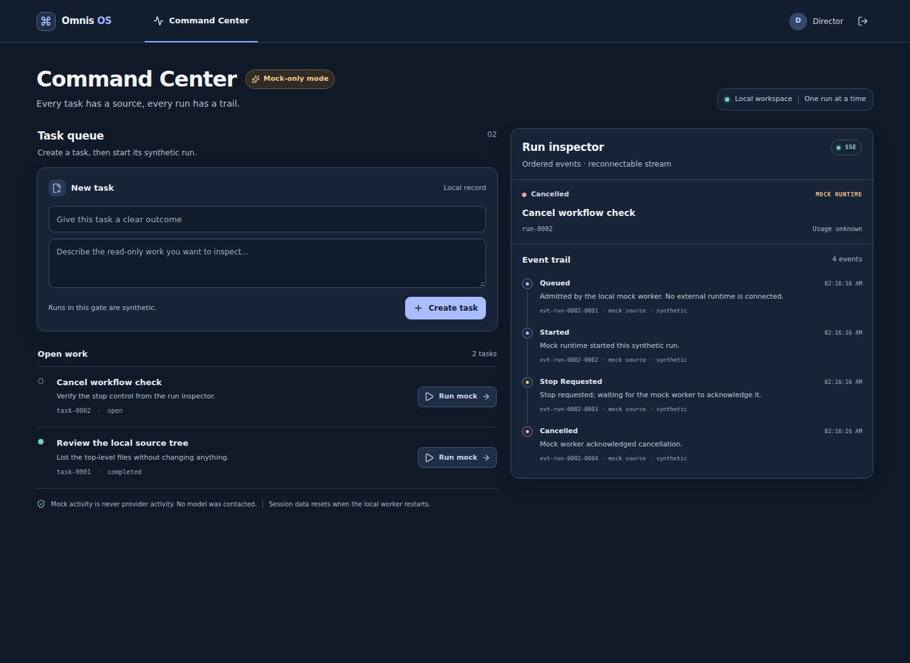
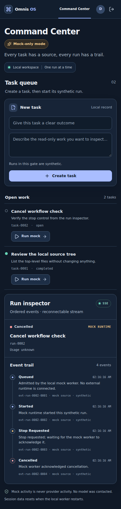

# Omnis OS mock run proof

**Recorded:** 2026-11-02

**Mode:** local-only synthetic runtime; no provider was contacted

## Environment

- WSL2 Ubuntu 26.04.1 x86_64
- Node.js v24.22.1
- Vite 8.3.5, Fastify 5.12.7, React 19.3.1, TypeScript 5.9.3
- Chromium 1248 through the installed Playwright CLI
- pnpm install and PostgreSQL were unavailable in this environment; see [decisions and risks](../DECISIONS_RISKS.md)

## API integration trace

The integration smoke used a temporary owner password hash and random session/internal secrets. It verified anonymous access denial, untrusted Origin rejection, owner login, task creation, idempotent run admission, ordered SSE events, stop request, cancellation acknowledgement, and unauthorized stop denial. Temporary credentials were removed after the run.

Redacted result:

```text
Mock API integration passed: owner session, CSRF/origin rejection, task, idempotent run, SSE ordering, stop, and terminal reconciliation.
```

The browser smoke repeated the user workflow and confirmed the selected run and event history reappeared after page reload while the local worker remained up. A second run was cancelled from the Run Inspector.

## Redacted run events

```json
[
  { "sequence": 1, "type": "run.queued", "source": "mock", "synthetic": true },
  { "sequence": 2, "type": "run.started", "source": "mock", "synthetic": true },
  { "sequence": 3, "type": "run.stop_requested", "source": "mock", "synthetic": true },
  { "sequence": 4, "type": "run.cancelled", "source": "mock", "synthetic": true }
]
```

The mock output remains synthetic and cannot be manually accepted as verified evidence. Usage is shown as unknown because the adapter reports no usage data.

## Screenshots





## Boundaries

- All services bind to loopback.
- The API has no native shell execution tools and authenticates its local worker with a generated internal token.
- This gate does not include a real runtime, PostgreSQL persistence, process-level sandboxing, network egress controls, or state recovery after worker restart.
- No real R1 runtime is approved or established by this proof.
